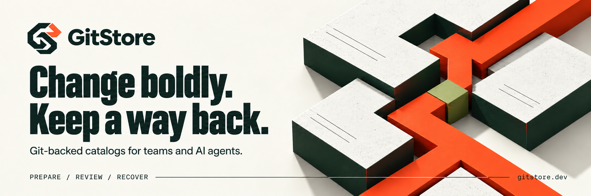

<picture>
  <source media="(prefers-color-scheme: dark)" srcset="docs/branding/readme-dark.png">
  <source media="(prefers-color-scheme: light)" srcset="docs/branding/readme-light.png">
  
</picture>

# GitStore - Agent-safe Catalogue Operations

> [!CAUTION]
> This project is in early development. The API and architecture are subject to change. Contributions and feedback are welcome, but expect breaking changes as we iterate.

GitStore is an open-source Git-backed commerce platform where product catalogues are managed as plain files instead of opaque database rows in a CMS admin interface.

Products, product variants, categories, and collections are Markdown files with structured YAML frontmatter. Developers, merchandisers, and AI agents can edit those files, review changes with normal Git workflows, and push them through policy and admission checks before they become queryable through GraphQL.

The broader thesis is that commerce operations are becoming increasingly agentic. AI agents will generate product descriptions, update prices, localise catalogues, prepare campaigns, and coordinate merchandising changes. GitStore gives those changes auditable history, reviewable diffs, and reversible operations.

## Why Now

AI agents are becoming capable enough to modify commercial content, but businesses do not yet have safe operational rails for letting them touch production commerce data. Git already solved review, history, rollback, branching, and collaboration for code.

GitStore applies those primitives to commerce catalogues, then exposes the admitted catalogue state through headless APIs. The timing is right because headless commerce, GitOps, and AI-assisted operations are converging.

## Why This Works Well for Developers and AI Agents

- **Markdown-native catalogue authoring**: Catalogue resources are easy to create and edit as text files.
- **Git-native collaboration**: Branches, commits, diffs, code review, and history become catalogue lifecycle tools.
- **Automation-friendly**: AI agents can generate and update catalogue content through file operations and standard Git pushes.
- **Operational safety**: Blocking pre-receive validation returns clear structural errors, while post-receive admission projects only valid catalog resources into GraphQL and skips stale or conflicting writes.

## Try GitStore

Follow the [GitStore Quickstart](https://github.com/gitstore-dev/quickstart)
for a guided, hands-on evaluation.

## Documentation

For more detail, see the [user guide](docs/user-guide.md),
[architecture overview](docs/architecture/README.md), and
[API reference](docs/api-reference.md).

## Contributing

See the [developer guide](docs/developer-guide.md) for contributing.

## License

AGPL-3.0-or-later. See [LICENSE](LICENSE) for details.
