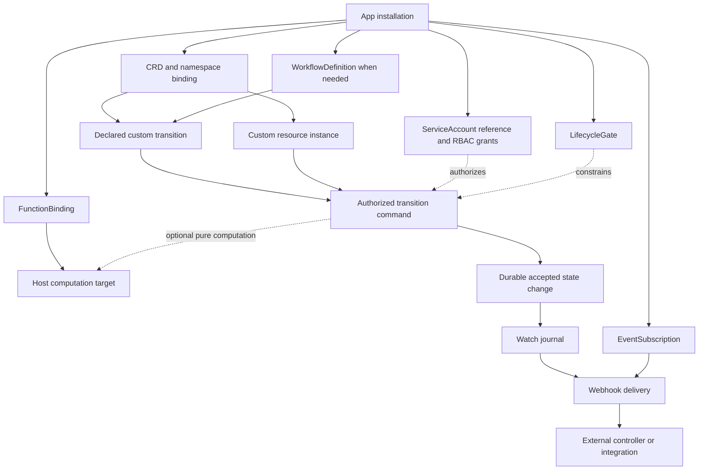

# ADR 0019: App Installation and Platform Capabilities

**Status**: Proposed

**Date**: 2026-11-01

**Audience**: app authors, merchant administrators, and API/controller maintainers.

## Context

A custom resource definition describes a kind of desired state. An application
can introduce several kinds, reuse only core kinds, or provide a platform
integration without defining any kind. These are different responsibilities.
Schema installation alone cannot establish a controller identity, grant data
access, select a search provider, or activate a checkout integration.

GitStore already proposes separate resources for computation (`FunctionBinding`),
notifications (`EventSubscription`), transition preconditions (`LifecycleGate`),
and workflow definitions and executions. Their configuration belongs in the
existing Markdown document with YAML frontmatter model. An app does not need a
second configuration dialect or a parallel function manifest.

This ADR proposes the installation layer composing those resources. All new
fields, capabilities, conditions, error reasons and examples here are design
contracts, not implemented endpoints or advertised release support. The accepted
identity and credential boundaries remain in force. This proposal does not add
an OAuth token endpoint or change ServiceAccount assertion compatibility.

## Decision

### 1. Package declaration and installed App

The publisher distributes an immutable, signed package containing a manifest
inventory, parameter schema, compatibility constraints and requested capability
descriptors. The package declaration is an artifact, not another cluster-scoped
App resource. Every executable module and dependency is digest-pinned.

A namespaced, Git-backed `App` records the merchant's desired installation. It
is admitted only from `<namespace>/gitstore-system`. Its package reference pins
the exact artifact; tags alone are rejected. Configuration is non-secret and
validated against the pinned package parameter schema. Secret references use
the existing reference contracts and never include resolved material.

```yaml
apiVersion: apps.gitstore.dev/v1alpha1
kind: App
metadata:
  name: discovery
  namespace: acme-store
spec:
  package:
    ref: oci://registry.example.com/apps/discovery
    digest: sha256:aaaaaaaaaaaaaaaaaaaaaaaaaaaaaaaaaaaaaaaaaaaaaaaaaaaaaaaaaaaaaaaa
  desiredState: Enabled                 # Enabled | Disabled
  config:
    defaultLocale: en
    indexPrefix: acme-discovery
  serviceAccountRef:
    name: acme-discovery                 # cluster-scoped identity, no namespace
  capabilityRequests:
  - name: search.provider
    version: v1alpha1
    resourceRefs:
    - {apiVersion: search.acme.example/v1alpha1, kind: SearchIndex, name: storefront}
  - name: recommendation.provider
    version: v1alpha1
    resourceRefs:
    - {apiVersion: search.acme.example/v1alpha1, kind: RecommendationModel, name: related}
  - name: admin.navigation
    version: v1alpha1
    resourceRefs:
    - {apiVersion: search.acme.example/v1alpha1, kind: SearchSynonymSet, name: default-en}
```

The digest above is a syntactically complete illustrative value, not a published
artifact. `resourceRefs` identify installed resources; they do not implicitly
create them. A capability request's descriptor defines its permitted resource
kinds and parameter schema. The package inventory separately declares any
default instances, so preview can show precisely which merchant data is added.

Each package inventory entry has a stable logical ID, relative manifest path,
expected GVK, dependency IDs and ownership mode (`Managed` or `Referenced`).
Paths cannot escape the artifact. Dependencies form a DAG; duplicate IDs,
cycles, name collisions and unpinned dependencies fail preview. Resource names
are resolved once at installation and recorded with UIDs in system status.
Arbitrary shell installers, executable post-install scripts and unconstrained
template evaluation are not part of the package format.

The following package-inventory fragment illustrates those entries; it is
artifact metadata, not an additional runtime resource or a
second configuration format:

```yaml
formatVersion: apps.gitstore.dev/v1alpha1
name: discovery
version: 1.0.0
compatibility:
  appContract: v1alpha1
capabilities:
- {name: search.provider, version: v1alpha1}
- {name: recommendation.provider, version: v1alpha1}
inventory:
- id: synonyms-definition
  path: definitions/search-synonyms.md
  gvk: {apiVersion: apiextensions.gitstore.dev/v1alpha1, kind: CustomResourceDefinition}
  ownership: Managed
  dependsOn: []
- id: synonyms-binding
  path: bindings/search-synonyms.md
  gvk: {apiVersion: apiextensions.gitstore.dev/v1alpha1, kind: CustomResourceDefinitionBinding}
  ownership: Managed
  dependsOn: [synonyms-definition]
- id: default-synonyms
  path: defaults/synonyms-en.md
  gvk: {apiVersion: search.acme.example/v1alpha1, kind: SearchSynonymSet}
  ownership: Managed
  dependsOn: [synonyms-binding]
```

Other definition/binding/provider entries are omitted from this fragment. It
cannot activate the App example by itself. The artifact may bundle a parameter
schema, but credentials and deployment identity remain external. Parameters
are substituted as typed data at declared schema paths, never as executable
expressions or raw text that can inject extra manifests. The preview shows the
fully resolved inventory and target repositories before admission.

The inventory can include CRDs and their namespace bindings, policies, gates,
function bindings, subscriptions, workflow resources and explicit defaults.
Referenced resources are checked but never adopted or deleted implicitly.
Cluster-scoped resources require a separately authorized provisioning step;
a namespace app cannot smuggle them through its inventory.

### 2. Capability requests, grants and activation

Capability names are platform-owned identifiers, not strings that create new
host behavior when authored in Git. A descriptor fixes its version, accepted
configuration, supported resources, trust level, host implementation, selection
rules and compatibility range. An unknown or unsupported descriptor fails
installation with `UnsupportedCapability`; it is never silently enabled.

| Capability family | Participation | Registration and authority |
| --- | --- | --- |
| Search and recommendation | Index reconciliation, serving provider selection, bounded query/ranking computation | Explicit provider selection plus approved function targets; separate behavioral-event ingestion |
| Catalog | Administrative resource presentation, release selection and public serialization | CRD catalog declarations and release/publication contracts; these are independent opt-ins |
| Functions | Pure in-process computation | `FunctionBinding` to a host-owned versioned target; no arbitrary imports or I/O |
| Events | Asynchronous notification | `EventSubscription` with allowed sources, sink and delivery policy |
| Lifecycle | Readiness, release, deletion or declared transition preconditions | `LifecycleGate`, verified evidence and an enforcing API command |
| Admin navigation | Menu placement, labels and schema-driven forms | Constrained UI descriptors and authorized commands; no authority from visibility |
| Analytics and insights | Approved runtime signal consumption and aggregate presentation | Separate event/data contracts, retention/privacy limits and scoped reads |
| Payment and shipping | Approved provider participation in checkout | Domain provider contracts, explicit selection, idempotency and core invariants |

This table defines boundaries, not all domain APIs. Payment capture, carrier
rating, analytics ingestion and other domain protocols need their own reviewed
contracts before a descriptor can advertise support. A package cannot create a
new checkout hook merely by declaring a capability name.

The package requests capabilities. The installed `App` selects requested
capabilities and configuration. An authorized approver grants an exact subset
through an audited control-plane operation. The platform records a durable,
system-managed grant receipt covering the App UID, package/configuration digest,
capability versions, exact scopes, resource selection and granting principal.
AuthZ is delegated to the configured provider; no role-name test or implicit
installer privilege substitutes for a decision. Capability grants and RBAC
grants are both required where applicable; neither substitutes for the other.

Changing security-relevant inputs invalidates the receipt. A package cannot
grant itself access through an embedded role or approval. Reusing an existing
ServiceAccount requires authorization to bind that identity and must not expand
its grants as a side effect. Capability approval is separate from public
publication, and a requested UI entry cannot make data public.

Effective participation requires all of:

1. admitted App generation and verified package digest;
2. compatible host descriptor and admitted constituent resources;
3. current capability grant and current provider-owned RBAC decisions;
4. resolved identity, artifact and configuration dependencies;
5. an active installation revision, with no applicable suspension.

### 3. Installation and runtime relationships



This is a dependency/participation DAG, not a workflow execution graph. An
external integration's later API call begins another authorized operation.
Workflow state machines can contain explicit revision/retry cycles. Search
requests can invoke computation targets without a lifecycle transition.

### 4. Installation lifecycle and ownership

| Stage | Required behavior | Failure behavior |
| --- | --- | --- |
| Preview | Resolve immutable artifact; verify publisher; show resource diff, defaults, capabilities, identity and permissions | No installed resource, grant or external side effect is activated |
| Admit | Validate App, manifest locations, dependency DAG, configuration and compatibility | Reject with field/resource diagnostics; preserve previous active revision |
| Provision | Obtain separately authorized ServiceAccount/public-key enrollment and RBAC; materialize Git-backed constituents into correct repositories | Persist bounded resumable progress; never expose an incomplete installation to request-time dispatch |
| Prepare | Admit constituents, compile modules, validate provider selection and evidence contracts | Conditions identify missing dependencies; no fetch or compilation on the request path |
| Approve | Record explicit capability grant for exact security-relevant inputs | Reject unauthorized requests; no self-grant from package content |
| Activate | CAS one installation revision after prerequisites pass | Concurrent activations have one winner; stale workers cannot activate |
| Disable | Stop new dispatch/execution at a revision boundary; revoke scoped activation | Retain configuration and audit evidence; do not treat disabled gates as satisfied |
| Uninstall | Quiesce, remove managed registrations safely, honor finalizers and retention | Hold deletion on dependent instances or unfinished cleanup; report actionable reason |

Preview is read-only with respect to installed state. An explicit preparation
operation may cache verified artifacts under operator limits; that cache does
not activate them. Approval and activation require fresh authorization, not a
remembered preview actor. Resuming work rechecks UID, generation and grant.

Activation uses an immutable registry revision tying together package,
capability grants, bindings, transition definitions and authorization catalog
snapshot. Every API/controller operation records its revision. Replicas pin one
compatible revision per operation, and fail closed if it is unavailable.
Eligibility updates must be reconciled against current admission and grant
state before a revision is activated; cached successful preparation is not an
authorization bypass. A journal or cache notification is a hint, not authority.

Resource materialization across repositories and identity APIs is not an atomic
Git transaction. Provisioning is a resumable DAG with idempotent steps keyed by
App UID, generation and logical inventory ID. The single activation pointer
prevents partially provisioned registrations from participating. Prepared
resources carry a host-validated installation association; packages cannot
associate an unrelated resource or claim its ownership by setting a label.
Standalone registrations remain independently managed and cannot be silently
adopted. CRD persistence and namespace binding preparation must finish before
custom instances are admitted.

Prepared definitions/bindings can admit only the installation's declared
inventory through the trusted provisioning path until activation. They must
not expose general namespace CRUD or dispatch hooks prematurely. Admission
checks the installation association and revision on both definition and
instance; a user-supplied owner label cannot access this staging path. This
breaks the definition-before-instance dependency without treating preparation
as a public capability grant. Runtime discovery advertises only active bindings.

`App.status` records `observedGeneration`, `resolvedPackageDigest`,
`activeRevision`, managed inventory UIDs, grant receipt digest and conditions:
`PackageVerified`, `IdentityReady`, `ResourcesAdmitted`, `CapabilitiesGranted`,
`RuntimePrepared`, `Ready` and `Terminating`. `Ready=True` requires all activation
prerequisites for the same generation. External provider health can later set
`Degraded=True`; the domain's fallback policy controls serving. Credentials,
raw assertions, event bodies and private keys never appear in status.

Upgrades prepare a new revision before atomically switching new operations.
Additional privileges require fresh approval. In-flight workflow executions and
published snapshots keep their pinned contracts; they are never reinterpreted
using a newly installed definition. Rollback selects a still-valid revision and
rechecks grants, compatibility, publication state and data-format support. It
does not reverse external payments, delete events or undo index writes.

Disabling or suspending an app stops new calls under the documented bounded
registry-refresh ceiling. An operation already issued to an external service
may finish; record the attempt and reconcile its result. Existing required gates
become unsatisfied/unknown while their evaluator is unavailable. Uninstall must
not remove a required security gate to unblock a transition. A separately
authorized, audited replacement policy must be active first.

Deleting an App does not delete merchant CR instances, published snapshots,
workflow evidence, shared credentials or a referenced ServiceAccount. Retain
managed CRDs while instances or other installations depend on them. Explicit
cleanup policy governs app-owned external indexes and subscription outboxes.
Do not remove identities needed to complete finalizers. Retention and deletion
obligations continue after dispatch is disabled.

### 5. Identity, authorization and secrets

Installers provision or reference cluster-scoped ServiceAccounts using existing
administrative APIs, enroll public keys, and assign bounded namespaced RBAC
grants. A namespaced App never changes ServiceAccount scope. The runtime workload
loads its private key from deployment bootstrap secret configuration, exchanges
signed assertions for short-lived access tokens, and renews them using existing
identity contracts. Neither App nor package contains a private key or a resource
reference that makes that workload identity key available to reconcilers.

RBAC assignment uses the configured provider's supported administration path.
The local provider can require an operator-managed policy update and atomic
reload; this proposal does not invent persisted IAM entities or assume a
RoleBinding mutation API already exists. A provider without automated grant
provisioning leaves installation pending with the exact required permissions
for authorized operator action. The app cannot edit deployment policy files or
use an installer's credential as its runtime identity.

Resource integration credentials use `CredentialsRef`/`SecretRef` under
[ADR 0009](0009-credential-secret-boundary.md). Deployment adapters supply secret
material; package configuration contains references only. Public-key enrollment
and token acquisition remain separate operations. OAuth protocol compatibility
is a separate follow-up and does not change this installation contract.

Proposed App actions are `app.{create,read,list,watch,update,delete}`,
`app.capabilities.approve` and `app.status.write`. Runtime activation and cleanup
also require the executor's narrow authority. CRD, transition and provider
actions must enter the bounded catalog under
[ADR 0010's proposed extension](0010-authorization-model.md#15-proposed-app-and-custom-kind-catalog-extension).
Defining an app, pushing to a system repository or receiving a signed webhook
does not confer authority to read subjects, mutate status or invoke transitions.

### 6. Capability selection and constrained UI

The active revision resolves capability requests to concrete registrations.
Selection is explicit per namespace and, where applicable, channel, market,
surface or subject selector. Two exclusive providers matching the same key are
an installation conflict; installation order is not a tiebreaker. Function
pipelines are possible only for targets with a reviewed composition contract.

Admin navigation metadata can declare a title, grouping, icon from an allowlist,
kind/form reference and authorized command mapping. Menu nesting is presentation,
not permission. A hidden entry is not a security boundary, and a visible entry
does not authorize the underlying query. Imported arbitrary scripts, external
GraphQL resolvers and remote UI execution are outside this first contract.

CRD API exposure uses stable generic operations and discovery first; schema
generation or remote schema stitching is not an installation prerequisite.
Discovery advertises supported operations, scope, schema version, authorization
slug, exact GraphQL callable mapping and optional CLI aliases. A client must not
infer an executable mutation from a plural name or a menu entry.

### 7. Use case: Search and Recommendation

**Capabilities illustrated:** several CRDs, configuration reconciliation,
secondary-resource watches, provider selection, pure request-time functions,
runtime events and administrative UI.

A discovery package installs `SearchIndex`, `SearchSynonymSet`,
`RecommendationModel` and `RecommendationSurface` definitions and namespace
bindings. It may explicitly seed a default synonym set and surface. Its external
controller is deployed separately. An app can instead use pre-existing kinds
by declaring them as referenced inventory.

```yaml
apiVersion: search.acme.example/v1alpha1
kind: SearchSynonymSet
metadata:
  name: default-en
  namespace: acme-store
spec:
  locale: en
  synonyms:
  - terms: [sneaker, trainer]
  - terms: [coat, jacket]
```

The corresponding CRD schema declares bounded strings/arrays, locale validation
and a status subresource. Only schema-valid desired state is authored; backend
task IDs, vectors, query results and index contents remain runtime data.

| Trigger | Authoritative action | Reconciliation or serving outcome |
| --- | --- | --- |
| Authorized installation | Create declared default instances after definition/binding admission | Controller creates backend configuration idempotently |
| Merchant edits synonyms through UI/CLI | Authorized generic Git-backed write, or merchant Git commit | Admission accepts a generation; controller applies that generation |
| Product/publication changes | Existing catalog/publication write, not a synonym edit | Watch secondary sources and update affected index entries |
| Merchant deletes synonym set | Delete through normal authored-state path | Finalizer holds deletion until app-owned backend configuration is removed |
| Shopper submits query | Authorized serving operation | Resolve target/snapshot and provider, run applicable functions and query backend |
| Shopper generates behavioral signal | Validated runtime ingestion, not CR CRUD | Update recommendation runtime state under consent and retention rules |

Schema and CEL validation precede applicable bound validating policies. A
Git-backed instance never runs mutating admission hooks. A Git push can pass
bounded pre-receive validation while asynchronous admission is pending; the
controller consumes accepted read-model generations and preserves the last
accepted state on denial.

The controller lists/watches custom configuration and relevant secondary
resources using its own scoped ServiceAccount. It records applied generation,
input digest, backend revision, freshness and readiness in system-managed
status. Concurrent replicas use per-key leases/fencing where available and
backend idempotency keys; stale completion cannot mark a newer generation
ready. A webhook subscription may wake the same reconciler, but receiving both
a watch and a webhook must not apply the change twice. Retention gaps require
paged relisting and a bounded rebuild, not trusting missing events as deletion.

Public indexes are partitioned by namespace, publication target and snapshot.
They ingest public projections, not mutable admin rows. An unpublished or
suppressed object must not reappear through a stale index or recommendation
cache: the serving API validates returned identities against the active
snapshot and current suppression state. Snapshot changes prepare a compatible
index before selection; incomplete indexes use an explicit safe fallback or
return an unavailable result. Admin preview uses a separately authorized scope.

Candidate host targets are `gitstore:search/query-rewrite@1` and
`gitstore:recommendation/rank@1`; these are proposed interfaces requiring WIT,
bounded input/output schemas and host implementation before advertisement.
The former transforms normalized query input; the latter reorders a bounded
set of host-provided, eligible candidates. Neither function contacts the index
or vector store. The host/backend performs I/O outside the pure function.
Selection is explicit per surface; a target must define single-binding or
ordered-pipeline semantics. Results remain subject to eligibility checks after
ranking. Failure uses the target's approved fallback, never cross-tenant or
unpublished candidates.

The query/ranking operation is transient even though its configuration and
bindings are Git-backed. No lifecycle gate or configuration mutation is implied
by a shopper request. Persisting behavioral signals is an explicit separate
runtime operation with its own authority and retention, not a side effect hidden
inside the pure function.

Behavioral ingestion is separate from `EventSubscription`: transient search
requests do not automatically enter the resource journal. The ingestion API
must specify actor/context validation, event IDs, deduplication, consent,
retention, quotas and allowed attribution before the app can consume signals.
Optional analytics capability is separately approved; search participation
does not grant customer-history access.

### 8. Use case: Antivirus scanner

**Capabilities illustrated:** an app without custom kinds, asynchronous payload
processing, scoped credentials, signed evidence and a readiness gate.

The scanner uses core `File`; it needs no placeholder CRD. Its package includes
an `EventSubscription` for relevant admitted File changes and a required
`LifecycleGate` on `File Ready`. The gate requires a clean verdict from an
approved issuer for the exact payload digest and scan-policy revision.

```yaml
apiVersion: lifecycle.gitstore.dev/v1alpha1
kind: LifecycleGate
metadata:
  name: payload-clean
  namespace: acme-store
spec:
  subject:
    apiGroup: storage.gitstore.dev
    kinds: [File]
  transition: Ready
  materialInputs: [spec]
  gate:
    externalAttestation:
      issuer: payload-scanner
      predicateType: https://schemas.gitstore.dev/attestations/payload-clean/v1
```

This illustrative gate hashes the complete admitted File spec. The File adapter
must also contribute the resolved immutable payload digest to the material
snapshot. An LFS location or object URL alone is not a content identity. Issuer
and predicate contracts include scanner policy/signature-database revision,
result, payload digest and evidence validity; a boolean status patch is not a
substitute for signed evidence.

1. The merchant commits a File manifest and uploads its referenced payload.
   Admission validates the manifest without synchronously downloading/scanning
   the payload. `Ready` remains false/unknown until payload facts are verified.
2. The journal event wakes the external scanner. It authenticates as its enrolled
   ServiceAccount, obtains a narrowly authorized, short-lived read of the exact
   payload and verifies the digest. No payload or storage credential is embedded
   in the event.
3. The scanner processes outside the API and submits signed evidence binding
   subject UID, material digest, payload digest, gate revision and scan policy.
   Evidence submission is authenticated and authorized separately from delivery.
4. The gate evaluator verifies issuer trust, signature, digest, validity and
   revocation. Clean evidence can satisfy the gate; infected, absent, expired or
   unverifiable evidence cannot. The File controller computes aggregate readiness.
5. Duplicate delivery returns the same logical scan result. Payload or policy
   changes invalidate prior evidence and schedule a new scan. A quarantined File
   cannot receive a download capability through a readiness bypass.

Scanner downtime or dead-lettered delivery does not make a File clean. A journal
gap triggers bounded resynchronization. A newly distrusted scanner or malware
signature update requires policy-defined re-evaluation and prompt suppression
of affected public downloads; historic clean evidence is not permanent trust.
Disabling the scanner preserves the required safety gate until an authorized
replacement is ready. Retain verdict/audit metadata under policy, not payload
copies or credentials. This path uses no WASM function and no custom transition.

### 9. Use case: Approval plus external attestation

**Capabilities illustrated:** all-of gates, independent human and machine
authority, versioned evidence, asynchronous integration and optional workflow.

A regulated offer must have one merchandising approval and a compliance
attestation before release preparation. The app installs a gate on the existing
`ReleaseEligible` transition; it does not invent a custom publication API.

```yaml
apiVersion: lifecycle.gitstore.dev/v1alpha1
kind: LifecycleGate
metadata:
  name: regulated-offer-review
  namespace: acme-store
spec:
  subject:
    apiGroup: catalog.gitstore.dev
    kinds: [Product, ProductVariant]
    selector:
      matchLabels: {commerce.example/regulated: "true"}
  transition: ReleaseEligible
  materialInputs: [spec, body]
  gate:
    allOf:
    - approval:
        policyRef: {name: independent-merchandising-review}
        count: 1
    - externalAttestation:
        issuer: compliance-reviewer
        predicateType: https://schemas.gitstore.dev/attestations/offer-compliance/v1
```

The approval policy names eligible principals through the configured authorizer,
separation-of-duties constraints, evidence lifetime and revocation rules. The
author cannot approve their own material revision where that policy forbids it.
An integration identity permitted to attest does not gain approval authority.

1. A merchant authors or revises the offer. The material snapshot includes its
   identity/generation, declared content and referenced dependency revisions.
2. A subscription requests external review asynchronously. The reviewer receives
   only authorized references and fetches the pinned material through the API.
3. A human submits an `ApprovalCertificate` for the same gate/material digest;
   the reviewer submits independently authenticated signed compliance evidence.
4. The evaluator checks both under `allOf`. An approval alone, a delivery 2xx,
   or evidence for an older generation leaves the gate unsatisfied.
5. Release preparation verifies current evidence for the selected immutable
   resources and records the evidence digests in the release snapshot. Activation
   still enforces publication and suppression rules from ADR 0014.

An edit invalidates both approvals for that material snapshot. Gate definition,
approval policy, issuer trust or material dependency changes also invalidate
cached satisfaction. A stale controller cannot apply old results to new status.
Revocation before transition commit prevents commitment; later revocation uses
explicit suppression/review policy and never silently rewrites a historic
release. External timeout leaves the gate pending with an actionable reason.

If review requires assignment, reminders, rejection and resubmission, the app
can include `WorkflowDefinition` and runtime executions. The workflow records
process state; the LifecycleGate remains the enforcing precondition. For a
custom `Activate` command, the CRD must declare the transition and its workflow
adapter under document 039; neither a subscription nor a menu command creates
that transition.

### 10. Safety limits, observability and verification

Operator configuration bounds inventory size, manifest/schema bytes,
dependencies, selected providers, registrations per kind/namespace, CEL cost,
module cache, evidence size/retention, outbox backlog, retries and concurrent
installation/reconciliation work. Packages may request tighter limits but
cannot raise ceilings. Numeric defaults require measurement before support is
advertised; this ADR does not claim a tested deployment envelope.

Expose sanitized conditions and bounded reason codes for unsupported capability,
grant mismatch, identity missing, resource conflict, runtime preparation failure,
evidence stale, cleanup blocked and revision conflict. Audit package and registry
digests, actor, App/subject UID, activation revision, decision and causal event.
Keep per-resource identifiers out of unbounded metric labels. Track installation
backlog, dispatch failures, reconciliation lag, gate age and outbox age without
logging secret material or personal event content.

Implementation acceptance must cover:

- two APIs and two controllers racing installation, activation, token renewal,
  status completion, evidence revocation, replay and cleanup;
- pluggable AuthN/AuthZ, no self-granted capability, cross-namespace reads,
  unauthorized identity reuse and denied runtime data access;
- mixed-version rolling replacement: readers support a descriptor/catalog
  revision before activation, and incompatible replicas fail closed;
- bounded sustained push, search/serving, reconciliation and webhook load with
  slow/unavailable providers, exhausted queues and module/evidence limits;
- crash recovery after every provisioning step, stale fencing tokens, duplicate
  events, journal retention gaps and old-generation external results;
- snapshot/suppression correctness, scanner fail-closed behavior, and all-of
  evidence invalidation in the three use cases above;
- upgrade/rollback/uninstall with live custom instances, required gates,
  retained executions and shared identities.

Git storage remains stateful and singleton-only. API/controller replica tests
do not imply Git replication, overlapping Git-service replacement, sharding or
zero-downtime failover. No arbitrary controller hosting is added.

## Consequences and alternatives

App installation becomes independently reviewable without overloading CRDs or
duplicating function configuration. Existing lifecycle, identity, secret and
workflow primitives remain reusable. Installation and revision management add
control-plane state and require explicit domain capability descriptors.

Embedding every registration in a CRD is rejected: apps can own multiple kinds
or none, and installation configuration has a different lifecycle from schemas.
A free-form `capabilities: [anything]` grant is rejected: names cannot create
host behavior or authority. A generic arbitrary-code installer is rejected:
bounded declarative inventory and existing APIs provide reviewable ownership
and recovery. Automatic uninstall cascade is rejected where merchant data,
security gates or retained commerce records depend on the app.

## Related contracts

- [ADR 0010](0010-authorization-model.md): finite actions and proposed installed-kind extension.
- [ADR 0014](0014-catalog-release-and-publication.md): release selection and public snapshots.
- [ADR 0015](0015-resource-lifecycle-hooks.md): hooks, events, functions and gates.
- [ADR 0016](0016-custom-resource-definitions.md): definitions, discovery and transition surface.
- [ADR 0018](0018-controller-ownership-concurrency-and-fencing.md): ownership and fencing.
- [037](../implementation/037-custom-commerce-workflows.md): workflow definitions and bundles.
- [039](../implementation/039-resource-lifecycle-hooks.md): executable registration contracts.
