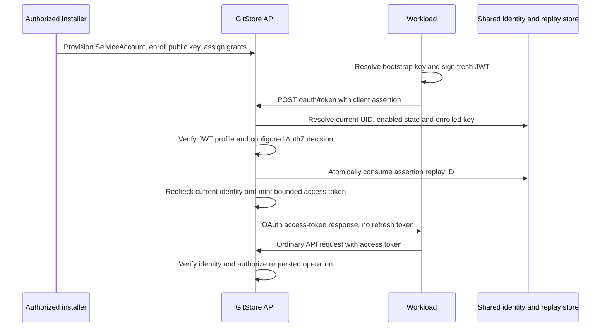

# ADR 0020: ServiceAccount OAuth Client Assertions

**Status**: Proposed

**Date**: 2026-11-01

**Audience**: workload/app authors, deployment administrators and API/controller maintainers.

**Contracts**: [040 ServiceAccount OAuth token exchange](../implementation/040-serviceaccount-oauth-token-exchange.md).

## Context

GitStore already enrolls cluster-scoped ServiceAccounts and their public keys.
A workload loads its private key through the bootstrap secret resolver, signs a
short-lived single-use assertion, and calls `issueServiceAccountToken` over
GraphQL. The resulting short-lived access token authenticates ordinary API and
watch traffic. A current ServiceAccount UID, valid enrolled key, audience,
expiry, shared replay check and `serviceAccount.token.issue` authorization are
required. Assertion credentials cannot authenticate arbitrary GraphQL commands.

That exchange has GitStore-specific HTTP/GraphQL framing, a private JWT type
and a configured assertion audience. Its security properties do not make its
wire protocol an OAuth token endpoint. Workload integrations otherwise able to
sign JWT client assertions need a bespoke client for that framing.

[RFC 7523](https://www.rfc-editor.org/rfc/rfc7523.html) distinguishes JWT
authorization grants from JWT client authentication. This proposal selects the
client-authentication profile with the client-credentials grant from
[RFC 6749 §4.4](https://www.rfc-editor.org/rfc/rfc6749.html#section-4.4).
The workload acts as itself; no end-user delegation or JWT bearer grant is added.

Initial identity/key enrollment is a separate trust-establishment operation.
A self-signed assertion from an unknown key cannot establish authority to create
a ServiceAccount or grant itself permissions. `CredentialsRef` describes resource
credential semantics; it is not a registration or OAuth protocol.

This is a documentation proposal. No OAuth endpoint, metadata document,
configuration switch or controller transport selection described here is
implemented by this ADR. The existing ServiceAccount and credential contracts
remain the supported baseline. This follow-up can be reviewed independently of
the [App installation proposal](https://github.com/gitstore-dev/GitStore/pull/507).

## Decision

### 1. An additional transport over the existing identity plane

Propose `POST /oauth/token`, relative to the installation's public API base path.
The enabled endpoint accepts form-encoded client-credentials requests authenticated
by an enrolled asymmetric JWT assertion. It returns an OAuth access-token response
using the existing ServiceAccount access-token issuer and verifier. It does not
introduce a second user directory, identity store, token signer or RBAC evaluator.

Reuse a provider-neutral assertion verification/issuance service behind both
transports. Keep transport-specific JWT profile validation explicit: the OAuth
handler does not disguise a form assertion as an HTTP bearer token and pass it
through the entire ordinary AuthN chain. Provider capability support must be
explicit; if the configured providers cannot verify and issue this exchange,
the endpoint is not advertised and fails closed.

| Concern | GraphQL exchange: existing | OAuth exchange: proposed |
| --- | --- | --- |
| Request | GraphQL mutation; assertion in Authorization header | Form-encoded client-credentials request; assertion in body |
| JWT profile | `gitstore-sa-assertion+jwt`, configured internal audience | JWT client assertion, exact public token-endpoint audience |
| Client identity | Canonical ServiceAccount subject and UID | Same subject as OAuth client ID, same UID binding |
| Trust | Enrolled public key and immutable ServiceAccount UID | Same enrolled key/UID registry |
| Replay | Shared durable single-use assertion store | Same consumption semantics and namespace across both transports |
| Authorization | `serviceAccount.token.issue` for the account itself | Same action, subject and authoritative facts |
| Response | GraphQL TokenRequest payload | `access_token`, `token_type`, `expires_in` |
| Resource access | Existing ServiceAccount AuthN plus live AuthZ | Identical; OAuth does not add permissions |

The old GraphQL profile remains distinct and is not silently reclassified as a
standards-compatible client assertion. Neither profile is valid as an access
token. Adding this endpoint is not approval to expose a general OAuth
authorization server, user authorization endpoint or dynamic client registration.

### 2. Enrollment, credentials and client identity

An authorized administrator provisions the ServiceAccount, enrolls public keys
and assigns least-privilege grants through existing identity/provider management.
ServiceAccount names remain globally unique and cluster-scoped. The OAuth
`client_id` is the exact canonical subject, for example
`system:serviceaccount:acme-search`. No namespace or separate OAuth client table
is introduced. The server returns or exposes the current UID through already
authorized administrative identity reads; it is not secret material.

The signed assertion binds that immutable UID using the `sa_uid` claim. A
delete/recreate under the same name cannot revive assertions or access tokens
for the old UID. This is an explicit GitStore interoperability requirement:
clients must support a custom signed claim in addition to standard JWT claims.
The advertised support is for this documented profile, not every OAuth client
library with unconfigurable JWT generation.

Workload private keys remain deployment bootstrap identity material under
[ADR 0009](0009-credential-secret-boundary.md). Only public enrollment data enters
the ServiceAccount store. Neither an App configuration nor a resource
`CredentialsRef` can resolve that workload key. Enrolled workload keys sign
client assertions; the API's separate issuer key signs access tokens. Rotation
and revocation of these two key families are independent operations.

### 3. JWT profile and cross-protocol isolation

The OAuth assertion uses a registered asymmetric key and includes:

- `iss` and `sub` equal to the canonical client ID;
- `aud` equal to the configured canonical external token endpoint URL;
- `iat` and `exp`, with positive lifetime at most 60 seconds;
- a unique, unpredictable `jti` and current `sa_uid`;
- protected `kid` matching an enrolled key and a permitted matching algorithm.

Accept protected `typ: JWT` or an omitted type at this endpoint; reject other
types, especially access-token and GraphQL assertion types. Accept `aud` as a
string or singleton string array, without URL normalization or additional
audiences. `nbf` is optional but validated when supplied. GitStore's required
UID, issued-at and replay claims tighten the base profile deliberately.

Use ES256 for ECDSA P-256 and EdDSA for existing Ed25519 enrollment where
supported. Public-key type, recorded algorithm and JWT algorithm must match.
Reject unsigned/shared-secret algorithms, token-supplied verification keys,
remote key URLs, unknown critical headers, duplicate JSON members, nested or
compressed JWTs and unsupported extensions. No network fetch selects a key.

The public URL is trusted deployment configuration, including a proxy prefix.
Do not derive it from request `Host` or untrusted forwarding headers. It must
be distinct from the GraphQL assertion audience and API access-token audience.
Audience/type isolation applies even though the enrolled key registry is shared.
Removing a proxy prefix or accepting arbitrary URL aliases is not normalization;
it would expand the credential's intended audience.

The OAuth profile has a separate assertion clock-skew ceiling, proposed at 30
seconds, while retaining the 60-second signed lifetime. It must not inherit a
larger existing access-token skew implicitly. Reject an `iat` too far in the
future or past; account for the entire permitted window in replay retention.

### 4. Exchange and permission boundaries

The endpoint verifies client authentication and delegates
`serviceAccount.token.issue` to the configured authorizer using the actual
cluster-scoped account facts. No token role-name shortcut or caller-selected
owner bypass is introduced. Valid signature alone does not confer issuance
authority, and issuance authority does not grant resource access.

Token audience is the existing configured API audience, and TTL comes from the
existing bounded issuer configuration. The first OAuth profile adds no custom
audience/expiration parameters or OAuth scope-to-action mapping. Nonempty OAuth
scope requests fail with `invalid_scope`. Omission selects the documented default
service identity audience and permissions remain live provider-owned RBAC.
The endpoint cannot grant impersonation, cross-namespace access or a new scope
by copying claims from the client assertion into the access token.

### 5. Replay, issuance races and retry

Reuse the existing atomic durable replay-consumption interface across replicas
and transports. Preserve its current globally unique `jti` semantics/digest
compatibility; do not create a separate transport cache or partition replay
records by endpoint, key or client. Clients generate cryptographically random
IDs to avoid accidental collision. Record retention covers expiration plus
the complete configured verification leeway; store failure prevents issuance.

After full signature/profile validation and authorization, consume the assertion
once, then use the existing issuer path. Recheck account UID, disabled/deleted
state, enrolled key revision and relevant policy facts before issuance. The
implementation must define and test the ordering/conditional revision guard
for concurrent key removal or identity revocation; a pre-verification lookup
alone is not authoritative. Resource-server validation still checks current
ServiceAccount state on use. Policy revocation continues to deny ordinary
operations even if an access token remains cryptographically valid.

This does not promise immediate revocation of all previously issued tokens when
an enrollment key alone is retired: current token claims bind ServiceAccount UID,
not the originating enrollment key. The implementation must preserve and
document current revocation behavior; disabling/deleting the account is the
existing broader revocation mechanism. Adding per-enrollment-key access-token
provenance would be separate scope, not an implicit property of RFC 7523.

A crash after consuming an assertion but before returning a token can burn the
assertion. A timeout does not imply no token was minted. The client signs a
new assertion for every retry; replay is never transformed into cached success.
Two tokens may exist after an uncertain response and fresh retry, bounded by
TTL and client renewal limits. No refresh token or bearer bootstrap credential
is introduced. Renewals remain coalesced per workload identity and endpoint.

### 6. Transport, compatibility and rollout

The HTTP request/response, limits and errors are specified in
[040](../implementation/040-serviceaccount-oauth-token-exchange.md). TLS is
mandatory on the public endpoint; trusted local transport to a terminating
proxy follows deployment network policy. Assertions never appear in query
parameters, redirects, logs, traces or metrics. Only the documented token response
may return the access token; it has no-store headers and is excluded from
response capture. Follow current client-authentication guidance in
[RFC 9700 §2.5](https://www.rfc-editor.org/rfc/rfc9700.html#section-2.5).

The endpoint starts opt-in. Clients configure its exact URL/profile explicitly;
the first version does not require or advertise OAuth/OIDC discovery metadata.
Absence of discovery is not evidence of endpoint support. A later metadata
contract must advertise only implemented grants/methods and preserve proxy paths.

Deploy compatible readers/handlers across all API replicas before enabling the
public route. An old replica must not handle traffic for the newly enabled
endpoint. Existing GraphQL traffic remains unchanged. Then deploy opt-in clients;
never silently fall back to another endpoint/profile after authentication or
authorization rejection. A transport rollback returns clients to an explicitly
configured GraphQL exchange and fresh profile-appropriate assertions. It does
not erase replay history, identity records or keys.

No immediate removal or deprecation of GraphQL issuance is proposed. No
configuration keys are advertised until a feature specification defines actual
schema, validation, proxy routing and deployment integration. If implementation
later touches shared configuration or Compose contracts, track the corresponding
quickstart repository update.

### 7. Acceptance requirements

The implementation must prove all of the following before endpoint support is
advertised:

- a standard form exchange with a properly configured JWT-signing client and
  both supported enrollment algorithms;
- exact public audience/client ID/UID and algorithm checks, unknown keys,
  malformed/oversized input, duplicate parameters/claims and cross-profile rejection;
- positive and denied pluggable AuthZ decisions, restricted response disclosure,
  no self-enrollment and no scope-to-permission escalation;
- two APIs sharing identity/replay state, concurrent identical assertions with
  at most one successful issuance, store outages and expiry-window cleanup;
- key overlap/removal, account disable/delete/recreate and revocation races,
  documenting the limits of already-issued token revocation;
- two controllers renewing under sustained reconciliation/watch load, jittered
  singleflight renewal, dropped responses, restart after expiry and bounded retries;
- API/controller rolling replacement and explicit transport rollback without
  resetting replay state or accepting incompatible audience/type profiles;
- leakage checks across reverse proxy, application diagnostics, HTTP capture,
  telemetry and error responses;
- bounded sustained valid/invalid exchange load alongside Git push/admission
  and reconciliation, with latency, CPU, memory, replay growth and fair limits.

Git storage remains singleton-only. This token transport adds no Git HA,
replication, sharding or overlapping replacement guarantees. Tests must report
the actual deployment envelope and cannot substitute for the full PR readiness
suite.

## Consequences

Workloads gain a documented OAuth client-credentials exchange without duplicating
identity, secret resolution or token authorization. Existing GraphQL clients
continue to work. Explicit profiles prevent confusing assertion credentials with
resource access tokens. The added HTTP surface requires its own routing, abuse
controls, interoperability and multi-replica tests.

Clients must support the UID claim, exact endpoint audience and enrolled algorithms;
this is deliberately narrower than an unrestricted OAuth server. A valid client
assertion establishes possession of an enrolled key, not ongoing possession of
the returned bearer token. Sender-constrained access tokens are a separate design.

## Alternatives considered

- **JWT bearer authorization grant.** Not selected: the intended caller is the
  registered workload itself. No delegated subject or independent grant source
  is required.
- **Self-enrollment from an assertion.** Rejected: unknown keys have no trust
  anchor and cannot authorize identity creation or policy grants.
- **Replace the current exchange immediately.** Rejected: protocol compatibility
  can be added independently while preserving current workload behavior.
- **Add client secrets or refresh tokens.** Rejected for this profile: enrolled
  asymmetric keys already support autonomous short-lived token acquisition.
- **Publish general OAuth discovery immediately.** Deferred: a token-only
  profile must not advertise unsupported user flows or dynamic registration.

## Related contracts and standards

- [ADR 0009](0009-credential-secret-boundary.md): bootstrap identity and resource secret boundary.
- [ADR 0010](0010-authorization-model.md): canonical issuance action and cluster-scoped identity.
- [ServiceAccount API](../../shared/schemas/serviceaccount.graphqls): current enrollment and GraphQL exchange.
- [RFC 7523 §§2.2–3](https://www.rfc-editor.org/rfc/rfc7523.html#section-2.2): JWT client authentication.
- [RFC 6749 §§4.4 and 5](https://www.rfc-editor.org/rfc/rfc6749.html#section-4.4): client credentials and token responses.
- [RFC 9700](https://www.rfc-editor.org/rfc/rfc9700.html): OAuth security guidance.
