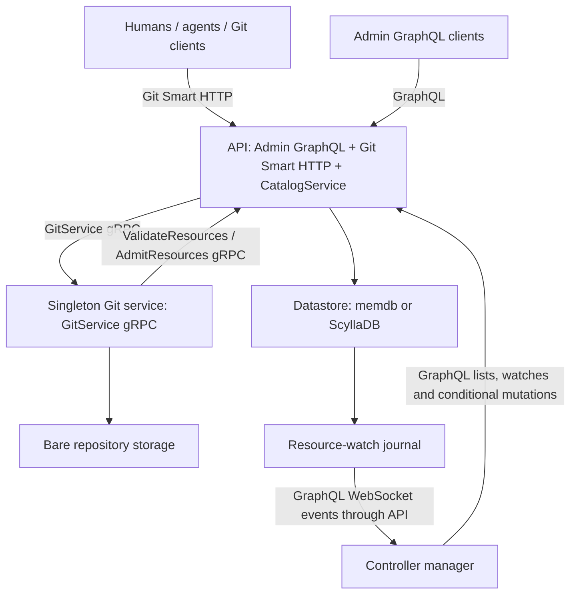

# Current Architecture

GitStore manages authored catalogue and control-plane resources in Git and
serves admitted state through the Admin GraphQL API. This overview describes
the implemented runtime, not planned commerce, publication or extension systems.

## Service topology

| Service | Default listener | Purpose |
| --- | --- | --- |
| API | `4000` | `/admin/graphql`, `/admin/playground`, health, readiness and diagnostic metrics |
| API | `4001` | `/storefront/graphql` and `/storefront/playground` |
| API | `9000` | Git Smart HTTP |
| API | `6000` | Internal CatalogService gRPC |
| Git service | `50051` | Internal GitService gRPC |
| Controller manager | `5001` | Health, metrics and quarantined-work management |

These are listener ports. The reference Compose deployment publishes the
Storefront listener on host port `4100`; native startup uses `4001`.
Optional identity integration has additional internal endpoints.
See [configuration](../configuration.md) for settings and deployment overrides.

The API does not mount or maintain a working copy of catalogue repositories.
It resolves namespace/repository paths to repository UIDs and calls the Git
service for repository operations, file access and transport. The Git service
uses native Rust gitoxide operations, exposes no public HTTP or `git://`
listener, and owns bare repositories under its configured data directory.
Repositories are provisioned explicitly; there is no implicit `catalog.git`.

## Desired state and admission

Authored manifests use `apiVersion`, `kind`, `metadata` and `spec`, with an
optional Markdown body. Authors must not supply system-managed identity,
resource-version or status fields. A file path records provenance; it is not
the resource's identity. Namespace and Repository control-plane mutations
write manifests into the system repository, with reserved bootstrap resources
handled separately.

The push path is:

1. The API authenticates and authorizes Git access, resolves the repository,
   and proxies Git transport through gRPC.
2. Pre-receive validation checks resource structure before updating refs.
   Schema validation and post-receive admission are always enabled; there
   are no hook-phase selection or enable/disable configuration switches.
3. After an accepted ref update, the Git service calls API admission with
   the repository, ref, and old/new commit tips.
4. The API checks the current ref, derives create/update/delete/move
   operations, applies resource-specific policy and persists admitted state.
   A superseded admission must not overwrite a newer writer.

Post-receive failures cannot retroactively reject a successful push. A commit
can exist in Git without its conflicting or invalid resources becoming
queryable. Inspect admission diagnostics and the admitted resource status;
a successful push alone is not proof of projection success.

Path-only moves preserve UID and generation while advancing resource version.
Spec/body edits advance generation; status-only updates preserve generation.
Deletion behavior is resource-specific: lifecycle guards and finalizers are
not implemented uniformly for every kind. Consult the relevant
[resource guides](../README.md#catalogue-and-control-plane-resources) before
automating deletion.

For API-authored manifests, the Git commit is durable before admission runs.
If admission fails, the API makes bounded best-effort repair attempts only
while that exact commit remains the ref tip. This does not provide durable
post-crash delivery or permission to admit a newer writer's commit.
See [push validation](../products/push-validation.md).

## Datastore and watches

The API owns persistence through a backend-neutral datastore interface.
`memdb` is an in-process development and contract-test backend; it does not
provide durable or shared multi-replica state. ScyllaDB stores authoritative
resource envelopes and query-specific projections. Projection repair rolls
forward from authoritative records, not from secondary indexes.
See [datastore resource storage](datastore-resource-storage.md).

Scylla changes to watched authoritative tables flow through CDC into the
shared resource-watch journal. Materializer leases and fencing coordinate
journal production across API replicas. Namespace, Repository, Product, File
and CategoryTaxonomy use this journal; RBAC and ServiceAccount sources are
also registered. CategoryTaxonomy does not use a process-local event bus.

The API exposes watches over `graphql-transport-ws`. Cursors are opaque and
replica-portable for the durable backend. Expired continuity returns
`WATCH_EXPIRED`, unavailable journal readiness returns `WATCH_UNAVAILABLE`,
and an unsupported generic kind returns `UNSUPPORTED_KIND`. Journal and CDC
retention are finite: clients must be able to relist rather than treating
replay as an unlimited event archive.

## Reconciliation and status

Controllers read through GraphQL, reconcile desired state, and write observed
status through conditional API mutations. They do not bypass the API to
write ScyllaDB or Git repository storage.

The production runtime uses paged list/watch adapters and per-kind disk-backed
checkpoints. Cached projections, pending work, retry deadlines, quarantine,
relation counts and bounded fan-out progress survive replacement on the same
checkpoint root. Each concurrent replica needs its own checkpoint directory.
Do not overlap processes on one directory.

Reconciliation is duplicate-tolerant and at least once, not exactly once or
distributed work partitioning. Resource-version preconditions, conflict retries
and idempotent effects provide safety on implemented paths. General external
side-effect leases and fencing are not implemented.

Related-resource aggregates belong in asynchronously materialized
`status.resolved`, not live aggregate queries in GraphQL resolvers.
CategoryTaxonomy product counts are an implemented example. Collection
membership materialization is not implemented; its current `products`
connection evaluates a selector on demand, and `memberCount` is not a
maintained count. Do not infer scalable membership or capacity guarantees
from the exposed field.

See [controller recovery](../runbooks/controller-recovery.md) and
[watch/status diagnostics](../runbooks/controller-watch-status.md).

## Authentication and API boundaries

AuthN validates credentials, UserDir supplies trusted profiles and groups,
and AuthZ evaluates permissions. These are separately selected provider
boundaries; configuring a directory does not authenticate a caller or grant
access. Internal Git/API RPCs use signed receiver-bound authentication.
The controller obtains short-lived ServiceAccount access tokens using its
separately mounted private key.

The local structured authorization policy is allow-only and deny-by-default.
Authorization is not an `isAdmin` JWT shortcut; owner and transfer constraints
are enforced at the owning API boundary. Local policy and static-user fixtures
are development/evaluation mechanisms, not proof of production acceptance.
Git-backed RBAC/embedded OPA production acceptance remains pending.
See [authorization](../authorization.md) and
[controller authentication](../runbooks/controller-auth.md).

Admin and Storefront use separate generated schemas, listeners, CORS policies
and request limits. The schema is generated from committed contracts, not
dynamically synthesized from custom-resource definitions.
Storefront always returns a no-store HTTP 503 until publication and target
binding are implemented; there are no supported published catalogue reads.
See [Storefront](../storefront.md) and the [API reference](../api-reference.md).

## Deployment limits

- **Exactly one active Git-service process per deployment.** Shared or
  separate repository volumes do not provide replication, sharding or Git HA.
  Retain storage, stop the old process, then start its replacement; downtime
  is expected.
- API/controller replica and rolling-upgrade correctness must be verified per
  path with the selected datastore and identity providers. Runtime separation
  alone is not a blanket HA guarantee.
- Bounded work and sustained push/reconciliation testing are requirements,
  not claims that all catalogue paths meet production capacity.
- CI publishes images; deployment, health verification and rollback remain
  operator responsibilities.

Deployment and recovery procedures are indexed under
[Operations and Recovery](../runbooks/README.md). Contributor designs and
acceptance gates are separate from supported behavior; see the
[documentation index](../README.md#contributors-and-design-provenance).
