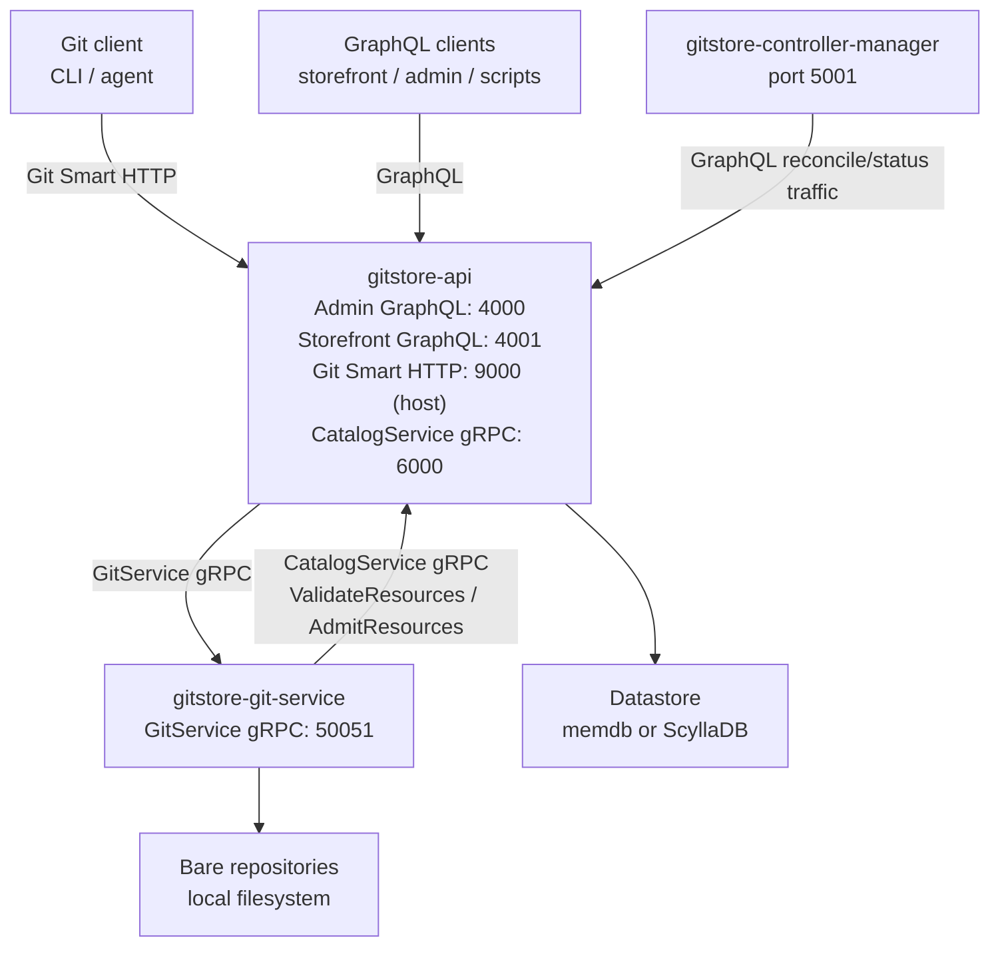

# GitStore Developer Guide

Admin uses `/admin/graphql` on port 4000 and Storefront uses
`/storefront/graphql` on port 4001. Configure `api.admin_port` and
`api.storefront_port`; generic `api.port` is rejected. Health/readiness stay at
the Admin root. The old `/graphql` and `/playground` paths are removed.
`make generate TARGET=all` generates both explicit gqlgen configurations;
aggregate checks verify deterministic output for both schemas.

Playgrounds live at `/admin/playground` and `/storefront/playground`. Switching
requires an explicit peer URL, closes subscriptions and clears headers; editor
sessions are separate. Configure endpoint CORS for cross-origin use. Storefront
currently returns a fixed unavailable response until publication/target support
exists. See [configuration](configuration.md) for policies and resource bounds.

**Audience**: Contributors, operators, and integration engineers
**Prerequisites**: Docker, Git, Go 1.27.2, Rust 1.99.1, Make, curl, jq

Use Go 1.27.2 for the workspace and standalone modules. Rustup selects
Rust 1.99.1 from the root `rust-toolchain.toml`, using the minimal profile
with Clippy and rustfmt. The Cargo manifest declares the same minimum Rust
version. CI and container builders use these compiler versions; when updating
them, keep the workspace, module manifests, Rust toolchain file, Dockerfiles
and CI setup steps aligned.

`make lint` uses the formatter bundled with each selected Go toolchain,
even when an older `gofmt` remains on `PATH`, and fails if formatting fails.

This guide keeps implementation detail out of the user guide. It covers service topology, local development, datastore backends, hook/admission flow, controller-manager runtime, generated schema/proto workflow, and module responsibilities.

Contributor procedures: [Make command reference](development/make-reference.md),
[production-readiness testing](development/production-readiness-testing.md)
and [release process](development/release-process.md). Deployment procedures and
exceptional recovery are indexed separately in [Operations and Recovery](runbooks/README.md).

## Current Topology



## Ports

| Service                       |    Port | Purpose                                                |
|-------------------------------|--------:|--------------------------------------------------------|
| `gitstore-api`                |  `4000` | GraphQL, Playground, `/health`, `/ready`, login helper |
| `gitstore-api`                |  `4001` | Storefront boundary; Compose host port is `4100`       |
| `gitstore-api`                |  `9000` | Git Smart HTTP front door (host port)                  |
| `gitstore-api`                |  `6000` | CatalogService gRPC called by the Git service          |
| `gitstore-git-service`        | `50051` | GitService gRPC storage and transport                  |
| `gitstore-controller-manager` |  `5001` | `/health`, `/metrics`, poison-item API                 |

## Production Design Constraints

`gitstore-api`, `gitstore-controller-manager`, and
`gitstore-git-service` are the three core services. Features affecting them
must define behavior for their actual service topology. API/controller changes
must test changed concurrent-replica, migration, replay and recovery risks
and document compatibility, naming any unverified paths. Full deployed
rolling-upgrade, capacity and soak qualification is separate from ordinary
alpha PR readiness; deferred evidence does not establish production support.
Git is stateful and singleton-only; repository sharding and
placement-aware routing are not implemented. Keep one active Git process,
retain repository storage and use non-overlapping replacement. Do not turn
generic replica requirements into multi-Git or Git HA scope.

Production paths must also define:

- pluggable authentication and authorization for human, service, and agent identities;
- namespace and repository isolation at the owning service boundary;
- bounded queries, queues, workers, retries, timeouts, and payloads;
- capacity at a minimum catalogue size of 5,000,000 products;
- sustained Git push load and downstream backpressure behavior;
- repeatable replica, failover, load, soak, and recovery validation.

Future controllers must distinguish conditional-write safety from work
coordination and external side-effect fencing. General controller leases and
external side-effect fencing are proposed, not implemented. CDC materializer
leases do not provide controller fencing.

Repository-wide capacity and fault tooling is exposed through the root
Makefile. Use `make capacity TARGET=<target> PROFILE=<scenario>
MODE=<diagnostic|alpha|production>` for offered-load and threshold
evidence, and `make chaos CHAOS_PROFILE=<profile>
CHAOS_TARGET=<gitstore-container> CHAOS_CONFIRM=1` for bounded container fault
injection. See [Production readiness testing](development/production-readiness-testing.md)
for profile authoring, correctness-verifier, evidence, and safety requirements.

## Reference identity integration

AuthN, UserDir and AuthZ are independent selections. The optional
`compose.oidc.yml` stack pins Kratos, Hydra and the self-service UI; use
`oidc-jwt` for human AuthN, Kratos for UserDir and the configured AuthZ policy
for permissions. Keep native Admin endpoints private and supply runtime
credentials outside committed configuration. Kratos replicas must share the
same PostgreSQL identity store; do not provision an identity database per API.
Reference schema and hook configuration lives under `config/oidc/kratos/`.

The local static login below is a development fixture. Avoid `static-users`
AuthN/UserDir and `none` UserDir in production, including static/OIDC/Kratos
mixes, even though they are accepted configuration combinations.
ServiceAccount credentials and enablement remain GitStore-owned.

Each API's workload mirror consumer starts at the current internal journal
boundary with bounded retries and buffering. Loss, overflow or restart can
leave missing, stale or orphaned directory mirrors and incomplete unified actor
lists indefinitely; no automatic replay or repair is shipped. Native
ServiceAccount reads remain source-backed. See
[identity configuration](configuration.md#authorization-and-user-directory)
and [workload delivery limits](configuration.md#workload-directory-mirrors).

## Local Development

Start the Docker stack:

```bash
make compose DETACH=1
make ps
```

This starts all three core services through the `local` Compose profile using
the shared, read-only `config/config.toml` and `config/policy.yaml` fixtures. No
service `.env` file is required. The local login is `admin` / `admin123`.
Choose an alternate shared file with
`make compose CONFIG_FILE=./config/config.stage.toml`; the selected host path
is mounted at the same container path for every service.

Run native Git and API services in separate terminals (with their required
environment configuration):

```bash
make git
make api
```

Once the API is listening, follow the controller setup below. Alternatively,
`make dev` generates/enrolls local credentials and runs all three core services
together in the foreground with shutdown trapping:

```bash
make dev
```

Bootstrap local control-plane resources through GraphQL:

```bash
make bootstrap TARGET=all ADMIN_PASSWORD=<admin-password>
```

Useful variables:

| Variable          | Default                         | Purpose                                     |
|-------------------|---------------------------------|---------------------------------------------|
| `API_URL`         | `http://localhost:4000/admin/graphql` | Bootstrap GraphQL endpoint                  |
| `API_HEALTH_URL`  | Admin-root `/health` derived from `API_URL` | Native startup health probe; override for separate operational routing |
| `ADMIN_USERNAME`  | `admin`                         | Login username                              |
| `ADMIN_PASSWORD`  | unset                           | Login password for bootstrap token creation |
| `BOOTSTRAP_TOKEN` | unset                           | Reuse an existing bearer token              |
| `NAMESPACE`       | `gitstore-test`                 | Namespace to create                         |
| `REPOSITORY`      | `catalog`                       | Repository to create                        |
| `DEFAULT_BRANCH`  | `main`                          | Repository default branch                   |
| `CONFIG_FILE`     | `./config/config.toml`          | Shared local Compose configuration          |

### Native controller credentials: generate → enroll → run

With a running local API and the shipped development identity/policy fixtures:

```bash
make secret TARGET=signing-key
make enroll-controller-serviceaccount
make controller
```

Each command has a separate responsibility:

| Command | Result with native defaults |
|---------|-----------------------------|
| `make secret TARGET=signing-key` | Creates `.gitstore/secrets/controller-manager/privateKey` and `.gitstore/secrets/controller-manager.json`, containing the matching private key and `controller-key` ID. No API connection is needed. |
| `make enroll-controller-serviceaccount` | Registers the public key with the API and saves its assigned UID to `.gitstore/secrets/controller-manager/serviceaccount.env`. Does not write the JSON record or generate private material. |
| `make controller` | Uses that JSON record and UID to run the controller. Missing material is an error; startup does not generate it. |

The PEM and JSON record are private files (mode `0600`); never commit them or
mount the controller record into the API/Git service. Re-running generation
preserves an existing key and identical record. A different record/key ID is
rejected, not overwritten; follow the
[rotation runbook](runbooks/secret-material-rotation.md) for rotation.

Enrollment uses `API_URL` (default `http://localhost:4000/admin/graphql`) and
`DEV_ADMIN_USERNAME` / `DEV_ADMIN_PASSWORD` (local fixtures: `admin` / `admin123`).
Use these fixture credentials only with local development APIs, never deployed
environments. Enrollment re-enrolls the selected key ID with
`--replace-existing-key`; it does not grant RBAC permissions. The shipped policy
already binds the cluster-scoped `gitstore-controller-manager` account. No
ServiceAccount namespace is accepted.

Use the same `CONTROLLER_SECRET_DIR` (absolute path), `CONTROLLER_SECRET_NAME`,
`CONTROLLER_SECRET_KEY`, and `CONTROLLER_SERVICEACCOUNT_KEY_ID` overrides across
all three commands. For example, export them before running the sequence.
`CONTROLLER_SERVICEACCOUNT_NAME` selects the account, while
`CONTROLLER_SERVICEACCOUNT_IDENTITY_FILE` can override the UID file destination.
Changing the account name also requires matching policy bindings.

For a custom signing-key destination, Make writes `<DESTINATION_PATH>.json` by
default. Override `RECORD_OUTPUT_PATH` explicitly when the record must match a
configured `key_ref.name`; relative paths resolve from the repository root:

```bash
make secret TARGET=signing-key \
  DESTINATION_PATH=/run/controller-secrets/gitstore-controller-manager-signing-key \
  RECORD_OUTPUT_PATH=/run/controller-secrets/gitstore-controller-manager-signing-key.json \
  CONTROLLER_SERVICEACCOUNT_KEY_ID=controller-key
```

These output-path overrides apply to generation only; they do not reconfigure
enrollment or controller startup. For a separate API issuer PEM without a
controller record, use `RECORD_OUTPUT_PATH=` explicitly. Never reuse the
controller private key as the API issuer key.

`make compose` and `make dev` already automate their own generation and
enrollment; the manual sequence above is for separately started native services.
Compose keeps its credentials in dedicated volumes, separate from native files.

### Private profiling

The API and controller expose opt-in `pprof` listeners for local diagnostics.
They are disabled by default; do not enable them in production. Set
`api.profiling.uri` or `controller.profiling.uri` to a plain HTTP URI with an
explicit loopback IP and nonzero port, using a separate port for each process.
Hostnames, wildcard addresses, credentials, paths, query strings, and fragments
are rejected.

An enabled listener requires a separate token of 32–256 printable, non-space
ASCII bytes. Provide it through `GITSTORE_API__PROFILING__TOKEN` or
`GITSTORE_CONTROLLER__PROFILING__TOKEN`; configure the corresponding URI with
`GITSTORE_API__PROFILING__URI` or
`GITSTORE_CONTROLLER__PROFILING__URI`. Requests require exactly one
`Authorization: Bearer <token>` header. The listener is not encrypted, so keep
it on loopback and capture from inside the service's network namespace.

Available GET routes include CPU profiles at
`/debug/pprof/profile?seconds=1..60`, traces at
`/debug/pprof/trace?seconds=1..5`, and binary heap, allocs, block, mutex, and
goroutine profiles under `/debug/pprof/`. For example, with the API URI and
token set in the environment:

```sh
umask 077
printf 'Authorization: Bearer %s\n' "$GITSTORE_API__PROFILING__TOKEN" |
  curl --fail --max-time 65 --header @- \
    --output cpu.pprof \
    "$GITSTORE_API__PROFILING__URI/debug/pprof/profile?seconds=30"
```

Profiles may contain runtime data. Keep them private, do not upload them to
telemetry backends, and delete them after diagnosis. Disable profiling and
restart the process when finished.

## Datastore Backends

`gitstore-api` owns the application datastore abstraction.

| Backend  | Use                         | Notes                                      |
|----------|-----------------------------|--------------------------------------------|
| `memdb`  | Development and fast tests  | In-memory only; no persistence             |
| `scylla` | Production-oriented backend | Uses ScyllaDB 5.x+ and embedded migrations |

Start Scylla services only:

```bash
make scylla DETACH=1
```

`make scylla` uses the CI-friendly single-node overlay from
`compose.scylla.yml` (`--smp=1`, replication factor 1). For local
multi-node validation, start the three-node overlay instead:

```bash
make scylla PROFILE=cluster DETACH=1
```

The cluster overlay uses `compose.scylla.cluster.yml`, creates three Scylla
nodes, and initializes the `gitstore` keyspace with replication factor 3.
Override `SCYLLA_CLUSTER_SMP` to change the CPU shard count per Scylla node,
for example `SCYLLA_CLUSTER_SMP=2 make scylla PROFILE=cluster DETACH=1`.
The default is `1`, with
`SCYLLA_CLUSTER_MAX_NETWORKING_IO_CONTROL_BLOCKS=2048`, so the three-node
topology starts reliably on Docker Desktop without requiring host AIO tuning.

Start the full stack with the default in-memory datastore:

```bash
make compose DETACH=1
```

Start the full stack with single-node Scylla:

```bash
make compose DATASTORE=scylla DETACH=1
```

To run the full stack against the three-node local cluster:

```bash
make compose DATASTORE=scylla PROFILE=cluster DETACH=1
```

Lifecycle helpers (`make ps`, `make logs`, `make stop`, and `make down`) load
both Scylla overlays so they can see services started by either profile.
`SERVICE=scylla` is treated as a convenience alias for all Scylla variants
(`scylla`, `scylla-1`, `scylla-2`, `scylla-3`, and `scylla-init`):

```bash
make logs SERVICE=scylla
make stop SERVICE=scylla
make down
```

Run Scylla-backed API datastore tests after Scylla is reachable:

```bash
make test TARGET=datastore DATASTORE=scylla SCYLLA_TEST_ADDR=127.0.0.1:9042
```

The tagged packages run sequentially because their isolated keyspaces still
share the same Scylla instance. This prevents one package's schema creation and
snapshotting teardown from competing with the other's deadline-sensitive LWT
tests on the single-shard fixture. Concurrent writers inside each test remain
concurrent; assertions and deadlines are unchanged.

### Projection audit, repair, and capacity validation

The operational CLI compares authoritative Namespace, Repository, Product,
CategoryTaxonomy, Collection, and ProductVariant rows with their query
projections:

```bash
cd gitstore-api
GITSTORE_API__DATASTORE__SCYLLA__HOSTS=127.0.0.1:9042 \
  go run ./cmd/server gitctl scylla-projection-audit
GITSTORE_API__DATASTORE__SCYLLA__HOSTS=127.0.0.1:9042 \
  go run ./cmd/server gitctl scylla-projection-repair --dry-run
GITSTORE_API__DATASTORE__SCYLLA__HOSTS=127.0.0.1:9042 \
  go run ./cmd/server gitctl scylla-projection-repair --confirm
```

Plans are stable JSON. Apply checks authoritative identity/resource version,
uses conditional projection mutations, and performs a post-repair audit. Never
reuse an old plan after a concurrent-writer error; audit again. Full operator
procedure: [`runbooks/scylla-projection-repair.md`](runbooks/scylla-projection-repair.md).

The capacity test is intentionally opt-in and requires a dedicated preloaded
Scylla environment:

```bash
cd gitstore-api
SCYLLA_TEST_ADDR=127.0.0.1:9042 \
GITSTORE_SCYLLA_CAPACITY_RUN=1 \
GITSTORE_SCYLLA_CAPACITY_PRODUCTS=5000000 \
go test -tags scylla -run 'TestScyllaCapacity' -count=1 -timeout 30m \
  ./internal/datastore/scylla
```

It asserts the 100 MiB partition ceiling, 10 MiB hot target, bounded page
limits, sustained projection mutation, and two independent clients. Add
`GITSTORE_SCYLLA_CAPACITY_SOAK_DURATION=2h` only for a scheduled soak.

## Git And Admission Flow

The API is the Git Smart HTTP front door. The Rust Git service is gRPC-only storage and transport.

1. A Git client clones, fetches, or pushes to `http://localhost:9000/{namespace}/{repo}.git`.
2. `gitstore-api` resolves `{namespace}/{repo}` to the stable repository ID stored in the datastore.
3. `gitstore-api` forwards Git transport work to `gitstore-git-service` through `GitService` gRPC.
4. During receive-pack, `gitstore-git-service` stages objects in quarantine and runs enabled hook phases.
5. In the blocking pre-receive phase, `gitstore-git-service` sends frontmatter resource blobs to `gitstore-api` via `CatalogService.ValidateResources`; when a resource is removed, it additionally sends the old and proposed trees to `CatalogService.ValidateResourceDeletions`.
6. If validation passes, refs are updated and the push succeeds.
7. In the post-receive phase, `gitstore-git-service` calls `CatalogService.AdmitResources` with repository ID, ref name, old commit SHA, and new commit SHA. New callers populate `new_commit_sha`; the deprecated `commit_sha` tag remains reserved for mixed-version decoding only.
8. `gitstore-api` compares old/new resource identities, applies admission checks, and creates, updates, or deletes hydrated records in the datastore. Signed changed-path callbacks read the affected blobs directly instead of enumerating the whole repository. If a newer push has advanced the ref, a delayed callback can still project an unchanged manifest that remains at the current tip; changed or removed manifests and stale deletions are skipped. Delayed creates remain create-only through the atomic datastore write: an identity materialized by another replica is preserved, including its content and provenance, and create conflicts are skipped. Current create replays that converge an existing identity require UPDATE authorization as well as CREATE authorization. Authorization is checked again; independent Product and Category upserts verify their complete manifest at the live tip so unrelated pushes do not require a globally idle branch, and non-Namespace resources retain their original accepted source revision. Git read failures fail admission rather than implying a deleted manifest. Product and Category denial-status retries require the original source commit to remain the tip so an older denial cannot replace a newer accepted status.
9. `gitstore-controller-manager` reconciles controller-owned status and operational follow-up through the API.

The native Git service retains at most 64 reusable gix repository handles, with object-index slots sized by gix for each repository to avoid repeatedly discovering pack indexes for short operations. Ref advertisements read HEAD as a reference without loading its object. Post-receive index discovery and tree reads use the blocking pool so RPC streams can continue. Ref reads remain disk-backed; authorization and repository locks still apply on every request. Configuration changes and repository deletion invalidate cached handles. Small quarantine packs use a request-local gix object-memory view, capped at 64 objects, 2 MiB of pack data and 8 MiB of decoded object content, with an 8 MiB decoder allocation bound. Accepted small packs are published as loose objects within the same bounds, avoiding a new pack index for each incremental push. Larger packs use separate disk-backed object stores and remain packed on acceptance. Neither path retains rejected objects in live cached mappings. Unchanged resource blobs do not trigger deletion preflight when a push adds another file. Nonrecursive listings read only the requested level, so resolving a ref does not traverse descendant trees.

The pre-receive phase is intentionally stateless and blocking. Admission can use datastore state and is allowed to complete asynchronously relative to the Git client acknowledgement.

Admission identity is `apiVersion`, `kind`, resolved namespace, and `metadata.name`; the Git file path is stored as provenance only. A path move with the same identity preserves `metadata.uid` and only increments `resourceVersion`. Spec/body edits increment both `generation` and `resourceVersion`. Deleting a resource file removes the stored identity; adding the same identity again later allocates a new UID.

Synchronous `updateRepository` authoring uses the same complete-manifest fence
when another path advances the namespace system branch. Its status-conflict
retries recheck authorization and the current manifest, retain the accepted
source revision, and reject changed, removed or unreadable content. Updating
one Repository therefore does not require other Repository authors to leave
the shared branch idle. Creates and deletions retain their existing stricter
revision checks.

Post-receive admission cannot reject an already accepted Git push. DB-backed conflicts such as duplicate `ProductVariant.spec.sku` leave the existing resource unchanged, skip the conflicting incoming resource, and emit structured API logs with the operation, namespace, name, SKU, and conflicting identity.

## Controller Manager Runtime

`gitstore-controller-manager` provides the shared runtime for level-triggered controllers.

Runtime pieces:

- Work queues keyed by kind, namespace, and name.
- Worker pools via `pond`.
- Retry and backoff via `cenkalti/backoff`.
- Quarantine for poison items after repeated failures.
- Panic capture with stack traces.
- Per-kind health statistics.
- Collector-routed OTLP metrics, operational logs and traces when enabled.
  See [telemetry configuration](configuration.md#telemetry-export).
  Metrics originate from SDK instruments, including runtime and gRPC sources;
  compatibility scrapes use SDK collection. See the contributor
  [metrics inventory](implementation/041-sdk-native-metrics.md) for signal contracts.
- Paged GraphQL lists and `graphql-transport-ws` watches per registered kind
  (`internal/checkpoint`, `internal/listwatch`). Production runners persist
  projections, replay cursors, work, retry deadlines and quarantine in
  `<Kind>.disk-v2` stores. They resume after replacement or relist after cursor
  expiry; legacy JSON snapshots are not loaded. Keep a separate checkpoint
  root for each concurrent process.

HTTP surface on port `5001`:

| Route                                                          | Purpose                                                              |
|----------------------------------------------------------------|----------------------------------------------------------------------|
| `GET /health`                                                  | Returns `ok` or `degraded` based on stalled workers and poison items |
| `GET /metrics`                                                 | Compatibility diagnostics; the collector topology does not scrape this route |
| `GET /controller/v1/poison/{kind}`                             | List quarantined items for one kind                                  |
| `GET /controller/v1/poison/_all`                               | List all quarantined items                                           |
| `POST /controller/v1/poison/{namespace}/{kind}/{name}/requeue` | Requeue one poison item                                              |

## Module Notes

### `gitstore-api`

Purpose:

- GraphQL API and Relay-style schema.
- Authentication and JWT sessions.
- Namespace and repository control plane.
- Git Smart HTTP handler.
- CatalogService gRPC server for push validation and admission.
- Datastore abstraction and backend implementations.

Important directories:

| Path                   | Purpose                             |
|------------------------|-------------------------------------|
| `cmd/server`           | API entrypoint                      |
| `internal/app`         | Runtime composition                 |
| `internal/admin/graph`       | gqlgen resolvers and generated code |
| `internal/githttp`     | Smart HTTP front door               |
| `internal/gitclient`   | GitService gRPC client              |
| `internal/cataloggrpc` | CatalogService gRPC implementation  |
| `internal/datastore`   | Datastore abstraction and backends  |
| `internal/validate`    | Frontmatter resource validation     |

Commands:

```bash
make api
cd gitstore-api
go test ./...
go generate ./...
```

### `gitstore-git-service`

Purpose:

- Own bare repository storage.
- Serve GitService gRPC operations for repository lifecycle, ref advertisement, receive-pack, upload-pack, file reads, commits, deletes, and tags.
- Run receive hook phases and call the API CatalogService.

`ListFiles` returns each regular or executable file's uncompressed blob byte
length in `FileEntry.size_bytes`, including zero for empty files. General
listings use object headers rather than loading complete blob contents; missing
or invalid blob objects fail the listing rather than appearing as empty files.
The bounded recursive RBAC listing retains its content validation.

Fetch negotiation acknowledges only offered commit objects present in the
repository, using the client's single-ACK, `multi_ack`, or
`multi_ack_detailed` mode. Unknown objects and non-commit objects are not
common commits. Negotiation responses end at their ACK/NAK packet; a completed
negotiation sends a final ACK before the pack when a common commit is known.

Important directories:

| Path                | Purpose                                               |
|---------------------|-------------------------------------------------------|
| `src/grpc`          | Tonic GitService server                               |
| `src/git`           | Repository and pack protocol logic                    |
| `src/git/hooks`     | Receive hook pipeline, validation, admission callouts |
| `gen`               | Generated Rust proto bindings                         |
| `tests/integration` | Rust integration tests                                |

Commands:

```bash
make git
cd gitstore-git-service
cargo test
cargo test --test integration
cargo build --release
```

### `gitstore-controller-manager`

Purpose:

- Shared controller runtime.
- Level-triggered reconciliation primitives.
- Health, metrics, and poison-item management API.

Important directories:

| Path               | Purpose                           |
|--------------------|-----------------------------------|
| `cmd/controller`   | Controller manager entrypoint     |
| `internal/manager` | Runtime registration and dispatch |
| `internal/queue`   | Work queue                        |
| `internal/worker`  | Worker pool                       |
| `internal/retry`   | Backoff and quarantine            |
| `internal/health`  | Health and metrics handlers       |
| `internal/api`     | Poison-item API                   |
| `tests/contract`   | Runtime contract tests            |
| `tests/integration`| End-to-end scenario tests (real Manager + Runner + Store wired together) |

Commands:

```bash
make controller
cd gitstore-controller-manager
go test ./...
```

Conditional recovery procedures are listed in the [operations index](runbooks/README.md):

| Guide | Symptom |
| --- | --- |
| [Controller recovery](runbooks/controller-recovery.md) | Growing backlog, expired cursor, or quarantined work |
| [Watch and status diagnostics](runbooks/controller-watch-status.md) | Watch disconnects, journal readiness, or sustained status conflicts |
| [Controller authentication](runbooks/controller-auth.md) | Credential enrollment, renewal, or revocation failure |

## Generated Schema And Proto Workflow

### GraphQL

Schema files live in [shared/schemas](../shared/schemas/). gqlgen configuration lives in [gitstore-api/gqlgen.admin.yml](../gitstore-api/gqlgen.admin.yml).

When schema changes:

```bash
cd gitstore-api
go generate ./...
go test ./...
```

Generated files are under `gitstore-api/internal/admin/graph/generated` and `gitstore-api/internal/admin/graph/model`.

### Protobuf

Canonical proto contracts live in [shared/proto](../shared/proto/):

- `gitstore/git/v1/git_service.proto`
- `gitstore/catalog/v1/catalog_service.proto`

Generated Go stubs live in `gitstore-api/gen`. Generated Rust stubs live in `gitstore-git-service/gen`. The Rust build does not generate proto code at compile time; `build.rs` documents that stubs are generated by the repository's buf workflow.

After proto changes, regenerate stubs with the repository's proto generation workflow and run:

```bash
make build
make test
```

## Tests And PR Readiness

Focused checks:

```bash
cd gitstore-api
go test ./...

cd ../gitstore-controller-manager
go test ./...

cd ../gitstore-git-service
cargo test
```

Aggregate checks:

```bash
make build
make test
make lint
make check TARGET=licenses
make check TARGET=credentials
make pr-ready
```

Install local hooks once per clone:

```bash
./scripts/install-git-hooks.sh
```

The installer works from the main checkout or a linked worktree and updates
clone-shared hooks for all linked worktrees. It never changes hook configuration.
Custom hook paths and differing installed hooks are left untouched; review
ownership before replacing an existing integration.

The pre-commit hook uses the unified license checker for Go, Rust and
JavaScript/TypeScript. It reads staged blobs, not unstaged working-tree edits.
`make check TARGET=licenses DIFF_BASE=origin/main` validates tracked headers
and current-year copyright endpoints for changed sources. Generated sources
and the pinned upstream Apache-licensed reader retain their existing exceptions;
see [license checker rules](../scripts/README.md#check-license-headerssh).

Use Conventional Commits.

### GitHub Actions scheduling

Core CI runs for pull requests, merge-queue groups and pushes to main. Branches
without a PR can use the CI workflow's manual dispatch; feature pushes do not
start a second copy alongside PR validation. A newer PR run cancels an older
run for the same workflow and PR, without cancelling another PR, main or a
merge group.

The four shared Go modules run sequentially in one job, each with its pinned
toolchain, dependency cache and `GOWORK=off` checks. Required API, controller,
Git service and PR-title check names are unchanged. Git service formatting,
Clippy, builds and tests still run on every core CI event; the optional Rust
coverage rerun and upload run only after a push to main. Security scans retain
their existing event coverage.

These settings reduce redundant jobs, not the account-wide runner limit.
Repository merge-queue concurrency and GitHub-managed CodeQL scheduling are
configured separately.

Translation locale, field-path and target-descriptor validation lives in
`shared/translation`, independently of service authorization and storage.
Descriptors digest their field constraints, stable list identities, reference
boundaries and target-work limits. Snapshot validation observes caller
cancellation and returns an operational failure when target work exceeds its
budget; it does not treat an unavailable snapshot as missing or valid.
Source decoding enforces a 1-MiB document ceiling and validates at most 65,536
YAML nodes at depth 64 before constructing the typed resource. The existing
Catalog RPC in-flight limit rejects saturation immediately; there is no
Translation-specific waiting queue. Cancellation stops subsequent candidate,
immutable-field, deletion and namespace-policy parses, and no validation
response is published after the request is canceled.
The dormant shared push/manifest preflight authorizes all source changes before
checking changed Translations against the complete proposed tree. Proposed
creates/updates/deletes and unchanged candidate targets override stored fields
independently of file order. Unchanged Translations are not retroactively
rejected when a target changes; reconciliation must update their observations.
Target-read authorization uses thin serialized Namespace and target ownership
facts before fetching stored target content by its proved UID. Content digests
and final metadata checks reject stale material and changed lifetimes.
A proposal may retain a proved existing UID, never an old version as a future
allocation. An unchanged candidate may use the current opaque version only
when its exact material matches the proof. Status-only target churn is harmless
without a version pin; explicit version pins remain strict.
True absence requires current target coverage and matching serialized
missing/vacant head observations. Missing permitted targets and unallocated
pins remain unresolved; pending proof, provider and storage failures do not
become absence. Namespace isolation, common bounded diagnostics and
all-or-nothing field/body validation apply before any result is returned.
Pre-receive and single-manifest rejection reuse the common admission diagnostic
mapping, including invalid UTF-8. Rejection preserves the previously accepted
source revision, generation and controller observations as well as target
authored and resolved content. A target-read denial has the same response
whether the target exists or not.
Stored JSON field names map through declared catalog YAML tags without
case-folding identities, values or locales. Missing/null text is not invented
as an empty leaf; ambiguous aliases and excessive node/depth/byte work fail
closed. Startup still rejects activation; dormant preflight wiring does not
enable public receive/replay or Admin routes.
An internal accepted-source projector retains the exact document and body,
Git blob identity, source digest and accepted attribution. It preserves UID,
creation metadata and controller observations; formatting-only changes advance
the source version without changing generation. Duplicate projection is a
no-op, and source/status CAS protects concurrent observations. Removal requires
matching raw source, repository/ref/path, current commit and UID/version proof.
Projection never rewrites target source or resolved content and does not
revalidate an accepted document against a subsequently changed target.
Translation admission, deletion validation, committed replay and generated
Admin routes remain unavailable. Internal storage components are not a complete
production capability or a deployment fault-recovery guarantee.

`api.translation.enabled` defaults to `false`; this build rejects `true` at
startup for every API role. An optional `api.translation.descriptor_digest`
must match the binary's target-descriptor digest. Environment overrides use
`GITSTORE_API__TRANSLATION__ENABLED` and
`GITSTORE_API__TRANSLATION__DESCRIPTOR_DIGEST`. These checks run before datastore,
provider or listener construction; a matching digest does not certify rollout
readiness or enable Translation operations.

The shared Git post-receive callback makes at most three RPC attempts for
transient failures, with a 30-second limit per attempt and 100/200-ms backoff. Each
attempt preserves the accepted repository/ref/commit/actor/path snapshot but
uses a fresh receiver-bound signature. Authorization and input/precondition
rejections are not retried. An already-started ref transaction retains its
repository write lock through completion even if the request is canceled;
successful commits retain their delivery work. Canonical and revision-guarded
file writes, plus tag creation, likewise
retain their write locks inside blocking mutation work; canceled guarded file
writes preserve their exact-source receipts. Production receive delivery is
asynchronous and persisted across non-overlapping Git-service replacement.
Exhausted or terminal attempts retain the receipt for later replay rather than
discarding accepted work.
The API returns retryable errors for transient namespace/ref lookup failures
and exhausted projection convergence instead of acknowledging completion.
Authorization denials remain terminal; cancellation and deadlines retain their
error codes. A genuinely removed ref, superseded branch deletion or proven
stale policy denial still skips stale work without changing newer status.

The native receive path retains immutable repository,
receive, actor and full accepted-ref snapshots using the existing protobuf.
It bounds retained work to 128 receipts of at most 1 MiB each, one in-flight
temporary file and 32-item metadata pages. Prepared/committed transitions and
acknowledgements are fsynced; exclusive ownership prevents overlapping users of
the retained queue. Corrupt or unknown records fail closed without eviction.
After validation, accepted loose objects or pack/index files and their
directory chain are synced before receipt preparation. The bounded small-pack
loose-object optimization remains intact, including already-packed objects.
Preparation requires the exact repository and every original
ref preimage, rejecting preexisting native ref locks. Under uninterrupted
repository exclusion, or replacement before serving mutations, its recovery
core finishes only old/new-matching ref outcomes and preserves divergent
evidence. Completed receipts cannot undo later ref changes. Recovery retains
each distinct nonzero old/new object with an internal Git ref before publishing
public refs. These pins survive branch deletion, ref packing and garbage
collection. A durable acknowledgement phase permits interrupted pin cleanup
to resume without replaying completed delivery. Beginning cleanup rejects
preexisting native locks; prepared work and interrupted cleanup must both
fence subsequent repository mutations. A bounded metadata index is rebuilt
from validated records at open and updated conservatively at phase changes.
Every native mutation path settles pending preparation/cleanup under the same
owned repository guard. Retained work also prevents repository removal or
recreation after storage loss until delivery is resolved.
Replay awaits every applicable ref callback before
acknowledging a committed receipt. Prepared work, unavailable repositories,
missing retained commit/root-tree objects and failed delivery retain the
receipt. Replacement replay preserves the original actor/receive and may
redeliver an already acknowledged ref when another ref failed. It takes the
caller's repository write lock only for cleanup, not while calling the API;
older cleanup cannot cross a newer unresolved receive.
The receipt also retains the accepted catalog-routing subset, so replacement
branch-pattern changes neither discard accepted delivery nor expand its scope.
Records without routing evidence fail closed and are preserved; drain an older
private-format queue with its originating binary before upgrading.
Startup validates retained repository lifetimes and recovers pending work
before binding the RPC listener. A single worker then consumes bounded pages,
waking on accepted publication with a one-second fallback for recovery/retry.
One failed delivery does not discard or prevent processing unrelated receipts.
Shutdown cancels delivery without deleting unacknowledged work; blocking
recovery/cleanup retains its owned guard. These native guarantees do not enable
Translation admission or establish connected/deployed fault acceptance.

Dormant Translation projection preserves the complete accepted document and
rejects malformed Translation snapshots before writing any entry. An invalid
patch cannot be mistaken for manifest removal or partially update its body.
Signed callback tests cover lost create/update/delete responses, delayed
replay and delete/recreate identity changes, with exact source bytes and
unchanged targets across all five target kinds. These are internal component
tests: public construction still rejects enabled Translation configurations.

Dormant named, Node and paginated source reads preserve authored locale, ordered
patches, exact body bytes, optional target pins and the accepted source revision.
Namespace-bound opaque cursors support bounded forward/backward scans, including
empty continuation pages. Source authorization never grants target access.
Every status-bearing read uses the bounded current-evidence guard. Committed
removal requires the original source identity/provenance,
current ref tip and confirmed path absence; a replacement source is not deleted.

Dormant typed and generic status writes use the same source-version CAS and
require observations to match the accepted generation and revision. Generic
patches preserve omitted status fields; condition enums retain their explicit
GraphQL/catalog conversion. Typed and generic watches reuse the shared durable
journal and mark replayed source payloads as historical. Watch permission alone
cannot expose a read-denied source, and no response exposes unguarded current
observations or private validation fingerprints.

Internal source-audit discovery uses bounded metadata pages independently of
namespace anchors and UID locators. Recovery verifies source scope, lifetime,
versions and phase, then reuses serialized source recovery and accepted index
allocations. Lost native live UID authority fails closed rather than inventing
frozen name-vacancy metadata. A retained retired source can conditionally restore
its retired UID locator without overwriting conflicting lifetimes or replacement
name ownership. Per-source recovery does not certify a complete audit or publish
a mutation-watermarked deployment capability. Absence-only source-audit hints
cannot retire a UID or release its name claim; missing source authority requires
explicit repair.

Source-audit recovery invalidates any earlier private repair watermark before
work begins and publishes a new one only against the unchanged source
coordinator version after successful recovery. Source, status, binding and
retirement transitions invalidate that watermark. Bounded recovery turns
validate the entire discovery page before repairs and recheck all published
versions before returning its continuation; failed or raced work returns no
accepted page. These are per-source repair observations, not a namespace-wide
completeness or activation certificate.

The internal reservation auditor separately visits bounded source-index
allocation pages. It retires obsolete allocations using their original
slot/token fences, including after confirmed source retirement; missing source
alone never authorizes removal. Its cursors cannot resume source scans.
Reservation coverage does not establish coverage of thin cells with missing
allocation records or a complete namespace audit.

The declared `TranslationStatus` follows the common resource shape:
`observedGeneration`, `lastAppliedRevision`, `conditions` and `resolved`.
Kind-specific results (`canonicalLocale`, `target`, `validatedFieldPaths`) live
under `resolved`, without a separate freshness field, check timestamp or
historical status copy. `Condition.lastTransitionTime` remains the time of a
condition transition, not the time of each freshness check.

The private freshness service compares recorded validation fingerprints and
authorized target material metadata, then rechecks the source UID, namespace
incarnation, lifetime and version. It retries a changed source version once,
using at most ten metadata reads including the original source read. Target
authorization shares the same thin observation rather than fetching content
or consulting derived name/UID lookups. Failed checks mask conditions and
redact resolved evidence without changing stored status. Named, Node, list and
typed/generic status-mutation responses use this guard. Lists share initial
target proof only within their bounded page; source-version retries obtain
fresh proof. Masked observations request durable revalidation without changing
the public resource.

Live typed and generic watches guard status only while the event still matches
the current source lifetime and version. If the source changes, they retain the
original event body/version, mark it historical and omit status rather than
substituting a newer resource. Initial replay is always historical and carries
no current-validation claim. Condition statuses retain GraphQL `TRUE`, `FALSE`
and `UNKNOWN`; YAML spellings are not accepted as GraphQL inputs. These dormant
routes do not bypass the production activation gate.

The internal controller transport reuses the shared authenticated Admin
HTTP/WebSocket client. It obtains a journal bookmark before streaming bounded
namespace pages, waits for each page visitor before fetching another, and
keeps source CAS versions separate from journal cursors. Typed observation
writes preserve the authored revision separately from the reconciled revision;
condition statuses accept only GraphQL enum spellings.
Translation status writes additionally require the source metadata UID,
including on the common status mutation. A delayed worker cannot update a
replacement source by reproducing its name, generation, revision and version.
Both status paths also require the currently enrolled controller ServiceAccount;
a policy grant alone does not make a human or stale enrollment a controller.
The shipped local policy and built-in roles include Translation source grants
for author/viewer roles. Controller additions grant Translation read/list/watch
and status writes plus read/list/watch for all five target kinds, not additional
target source writes.

Other resource kinds retain their existing status preconditions.
Private binding and dependent operations require the live enrolled controller
and scoped source permissions. Binding reads/writes additionally authorize
target ownership from serialized thin metadata, without fetching target
content. First binding fences the source UID/version, binding version and
reference epoch; historical bindings stay server-owned. Dependent pages carry
source hints rather than target authority, so invalidation can continue after
target deletion without claiming target existence. This transport is not yet
registered as a running reconciler.

The unregistered validation-only reconciler core consumes authorized source/
target snapshots and the shared pure validator for all five target kinds.
It preserves binding and source-lifetime fences, materializes only validation
evidence and common status, and never modifies target content. Transport or
work-budget failures remain retryable rather than becoming invalid-content
observations. Its no-op comparison uses the version-fenced stored observation
from the controller-only snapshot, including private fingerprints; it does not
rely on public status that may be absent or masked. The controller-only
snapshot transport checks source and namespace lifetimes, scoped target
authorization and exact material evidence around a bounded raw-spec read.
Namespace checks use serialized name-reservation/UID metadata, not ordinary
lookup projections. A missing target becomes a negative snapshot only with
current Namespace-bound target coverage and matching missing/vacant heads;
target-read permission and final source/Namespace fences still apply.
An observed eligible UID is bound even if its fields are invalid, so a later
same-name replacement cannot silently make that Translation valid.
It preserves absent/null fields and reuses admission's authored-name
normalization. Raw target JSON value/depth limits and duplicate-member checks
run before full decoding; cancellation stops further validation work and is not
reported as invalid content. Ordinary Translation reads and their guard do not fetch target
content. Missing target proof remains unavailable, not an asserted absence.
Component contracts exercise independent disk-v2 replicas through the real
GraphQL client and manager: conflicts and retry deadlines survive replacement,
watch refresh settles retained work even with masked public status, and
persisted fan-out work resumes. Controller imports and container wiring include
the shared validator and are verified without a workspace. Runtime registration
is gated and production startup still leaves Translation disabled.

Native validation forwarding uses the same raw corpus, including CRLF/Unicode
bodies, invalid UTF-8 and deferred targets, without adding a Rust semantic
parser. Rejection formatting shares the API's golden fixtures; transport tests
do not establish connected or deployed ingestion support.

Internal Translation invalidation handoff reuses disk-v2's durable range
requests and 256-item fan-out pages. Namespace/GVK-scoped name and UID indexes
separate material changes from version-pin-only notifications; unknown material
identity invalidates conservatively. The disk runner can stop a target event
before its projection/cursor commit when dependency persistence fails. Coalesced
invalidations preserve the current sweep and persist a follow-up sweep for
changes behind its cursor. A durable round-robin cursor prevents a continuously
changing target from starving another target. Ordinary range requests retain
their existing restart behavior unless coalescing has been requested.
Cold relists stream new, changed and removed projections through the same
dependency handoff before publishing their snapshot or journal cursor.
Callbacks hold no checkpoint lock; failed or interrupted handoffs remain
replayable on retry or process replacement.

ProductVariant and Collection typed/generic watches share the existing durable
journal. Their authoritative tables enable full-image CDC in the additive
schema bundle; memdb publishes committed changes in source order. File now has
a namespace-scoped Relay list alongside its existing typed watch. The controller
uses the same bounded list/watch transport for Translation and metadata-only
ProductVariant, Collection and File adapters, preserving page backpressure,
bootstrap bookmarks and separate object/journal versions. Product and
CategoryTaxonomy continue to use their existing runners. Metadata-only target
projections are invalidation hints, never material proof. Matching controller-only
binding observations supply raw Namespace and sticky target UIDs; public status
and opaque Relay IDs do not supply that authority. Namespace/name aliases keep
invalidation conservative when binding proof is unavailable. An enrolled,
target-authorized metadata endpoint provides fresh serialized material proof
without reading spec or body. Bounded, durable hint records classify invalidation
only, never current Ready; fan-out requests are durable before those records
or a target cursor can advance. Missing or denied proof and target termination
invalidate conservatively. Namespace lifetime changes also invalidate retained
old-incarnation dependencies. All five hooks and independent observer/source
checkpoints are wired in the gated runtime factory. Metadata-only observers
do not create their own reconciliation work. Production startup remains
disabled; these components do not activate Translation operations.

The internal read guard checks only thin target material and unchanged source
identity/version, with at most two attempts and ten metadata reads per resource.
Page-scoped observations are deduplicated across a bounded eight-worker pool
only after all initial source rows have been fetched. A newer-source retry
always obtains fresh target proof; observations never carry across requests.
Denied or unavailable target proof remains isolated and redacted. Cancellation
stops both in-flight checks and queued work.

Masked stale, forbidden or unavailable observations request a durable,
source-lifetime/version-fenced revalidation hint. One private marker coalesces
requests per source version; public metadata, authored content, stored status
and binding history remain unchanged. The existing shared journal delivers the
unchanged source, and the Translation runner atomically persists reconciliation
work with its new journal cursor even when the object version is unchanged.
Superseded-source hints are unnecessary; other persistence failures fail the
read closed. This adds one bounded conditional metadata write, not target
content resolution or an in-memory queue. Guard and transport components have
local/native recovery coverage. Public construction still rejects activation
until the remaining admission, provider and deployment readiness gates pass.

The internal target-read protocol checks a stable name fence, thin authoritative
source metadata and the unchanged fence, with no retries or cross-request cache.
It requires private namespace/token/digest agreement, the same source lifetime
and explicitly proved active lifecycle. Status-only resourceVersion advances
retain material identity; missing or contradictory proof fails closed rather
than claiming target absence. Memdb/native adapters supply all five kinds'
authoritative metadata without fetching target content; native reads use one
SERIAL point query, and datastore instrumentation preserves the operation.
Both backends and instrumentation expose this sequence through the internal
`ReadTargetEvidence` operation. It is not a deployment-capability or backfill
certificate: watermarked backfill and public read-guard integration remain
incomplete, and admission remains disabled.
An independent bounded target-source audit visits all five authoritative
layouts without name/UID lookup projections or content reads. Scope-bound
cursors count foreign rows against the page budget. Recovery rechecks source
lifetime/version before the serialized evidence protocol, reloads observations
after pending-write recovery and preserves unproved legacy ownership. This
discovery/verification component does not backfill missing birth authority or
certify a mutation-watermarked deployment cut.
Whole-page recovery validates every hint before starting work, then rechecks
each original source observation before returning the continuation. Failed or
raced work returns no accepted page; an empty sparse page is not completion.

Memdb maintains source/status, sticky binding history and thin indexes in one
transaction. Scylla uses resource-sized authoritative keys, durable per-source
coordination and recoverable creation/update/deletion intents. Pending source
reads fail closed. Private binding and hint-repair work does not change public
source versions or emit resource events. Retained UID, name-vacancy and index
retirement fences prevent delayed workers from resurrecting removed identities.
Binding history has finite epoch/byte budgets and is never reset implicitly.
Namespace discovery anchors remain fixed across updates. Namespace and reverse
index pages scan at most 256 cells and probe at most 16 heads/segments per turn;
callers must follow advancing continuations even for empty pages. Namespace
ordering is shard/segment ascending, then creation timestamp/UID descending.
Maintenance can restore missing thin cells from accepted allocations; missing
allocation heads, retired accepted placements or contradictory evidence fail
closed rather than inventing capacity or history. Scylla's shared catalog CDC
runner publishes only final public source transitions and resumes through
durable checkpoints; provisional, binding-only and tombstone-compaction writes
remain progress-only. Accepted sources block repository finalization and
participate in blocking-owner queries. Scylla co-partitions retained private
retry markers with these projections; one conditional batch advances the marker
and changes the live row, fencing delayed retarget/delete workers. Empty-kind
markers are excluded from existence queries without scanning retired history.
Stable source maintenance can restore missing ownership and membership hints.
An internal metadata-only source audit pager can discover live and retained
retired sources without namespace anchors or UID lookup projections. Each turn
scans at most 256 records, including other namespaces, so empty pages can carry
continuations. Cursors are namespace/backend-bound and cannot certify a complete
audit. Discovery alone does not repair lost authority or publish a repair
watermark; the separate fenced recovery operation does.
Independent bounded scans also visit reservation authority and each physical
namespace/name/UID cell layout. Missing or contradictory reservation authority
fails closed, and an unowned Preparing allocation is preserved for explicit
repair rather than guessed cancellation. Recovery retires obsolete allocations
through their existing slot/token fences, including permanently retired sources.
Server-owned per-namespace progress traverses Sources, Reservations, Cells and
VerifySources before recording Scanned. Failed pages do not accept a continuation;
an uncertain database response requires rereading persisted progress. Scanned is
traversal history, not mutation-fenced completeness or permission to activate.

The existing `gitctl scylla-projection-audit` and
`gitctl scylla-projection-repair` commands accept `--kind Translation` with a
canonical `--namespace-uid`, `--page-size 1..256` and positive `--timeout`.
Audit and repair `--dry-run` inspect the next bounded discovery page without
initializing progress, repairing records or publishing watermarks; they are not
a complete consistency verdict. Repair `--confirm` performs exactly one
server-resumed turn, ignoring any earlier inspection as mutation authority.
The default `--audit-scope indexes` preserves the source/index traversal:
repeat confirmed turns to reach Scanned; the next turn starts a fresh traversal.
`--audit-scope targets` instead traverses all five authoritative target layouts
through Repairing and Verifying to Verified. Its independent persisted progress
uses full-preimage CAS, survives replacement processes and binds the verification
pass to one namespace coverage epoch and descriptor digest. Unproved or
invalidating source writes restart repair; canonical fenced births, proved
material updates and retirement preserve coverage. Verification checks
recoverable heads without requiring material versions to remain stationary or
canceling proved writers. Verified is usable only while a fresh coverage-epoch
observation still matches. Neither a
saved Verified result nor a bare cursor establishes current coverage.
These maintenance operations do not enable public Translation admission or
certify deployment readiness.
Generic projection repair leaves Translation-owned rows to their fenced
source-maintenance path. The internal target write-fence store retains bounded
Git/source intents, exact authoritative creation timestamps and non-reused
STABLE/UPDATING tokens. It supports idempotent replacement-worker retries,
including resourceVersion advances caused by status-only writes, without
replacing the resource writer's own CAS. These metadata operations alone are
not proof of current target content. Target deletion retains a kind-scoped UID
claim; the UUID bytes can still identify a different resource kind. Native
deletion first freezes the authoritative key in that claim, then records
retirement in the source row's expected-version CAS. Permanent UID retirement
is published before physical source cleanup. A failed CAS leaves the existing
source live, not retired. Native point reads consult serialized source and UID
evidence, rejecting a retired UID even before publication or if a delayed writer
reintroduces a resource row. Updates and creation compensation cannot clear the
source retirement proof. The shared CDC runner publishes deletion at the
retirement transition and keeps subsequent physical compaction silent.
Namespace pages for all five target kinds reject negative sizes and cap each
direction at 250 items. Native raw pages fail closed if a retained row belongs
to a retired UID instead of returning it or inventing a continuation. The
projection auditor identifies these physical rows. Repair rechecks permanent
retirement or the exact source's private retirement marker with a SERIAL read.
It publishes permanent UID retirement before removing the exact authoritative
key and cleaning lookup reservations, including after interrupted publication.
Saved plans cannot replace current proof; UID claims are never removed.
For canonical memdb envelopes, source creation and advancing-version material
updates commit namespace UID, exact spec/body digest, non-reused write token
and name-fence evidence together. Status-only changes preserve the material
token; ordinary DTO clones and JSON/YAML serialization omit private proof.
The source fingerprint uses framed GVK/spec/body bytes, a combined 100 MiB
budget and cancellation checks every 32 KiB. It is an identity check, not
target-content validation. Deletion or name movement vacates the old name in
the same transaction. Legacy envelopes, name moves and unsupported File material
updates cannot inherit positive proof. An unprovable update of a previously
proved source revokes owned name evidence atomically and cannot bypass a pending
owner. Existing CRUD semantics remain available without claiming current
Translation readiness.
Native target source inserts and material updates persist namespace ownership
and exact-material digest in the same source CAS. Updates condition on the
previous nullable private identity as well as resourceVersion and retirement;
a paused writer cannot replace an intervening ownership marker even if the
public version did not change. Legacy rows do not acquire today's namespace
identity through ordinary mutation. Unproved material writes also use a fresh
private mutation ID: restoring equal-version content cannot restore an older
paused writer's CAS authority. Malformed or oversized private identity
fails closed. Creation without a Namespace row remains available without
inventing namespace ownership. Each create freezes the Namespace incarnation
before writing projections and rejects a different incarnation at source
publication; a paused legacy create cannot adopt a newly created Namespace.
Native source writes use a separate namespace-name-scoped mutation clock,
including repository-less and unowned legacy CRUD. Arbitration by name covers
operations begun before Namespace birth or recreation; it does not assign birth
authority. Source records retain their original namespace UID, including
absence, and epoch observations are bound to the live namespace UID. Each durable
grant covers one conditional source write, not a business callback; later
compensation acquires a new grant. Recovery revokes the frozen grant and
conditionally cancels its source operation or recognizes committed material
before releasing it. Waiting may trigger recovery, but expiry alone cannot
release authority. The bounded private owner record is separate from the
catalog lifecycle reservation; source recovery never clears that reservation.
Mutation-epoch observations reject pending or malformed grants. Memdb updates
its epoch atomically with source publication and retirement, including
incomplete new envelopes whose namespace birth is known. Bounded source-audit
turns compare epochs around discovery and verification, rejecting continuation
when another source changes even if every observed page member is unchanged.
These per-turn checks alone do not certify a complete namespace scan, backfill
missing birth authority or authorize activation.
Source-audit recovery can initialize material proof for all five target kinds
when the source already retains its original namespace birth UID and now has
canonical metadata. It preserves the complete public envelope, including body,
status and resourceVersion. Memdb commits source proof and name evidence
atomically. Native recovery uses a frozen same-source backfill intent and a
conditional private-only source write, with retained UID enrollment before
publication. Replacement APIs can finish committed proof or cancel the paused
write before clearing its intent. Cancellation cannot invent prior evidence or
retire the live source. Intervening material changes and delete/recreate lifetimes
remain authoritative; sources missing birth authority remain unproved. The same
path can restore proof after an unsupported transition returns to canonical
metadata. Full-scan target coverage additionally requires the server-owned
verification pass and a matching current epoch. This is coverage of participating
writers, not a certificate for old replicas, Translation reverse indexes or
activation. Mutation-clock observations and dry-run inspections never initialize
an absent clock.

The source mutation epoch still observes every participating source CAS.
The independent coverage epoch changes only when a source operation can
introduce unproved material. A held proved grant can preserve coverage; an
unproved, malformed or unavailable grant cannot. Coverage does not establish
positive target material or name absence: those consumers retain their own
serialized evidence checks. Native backfill cancellation invalidates coverage
even when its intended result was positive, because its prior source was
unproved. Namespace replacement never adopts an older source's birth authority.
Confirmed native target repair can fence a blocking unproved source grant,
returning Conflict without advancing progress. Classification and revocation
compare the same frozen owner, so a newer proved grant cannot inherit its
cancellation. Read-only inspection never performs this recovery.
Already-proved native sources use UPDATING,
source-token CAS and stable evidence for all five normal material-update paths.
Bounded update recovery either publishes a matching committed token or first
changes the source identity to durably cancel the paused writer. It preserves
old material under a fresh token rather than clearing pending work by timeout.
A canceled-intent marker distinguishes that outcome from a status-only advance
with identical content. File status updates preserve material identity without
rewriting or hashing the body. Canonical native creation now reserves a name
fence, commits its originating token with the source insert and publishes stable
evidence. Incomplete legacy envelopes retain CRUD without acquiring proof.
Creation recovery either proves the committed token or first installs an
exact-key conditional negative source marker before permanently retiring the
UID and publishing name absence. A missing-row read alone cannot cancel a
paused insert. Creation compensation fences both the public version and private
identity, retires the UID and vacates its name rather than deleting positive
source proof directly. Unproved creation rollback also permanently retires the
UID, preventing replay through another API instance while permitting a fresh
UID to reuse the name.
Native foreground termination uses the fenced source writer. Final deletion
publishes permanent UID retirement and stable name absence before source
compaction. Repair settles an owned pending name fence before removing its
retirement proof. These write/recovery protocols do not certify legacy
backfill or authorize activation.
Non-advancing or unsupported transitions from a proved source reserve a fresh
invalidating intent. Their source CAS records that outcome before stable
evidence is revoked; interrupted publication remains recoverable. This does
not retire the live UID or tighten legacy File CRUD. Subsequent unproved
changes cannot recreate positive evidence without a supported upgrade path.
An evidence-less stable head is unavailable proof, not by itself proof that
the target resource is absent.
Native target writes publish segmented private discovery before reserving their
name head. A retained locator freezes the intent, old expected token and actual
new fence token. API replicas automatically recover this work, including
pre-head interruptions and deleted namespaces. Discovery and recovery use
separate durable phases, each limited to 16 head/segment probes and 256 cells.
Per-namespace cursors survive replacement processes; a namespace receives at
most four consecutive recovery turns. Normal completion closes the retained
locator before compacting its derived discovery cell. A late cell replay can
only rediscover closed work, not restart the old name CAS.
The worker uses bounded deadlines, retries conflicts and stops before datastore
shutdown. This is not a deployed recovery-time guarantee. Connected
rolling-upgrade verification, namespace-wide mutation-watermarked
audit/backfill and public readiness integration
remain required before activation.

## Configuration Highlights

### API

| Env var                               | Default                  | Purpose                  |
|---------------------------------------|--------------------------|--------------------------|
| `GITSTORE_API__ADMIN_PORT`                  | `4000`                   | GraphQL HTTP port        |
| `GITSTORE_API__GIT_PORT`              | `9000`                   | Git Smart HTTP port      |
| `GITSTORE_API__GRPC_PORT`             | `6000`                   | CatalogService gRPC port |
| `GITSTORE_API__GIT_SERVICE__URI`      | `dns:///localhost:50051` | GitService gRPC target   |
| `GITSTORE_API__DATASTORE__BACKEND`    | `memdb`                  | `memdb` or `scylla`      |
| `GITSTORE_API__AUTH__STATIC_USERS__JWT__SECRET`     | unset                    | JWT signing secret       |
| `GITSTORE_API__AUTH__SERVICEACCOUNT__SIGNING_KEY` | unset | API-only service-account access-token signing key; required when service-account providers are enabled |

### Git Service

| Env var                                     | Default                   | Purpose                     |
|-----------------------------------------------|------------------------------|--------------------------------|
| `GITSTORE_GIT_SERVICE__GRPC_PORT`           | `50051`                   | GitService gRPC port        |
| `GITSTORE_GIT_SERVICE__DATA_DIR`            | `/var/lib/gitstore/repos` | Bare repository root        |
| `GITSTORE_PUSH_LIMITS__MAX_FILE_SIZE`       | `100MiB`                  | Shared platform file-size ceiling (IEC size string) |
| `GITSTORE_GIT_SERVICE__CATALOG__URI`        | `dns:///localhost:6000`   | API CatalogService target (`dns:///host:port`) |

### Controller Manager

See [configuration.md](configuration.md) for canonical controller settings,
environment variables, defaults, and bootstrap requirements.

## Related Docs

- [User Guide](user-guide.md)
- [API Reference](api-reference.md)
- [Architecture](architecture/README.md)
- [Documentation Index](README.md)
- [Push Validation](products/push-validation.md)
- [CategoryTaxonomy Spec](categories/category-taxonomy-spec.md)
- [Collection Spec](collections/collection-spec.md)
- [ProductVariant Spec](products/product-variant-spec.md)
- [Release Process](development/release-process.md)
- [Production Readiness Testing](development/production-readiness-testing.md)
