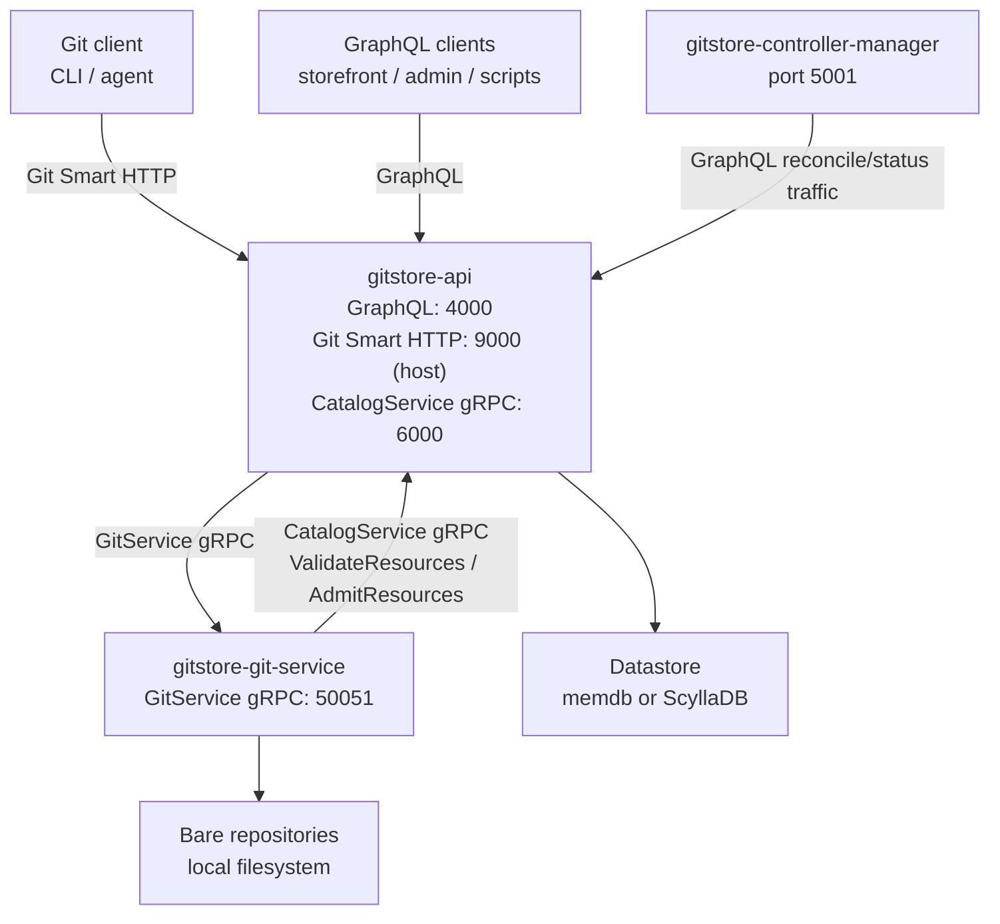

# GitStore Developer Guide

**Date**: 2026-10-11

**Audience**: Contributors, operators, and integration engineers
**Prerequisites**: Docker, Git, Go, Rust, Make, curl, jq

This guide keeps implementation detail out of the user guide. It covers service topology, local development, datastore backends, hook/admission flow, controller-manager runtime, generated schema/proto workflow, and module responsibilities.

For command discovery, selectors, prerequisites and safe examples, see the
[Make command reference](development/make-reference.md). Run `make help` from
the repository root for the current target list.

## Current Topology



## Ports

| Service                       |    Port | Purpose                                                |
|-------------------------------|--------:|--------------------------------------------------------|
| `gitstore-api`                |  `4000` | GraphQL, Playground, `/health`, `/ready`, login helper |
| `gitstore-api`                |  `9000` | Git Smart HTTP front door (host port)                  |
| `gitstore-api`                |  `6000` | CatalogService gRPC called by the Git service          |
| `gitstore-git-service`        | `50051` | GitService gRPC storage and transport                  |
| `gitstore-controller-manager` |  `5001` | `/health`, `/metrics`, poison-item API                 |

## Production Design Constraints

`gitstore-api`, `gitstore-controller-manager`, and
`gitstore-git-service` are the three core services. Features affecting them
must define behavior for their actual service topology. API/controller changes
must verify concurrent-replica behavior and rolling upgrades, naming any
unverified paths. Git is stateful and singleton-only; repository sharding and
placement-aware routing are not implemented. Keep one active Git process,
retain repository storage and use non-overlapping replacement. Do not turn
generic replica requirements into multi-Git or Git HA scope.

Production paths must also define:

- pluggable authentication and authorization for human, service, and agent identities;
- namespace and repository isolation at the owning service boundary;
- bounded queries, queues, workers, retries, timeouts, and payloads;
- capacity at a minimum catalogue size of 5,000,000 products;
- sustained Git push load and downstream backpressure behavior;
- repeatable replica, failover, load, soak, and recovery validation.

Future controllers and multi-controller deployments must also follow
[ADR 0018 — Controller Ownership, Concurrency and Fencing](ADRs/0018-controller-ownership-concurrency-and-fencing.md).
It separates logical ownership and conditional writes, which provide safety, from per-key leases,
which only provide liveness. It also separates CDC materializer leases from controller fencing.

Repository-wide capacity and fault tooling is exposed through the root
Makefile. Use `make capacity TARGET=<target> PROFILE=<scenario>
MODE=<diagnostic|alpha|production>` for offered-load and threshold
evidence, and `make chaos CHAOS_PROFILE=<profile>
CHAOS_TARGET=<gitstore-container> CHAOS_CONFIRM=1` for bounded container fault
injection. See [Production readiness testing](runbooks/production-readiness-testing.md)
for profile authoring, correctness-verifier, evidence, and safety requirements.

Capacity profiles share fixture identity, offered-work accounting and replica
evidence conventions across resource kinds. Scylla measurements follow the
[partition, filtering and hot-parent guidance](runbooks/namespace-admission.md#repository-membership-index):
bounded returned rows are not proof of bounded disk work.
The managed stack namespaces containers by Compose project, accepts
`CAPACITY_SCYLLA_KEYSPACE`, `POLICY_FILE` and `USERS_FILE`, and allows host-port
selection through `CAPACITY_API_{A,B}_PORT`, `CAPACITY_GIT_HTTP_{A,B}_PORT`,
`CAPACITY_CATALOG_{A,B}_PORT` and `CAPACITY_CONTROLLER_{A,B}_PORT`.
It rejects occupied ports and existing project containers/volumes before
startup, and retains datastore/Git/checkpoint volumes on shutdown.

For controlled Repository-only, File-only and combined diagnostics, set
`REPOSITORY_CAPACITY_WORKLOAD=repository|file|combined` with the lifecycle
profile in diagnostic mode and `REPOSITORY_CAPACITY_SKIP_REPLACEMENT=1`.
Each comparison seeds the same Repository/File pools on a provisioned owned
deployment before stabilization. File observations distinguish queue wait,
local Git preparation, Git HTTP and projection visibility; fixed error classes
never retain command output or response bodies. Repository observations separate
queue wait, per-resource client locking, mutation/retry latency and individual
HTTP attempts. Fixture creation waits for current-generation Namespace readiness
on both APIs; malformed or rejected operations are not treated as pending.
These comparisons do not run
the full dataset, replay, replacement or scheduled-fault acceptance gates.

Full-resource File, Namespace and Repository updates, like catalog updates,
must provide the expected durable resource version and a replacement version
that advances it exactly once. Metadata-only changes preserve generation but
still advance resource version. An identical admission may skip the write;
it must not send a same-version replacement to the datastore.

## Local Development

Start the Docker stack:

```bash
make compose DETACH=1
make ps
```

This starts all three core services through the `local` Compose profile using
the shared, read-only `config/config.toml` and `config/policy.yaml` fixtures. No
service `.env` file is required. The local login is `admin` / `admin123`.
Choose an alternate shared file with
`make compose CONFIG_FILE=./config/config.stage.toml`; the selected host path
is mounted at the same container path for every service.

Run native Git and API services in separate terminals (with their required
environment configuration):

```bash
make git
make api
```

Once the API is listening, follow the controller setup below. Alternatively,
`make dev` generates/enrolls local credentials and runs all three core services
together in the foreground with shutdown trapping:

```bash
make dev
```

Bootstrap local control-plane resources through GraphQL:

```bash
make bootstrap TARGET=all ADMIN_PASSWORD=<admin-password>
```

Useful variables:

| Variable          | Default                         | Purpose                                     |
|-------------------|---------------------------------|---------------------------------------------|
| `API_URL`         | `http://localhost:4000/graphql` | Bootstrap GraphQL endpoint                  |
| `ADMIN_USERNAME`  | `admin`                         | Login username                              |
| `ADMIN_PASSWORD`  | unset                           | Login password for bootstrap token creation |
| `BOOTSTRAP_TOKEN` | unset                           | Reuse an existing bearer token              |
| `NAMESPACE`       | `gitstore-test`                 | Namespace to create                         |
| `REPOSITORY`      | `catalog`                       | Repository to create                        |
| `DEFAULT_BRANCH`  | `main`                          | Repository default branch                   |
| `CONFIG_FILE`     | `./config/config.toml`          | Shared local Compose configuration          |

### Native controller credentials: generate → enroll → run

With a running local API and the shipped development identity/policy fixtures:

```bash
make secret TARGET=signing-key
make enroll-controller-serviceaccount
make controller
```

Each command has a separate responsibility:

| Command                                 | Result with native defaults                                                                                                                                                                          |
|-----------------------------------------|------------------------------------------------------------------------------------------------------------------------------------------------------------------------------------------------------|
| `make secret TARGET=signing-key`        | Creates `.gitstore/secrets/controller-manager/privateKey` and `.gitstore/secrets/controller-manager.json`, containing the matching private key and `controller-key` ID. No API connection is needed. |
| `make enroll-controller-serviceaccount` | Registers the public key with the API and saves its assigned UID to `.gitstore/secrets/controller-manager/serviceaccount.env`. Does not write the JSON record or generate private material.          |
| `make controller`                       | Uses that JSON record and UID to run the controller. Missing material is an error; startup does not generate it.                                                                                     |

The PEM and JSON record are private files (mode `0600`); never commit them or
mount the controller record into the API/Git service. Re-running generation
preserves an existing key and identical record. A different record/key ID is
rejected, not overwritten; follow the
[rotation runbook](runbooks/secret-material-rotation.md) for rotation.

Enrollment uses `API_URL` (default `http://localhost:4000/graphql`) and
`DEV_ADMIN_USERNAME` / `DEV_ADMIN_PASSWORD` (local fixtures: `admin` / `admin123`).
It re-enrolls the selected key ID with `--replace-existing-key`; it does not
grant RBAC permissions. The shipped policy already binds the cluster-scoped
`gitstore-controller-manager` account. No ServiceAccount namespace is accepted.

Use the same `CONTROLLER_SECRET_DIR` (absolute path), `CONTROLLER_SECRET_NAME`,
`CONTROLLER_SECRET_KEY`, and `CONTROLLER_SERVICEACCOUNT_KEY_ID` overrides across
all three commands. For example, export them before running the sequence.
`CONTROLLER_SERVICEACCOUNT_NAME` selects the account, while
`CONTROLLER_SERVICEACCOUNT_IDENTITY_FILE` can override the UID file destination.
Changing the account name also requires matching policy bindings.

For a custom signing-key destination, Make writes `<DESTINATION_PATH>.json` by
default. Override `RECORD_OUTPUT_PATH` explicitly when the record must match a
configured `key_ref.name`; relative paths resolve from the repository root:

```bash
make secret TARGET=signing-key \
  DESTINATION_PATH=/run/controller-secrets/gitstore-controller-manager-signing-key \
  RECORD_OUTPUT_PATH=/run/controller-secrets/gitstore-controller-manager-signing-key.json \
  CONTROLLER_SERVICEACCOUNT_KEY_ID=controller-key
```

These output-path overrides apply to generation only; they do not reconfigure
enrollment or controller startup. For a separate API issuer PEM without a
controller record, use `RECORD_OUTPUT_PATH=` explicitly. Never reuse the
controller private key as the API issuer key.

`make compose` and `make dev` already automate their own generation and
enrollment; the manual sequence above is for separately started native services.
Compose keeps its credentials in dedicated volumes, separate from native files.

## Datastore Backends

`gitstore-api` owns the application datastore abstraction.

| Backend  | Use                         | Notes                                      |
|----------|-----------------------------|--------------------------------------------|
| `memdb`  | Development and fast tests  | In-memory only; no persistence             |
| `scylla` | Production-oriented backend | Uses ScyllaDB 5.x+ and embedded migrations |

Start Scylla services only:

```bash
make scylla DETACH=1
```

`make scylla` uses the CI-friendly single-node overlay from
`compose.scylla.yml` (`--smp=1`, replication factor 1). For local
multi-node validation, start the three-node overlay instead:

```bash
make scylla PROFILE=cluster DETACH=1
```

The cluster overlay uses `compose.scylla.cluster.yml`, creates three Scylla
nodes, and initializes the `gitstore` keyspace with replication factor 3.
Override `SCYLLA_CLUSTER_SMP` to change the CPU shard count per Scylla node,
for example `SCYLLA_CLUSTER_SMP=2 make scylla PROFILE=cluster DETACH=1`.
The default is `1`, with
`SCYLLA_CLUSTER_MAX_NETWORKING_IO_CONTROL_BLOCKS=2048`, so the three-node
topology starts reliably on Docker Desktop without requiring host AIO tuning.

Start the full stack with the default in-memory datastore:

```bash
make compose DETACH=1
```

Start the full stack with single-node Scylla:

```bash
make compose DATASTORE=scylla DETACH=1
```

To run the full stack against the three-node local cluster:

```bash
make compose DATASTORE=scylla PROFILE=cluster DETACH=1
```

Lifecycle helpers (`make ps`, `make logs`, `make stop`, and `make down`) load
both Scylla overlays so they can see services started by either profile.
`SERVICE=scylla` is treated as a convenience alias for all Scylla variants
(`scylla`, `scylla-1`, `scylla-2`, `scylla-3`, and `scylla-init`):

```bash
make logs SERVICE=scylla
make stop SERVICE=scylla
make down
```

Run Scylla-backed API datastore tests after Scylla is reachable:

```bash
cd gitstore-api
GITSTORE_TEST_SCYLLA_ADDR=127.0.0.1:9042 \
  go test -tags scylla -v -timeout 10m ./tests/contract/datastore/... ./internal/datastore/scylla/...
```

### Projection audit, repair, and capacity validation

The operational CLI compares authoritative Namespace, Repository, Product,
CategoryTaxonomy, Collection, and ProductVariant rows with their query
projections:

```bash
cd gitstore-api
GITSTORE_API__DATASTORE__SCYLLA__HOSTS=127.0.0.1:9042 \
  go run ./cmd/gitctl scylla-projection-audit
GITSTORE_API__DATASTORE__SCYLLA__HOSTS=127.0.0.1:9042 \
  go run ./cmd/gitctl scylla-projection-repair --dry-run
GITSTORE_API__DATASTORE__SCYLLA__HOSTS=127.0.0.1:9042 \
  go run ./cmd/gitctl scylla-projection-repair --confirm
```

Plans are stable JSON. Apply checks authoritative identity/resource version,
uses conditional projection mutations, and performs a post-repair audit. Never
reuse an old plan after a concurrent-writer error; audit again. Full operator
procedure: [`runbooks/scylla-projection-repair.md`](runbooks/scylla-projection-repair.md).

Datastore contracts use fresh, isolated test keyspaces and leave application
keyspaces untouched. Both Scylla test suites default to replication factor 1.
For an owned three-node test cluster, select replication factor 3 explicitly:

```bash
GITSTORE_TEST_SCYLLA_REPLICATION_FACTOR=3 \
  make test TARGET=datastore DATASTORE=scylla SCYLLA_TEST_ADDR=127.0.0.1:9042
```

The contract fixture verifies the server's actual keyspace replication settings
and reports cleanup errors. Its schema-only sessions allow up to one minute per
operation for replicated create/drop work; datastore request timeouts and service
deadlines are unchanged. This is functional contract coverage, not a
sustained-load or capacity gate.

The capacity test is intentionally opt-in and requires a dedicated preloaded
Scylla environment:

```bash
cd gitstore-api
SCYLLA_TEST_ADDR=127.0.0.1:9042 \
GITSTORE_SCYLLA_CAPACITY_RUN=1 \
GITSTORE_SCYLLA_CAPACITY_PRODUCTS=5000000 \
go test -tags scylla -run 'TestScyllaCapacity' -count=1 -timeout 30m \
  ./internal/datastore/scylla
```

It asserts the 100 MiB partition ceiling, 10 MiB hot target, bounded page
limits, sustained projection mutation, and two independent clients. Add
`GITSTORE_SCYLLA_CAPACITY_SOAK_DURATION=2h` only for a scheduled soak.

## Git And Admission Flow

The API is the Git Smart HTTP front door. The Rust Git service is gRPC-only storage and transport.

1. A Git client clones, fetches, or pushes to `http://localhost:9000/{namespace}/{repo}.git`.
2. `gitstore-api` resolves `{namespace}/{repo}` to the stable repository ID stored in the datastore.
3. `gitstore-api` forwards Git transport work to `gitstore-git-service` through `GitService` gRPC.
4. During receive-pack, `gitstore-git-service` stages objects in quarantine and runs enabled hook phases.
5. In the blocking pre-receive phase, `gitstore-git-service` sends frontmatter resource blobs to `gitstore-api` via `CatalogService.ValidateResources`; when a resource is removed, it additionally sends the old and proposed trees to `CatalogService.ValidateResourceDeletions`.
6. If validation passes, refs are updated and the push succeeds.
7. In the post-receive phase, `gitstore-git-service` calls `CatalogService.AdmitResources` with repository ID, ref name, old commit SHA, and new commit SHA. New callers populate `new_commit_sha`; the deprecated `commit_sha` tag remains reserved for mixed-version decoding only.
8. `gitstore-api` verifies that the ref still points at the admitted new commit, skips stale admissions if a newer push already won, compares old/new resource identities, applies admission checks, and creates, updates, or deletes hydrated records in the datastore.
9. `gitstore-controller-manager` reconciles controller-owned status and operational follow-up through the API.

The pre-receive phase is intentionally stateless and blocking. Admission can use datastore state and is allowed to complete asynchronously relative to the Git client acknowledgement.

The asynchronous dispatcher waits for the admission handler's actual callback
responses; the handler does not detach another task per ref. It attempts every
matching ref, logs each failure and returns an error if any callback failed.
`hook_phase_complete` with `outcome="accepted"` is emitted only after the handler
finishes successfully, not when it is dispatched. Callback timing includes the
RPC.

Post-receive callbacks are dispatched in-process without a persistent retry
queue. A service restart or callback failure can therefore leave Git changes
without a completed catalog projection. Git acknowledgement is not proof of
catalog admission; verify accepted content and current-generation readiness
through the API before treating bulk authoring as complete.

Changed-path computation propagates missing commits and unreadable subtrees;
it cannot acknowledge a partial diff as successful delivery. Identical trees
produce no admission call, rather than an empty-path legacy full scan.

Admission identity is `apiVersion`, `kind`, resolved namespace, and `metadata.name`; the Git file path is stored as provenance only. A path move with the same identity preserves `metadata.uid` and only increments `resourceVersion`. Spec/body edits increment both `generation` and `resourceVersion`. Deleting a resource file removes the stored identity; adding the same identity again later allocates a new UID.

Post-receive admission cannot reject an already accepted Git push. DB-backed conflicts such as duplicate `ProductVariant.spec.sku` leave the existing resource unchanged, skip the conflicting incoming resource, and emit structured API logs with the operation, namespace, name, SKU, and conflicting identity.

## Controller Manager Runtime

`gitstore-controller-manager` provides the shared runtime for level-triggered controllers.

Runtime pieces:

- Work queues keyed by kind, namespace, and name.
- Worker pools via `pond`.
- Retry and backoff via `cenkalti/backoff`.
- Quarantine for poison items after repeated failures.
- Panic capture with stack traces.
- Per-kind health statistics.
- Prometheus metrics.
- List-then-watch bootstrap and `resourceVersion` checkpointing per registered kind (`internal/checkpoint`, `internal/listwatch`) — populates the informer cache on first start, resumes a watch stream from a persisted checkpoint after a restart, and recovers from a compacted watch cursor by re-listing (the `Runner[T]`/`ListWatcher[T]` wiring pattern); no concrete transport ships yet.

HTTP surface on port `5001`:

| Route                                                          | Purpose                                                              |
|----------------------------------------------------------------|----------------------------------------------------------------------|
| `GET /health`                                                  | Returns `ok` or `degraded` based on stalled workers and poison items |
| `GET /metrics`                                                 | Prometheus metrics                                                   |
| `GET /controller/v1/poison/{kind}`                             | List quarantined items for one kind                                  |
| `GET /controller/v1/poison/_all`                               | List all quarantined items                                           |
| `POST /controller/v1/poison/{namespace}/{kind}/{name}/requeue` | Requeue one poison item                                              |

## Module Notes

### `gitstore-api`

Purpose:

- GraphQL API and Relay-style schema.
- Authentication and JWT sessions.
- Namespace and repository control plane.
- Git Smart HTTP handler.
- CatalogService gRPC server for push validation and admission.
- Datastore abstraction and backend implementations.

Important directories:

| Path                   | Purpose                             |
|------------------------|-------------------------------------|
| `cmd/server`           | API entrypoint                      |
| `internal/app`         | Runtime composition                 |
| `internal/graph`       | gqlgen resolvers and generated code |
| `internal/githttp`     | Smart HTTP front door               |
| `internal/gitclient`   | GitService gRPC client              |
| `internal/cataloggrpc` | CatalogService gRPC implementation  |
| `internal/datastore`   | Datastore abstraction and backends  |
| `internal/validate`    | Frontmatter resource validation     |

Commands:

```bash
make api
cd gitstore-api
go test ./...
go generate ./...
```

### `gitstore-git-service`

Purpose:

- Own bare repository storage.
- Serve GitService gRPC operations for repository lifecycle, ref advertisement, receive-pack, upload-pack, file reads, commits, deletes, and tags.
- Run receive hook phases and call the API CatalogService.

Important directories:

| Path                | Purpose                                               |
|---------------------|-------------------------------------------------------|
| `src/grpc`          | Tonic GitService server                               |
| `src/git`           | Repository and pack protocol logic                    |
| `src/git/hooks`     | Receive hook pipeline, validation, admission callouts |
| `gen`               | Generated Rust proto bindings                         |
| `tests/integration` | Rust integration tests                                |

Commands:

```bash
make git
cd gitstore-git-service
cargo test
cargo test --test integration
cargo build --release
```

Concurrent `GetFile` and `GetFiles` requests can share native object-store
indexes while retaining fresh per-request configuration and reference stores.
The sharing registry has 16 weak slots: it does not keep repository indexes
alive after their active readers finish. Authentication, repository locks and
source-proof budgets are unchanged.

The ignored `test_file_history_wide_tree_diagnostic` test accepts
`GITSTORE_READ_DIAGNOSTIC_REPOSITORY` and
`GITSTORE_READ_DIAGNOSTIC_MANIFEST` for an explicitly supplied, read-only
25,000-entry acknowledged fixture. It compares fresh handles, shared object
stores and active-reader sharing, checking identical commit IDs, blob IDs and
contents. These library timings do not establish RPC, push-acknowledgment or
sustained-load performance.

`GetFile` supports an explicit `prove_path_absence` mode with a named ref,
path and `unchanged_since_commit`. It checks the path is absent at the ancestor
and every intervening tree through the guarded current-ref snapshot. The
history walk has the same per-RPC 4,096-edge and one-second limits as unchanged-file
proofs; merges, unrelated history and a recreated path fail closed. Even exact
ancestor/tip equality requires a tree read, not an ancestor-only receipt.
Exhausting either budget returns `RESOURCE_EXHAUSTED`, not a source-divergence
result. An exhausted native read can return a verified prefix in a bounded
2 KiB `x-gitstore-file-history-bin` error trailer. This is still an RPC failure,
never a successful or complete proof; its cursor names the first unverified
parent. Successful responses never carry a continuation cursor.

The Go client can continue at immutable commits, checking the path, original
ancestor, cursor linkage and identical blob ID or continuous absence throughout.
It makes at most eight RPCs within the caller's unchanged context deadline,
rejects malformed or cyclic progress, and returns no content before reaching
the ancestor. A segmented named-ref proof then rechecks the current ref against
its verified head; advancement must also prove unchanged history. Thus an old
Product source can span multiple bounded reads without treating matching
endpoints as evidence that intermediate writes never happened. RPC exhaustion
remains observable even when the overall proof eventually succeeds.

Requests and signing are unchanged. Older Git services without prefix trailers
still return their original exhaustion errors; older API clients still see
failure from a new service. If continuation or its final ref check exhausts
the caller's bounds, the API propagates the failure rather than treating an
unproven manifest as superseded. These bounded proofs do not establish
large-catalog lifecycle or sustained-load acceptance.

The Go client's `ReadCurrentFileAbsenceForRepo` requires an explicit
`path_absent` response with matching path/ancestor and a full current commit ID.
It rejects blob data, ancestor-only receipts and legacy default responses.
Upgrade the singleton Git service before enabling this request mode in API
callers; missing support and ordinary `NotFound` errors are not proof.
This is snapshot evidence, not a datastore UID binding, an atomic
Git/datastore transaction or a durable callback-replay mechanism.

Product removals, including current-tip callbacks, combine this proof with
a persisted deletion reservation before verification. The API first proves the
stored source's lineage through the original pre-removal commit, then reserves its UID and
proves continuous absence from the accepted removal. Each fresh acquisition
uses a random token; resuming an existing acquisition preserves its token,
while release and reacquisition invalidate older proofs. The token remains
held through the termination CAS, and controller status patches preserve it.
Failure cleanup must match the exact acquisition, not just actor and commits.
For branch deletion, `ListFiles.prove_ref_absence` instead requires a named
ref, empty prefix and nonrecursive mode. Under the owned snapshot read guard,
an accessible repository with no such ref returns only its matching
`ref_absent`. Present, corrupt or inaccessible targets do not prove absence.
The Go client rejects ordinary `NotFound`, legacy empty replies and unsolicited
ref-absence receipts in ordinary listings or ref resolution.
All participating API writers must honor and preserve these intents. Older
writers that ignore them cannot safely overlap this protocol: quiesce
publications and admission during such an upgrade rather than treating it as
a compatible rolling change. Deployed rolling recovery requires separate
verification. Product status reservations are not a replay queue and do not
schedule recovery of interrupted admission.

A Product created during a Git admission attempt is reserved with its full
authored envelope before the final source check. Once that check and
authorization succeed, Scylla can complete admission with a conditional
status-and-resource-version write. The stored UID, source, actors, timestamps
and authored fields must still match; deletion and version changes reject
completion. Reverse owner-reference records retain the new resource version.
Only a successful create in the same attempt uses this path. Older pending
records, partial creates and conflict retries retain the full update and
projection-repair path. Completion checks parent eligibility, but does not
reacquire the membership writer reservation: the already-created child remains
a durable parent-deletion blocker, its identity and membership cannot change,
and its exact row version fences concurrent source and lifecycle writes.
Both paths use the existing `UpdateProduct` operation
metric, so comparisons include the complete datastore work.

Distinct Product-only admission batches use cohorts of at most four workers per
callback. After each cohort's lookups and authorization, same-Namespace
Products may share the datastore's existing parent mutation fence. That fence
remains held until every cohort worker finishes; it is not shared with deletion
or parent lifecycle operations. Each cohort releases it before the next cohort.
Each Product still performs its own authorization, source proofs, provisional
creation and version-fenced completion; there is no shared authorization or
source-proof shortcut. Decisions and combined errors retain input order, and
one Product's failure does not skip independent Products. Workers check
cancellation before starting another Product, and the callback waits for every
worker before completing. Fence acquisition or release failures are reported
for affected Products. A repair-required failure stops later cohorts rather
than continuing under an uncertain parent reservation.
Mixed-kind batches and repeated Product identities retain sequential admission,
including category dependency ordering and updates before deletions. This does
not change the native post-receive handler or add callback replay.

### `gitstore-controller-manager`

Purpose:

- Shared controller runtime.
- Level-triggered reconciliation primitives.
- Health, metrics, and poison-item management API.

Important directories:

| Path               | Purpose                           |
|--------------------|-----------------------------------|
| `cmd/controller`   | Controller manager entrypoint     |
| `internal/manager` | Runtime registration and dispatch |
| `internal/queue`   | Work queue                        |
| `internal/worker`  | Worker pool                       |
| `internal/retry`   | Backoff and quarantine            |
| `internal/health`  | Health and metrics handlers       |
| `internal/api`     | Poison-item API                   |
| `tests/contract`   | Runtime contract tests            |
| `tests/integration`| End-to-end scenario tests (real Manager + Runner + Store wired together) |

Commands:

```bash
make controller
cd gitstore-controller-manager
go test ./...
```

Operations runbooks:

| Runbook                                                                              | Symptom                                                          |
|--------------------------------------------------------------------------------------|------------------------------------------------------------------|
| [`controller-lag`](runbooks/controller-lag.md)                                       | Queue depth growing, reconciles falling behind                   |
| [`controller-replay-window-exceeded`](runbooks/controller-replay-window-exceeded.md) | Watch cursor expired / relist triggered                          |
| [`controller-poisoned-item`](runbooks/controller-poisoned-item.md)                   | A resource repeatedly fails reconciliation                       |
| [`controller-auth`](runbooks/controller-auth.md)                                     | Controller credential enrollment, renewal, or revocation failure |

## Generated Schema And Proto Workflow

### GraphQL

Schema files live in [shared/schemas](../shared/schemas/). gqlgen configuration lives in [gitstore-api/gqlgen.yml](../gitstore-api/gqlgen.yml).

When schema changes:

```bash
cd gitstore-api
go generate ./...
go test ./...
```

Generated files are under `gitstore-api/internal/graph/generated` and `gitstore-api/internal/graph/model`.

### Protobuf

Canonical proto contracts live in [shared/proto](../shared/proto/):

- `gitstore/git/v1/git_service.proto`
- `gitstore/catalog/v1/catalog_service.proto`

Generated Go stubs live in `gitstore-api/gen`. Generated Rust stubs live in `gitstore-git-service/gen`. The Rust build does not generate proto code at compile time; `build.rs` documents that stubs are generated by the repository's buf workflow.

Generation uses local plugins; proto source is not uploaded to remote plugin
services. Install the pinned generators once:

```bash
go install google.golang.org/protobuf/cmd/protoc-gen-go@v1.36.5
go install google.golang.org/grpc/cmd/protoc-gen-go-grpc@v1.5.1
cargo install protoc-gen-prost --version 0.5.0 --locked
cargo install protoc-gen-tonic --version 0.5.0 --locked
```

Put Go's binary directory and `~/.cargo/bin` on `PATH`. After proto changes:

```bash
make generate TARGET=proto
make build
make test
```

## Tests And PR Readiness

Category-to-Product membership writes are retryable across API replicas. A retry
of the same resource version completes a missing forward-index write after the
reverse-index write has succeeded; an older retry cannot restore a membership
superseded by a newer reverse-index version. Concurrent membership fencing
propagates category lookup failures rather than treating them as absent categories.

The API uses a license-preserving local copy of its pinned Scylla CDC reader
under `shared/scylla-cdc-go`. A minimal shutdown patch releases the generation
producer on cancellation and consumer errors, allowing current-version
materializer replacement to finish. Root Go build, test and lint commands include
this module; the API container includes the same sources. Its `NOTICE.md`
documents provenance, the patch and removal criteria.

Catalog connection reads propagate their request context through Scylla queries,
including Product, ProductVariant, Collection and CategoryTaxonomy. UID, name,
SKU and authoritative key hydration carry the same context. Cancellation
and deadlines must not be discarded. Capacity instrumentation can attach a
runtime-only query observer; it cannot be enabled through configuration files and
must never retain bound values containing resource or credential data.

Category product pages merge per-shard frontiers and refill exhausted shards
when projection rows no longer hydrate. A stale hot shard must not produce an
underfilled page, hide live members, or imply another live page in the reverse
direction. Refills share the existing projection-list bounds of 256 queries
and 4,096 hydration attempts; exhaustion fails explicitly and requires repair,
rather than returning a partial successful page. The connection maximum remains
250 rows. The in-memory category index binds replacements to the current
authoritative Product version and removes projection entries for deleted UIDs.
Category membership removal accepts the version being removed while protecting
newer versions, removes the forward entry before its reverse retry marker, and
cleans up projection writes that race with authoritative Product deletion.

Focused checks:

```bash
cd gitstore-api
go test ./...

cd ../gitstore-controller-manager
go test ./...

cd ../gitstore-git-service
cargo test
```

Aggregate checks:

```bash
make build
make test
make lint
make check TARGET=licenses
make check TARGET=credentials
make pr-ready
```

Install local hooks once per clone:

```bash
./scripts/install-git-hooks.sh
```

Use Conventional Commits.

## Configuration Highlights

### API

| Env var                               | Default                  | Purpose                  |
|---------------------------------------|--------------------------|--------------------------|
| `GITSTORE_API__PORT`                  | `4000`                   | GraphQL HTTP port        |
| `GITSTORE_API__GIT_PORT`              | `9000`                   | Git Smart HTTP port      |
| `GITSTORE_API__GRPC_PORT`             | `6000`                   | CatalogService gRPC port |
| `GITSTORE_API__GIT_SERVICE__URI`      | `dns:///localhost:50051` | GitService gRPC target   |
| `GITSTORE_API__DATASTORE__BACKEND`    | `memdb`                  | `memdb` or `scylla`      |
| `GITSTORE_API__AUTH__JWT__SECRET`     | unset                    | JWT signing secret       |
| `GITSTORE_API__AUTH__SERVICEACCOUNT__SIGNING_KEY` | unset | API-only service-account access-token signing key; required when service-account providers are enabled |

### Git Service

| Env var                                     | Default                   | Purpose                     |
|-----------------------------------------------|------------------------------|--------------------------------|
| `GITSTORE_GIT_SERVICE__GRPC_PORT`           | `50051`                   | GitService gRPC port        |
| `GITSTORE_GIT_SERVICE__DATA_DIR`            | `/var/lib/gitstore/repos` | Bare repository root        |
| `GITSTORE_PUSH_LIMITS__MAX_FILE_SIZE`       | `100MiB`                  | Shared platform file-size ceiling (IEC size string) |
| `GITSTORE_GIT_SERVICE__CATALOG__URI`        | `dns:///localhost:6000`   | API CatalogService target (`dns:///host:port`) |

### Controller Manager

See [configuration.md](configuration.md) for canonical controller settings,
environment variables, defaults, and bootstrap requirements.

## Related Docs

- [User Guide](user-guide.md)
- [API Reference](api-reference.md)
- [Architecture](architecture/README.md)
- [Admin](admin/README.md)
- [Push Validation](products/push-validation.md)
- [CategoryTaxonomy Spec](categories/category-taxonomy-spec.md)
- [Collection Spec](collections/collection-spec.md)
- [ProductVariant Spec](products/product-variant-spec.md)
- [Release Process](runbooks/release-process.md)
- [Production Readiness Testing](runbooks/production-readiness-testing.md)
