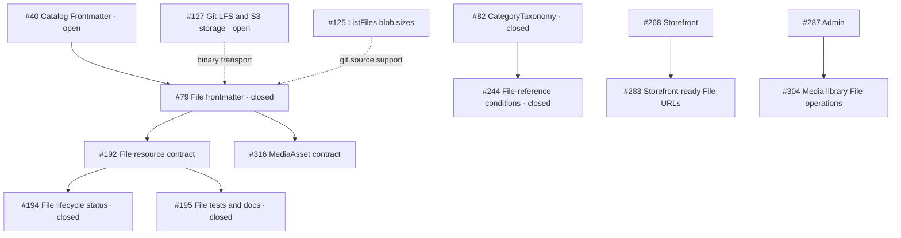
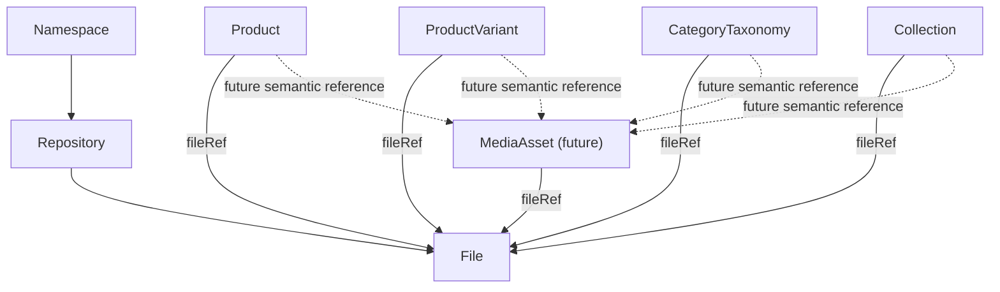
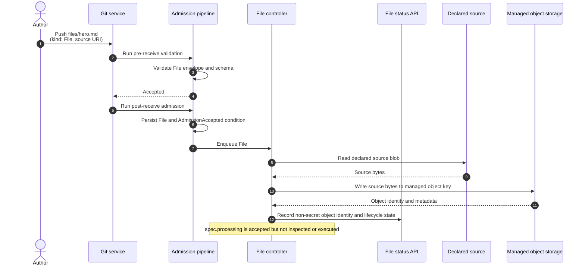
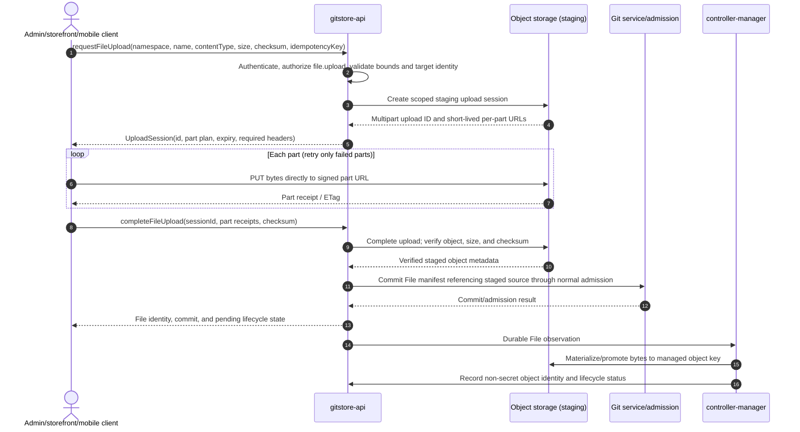
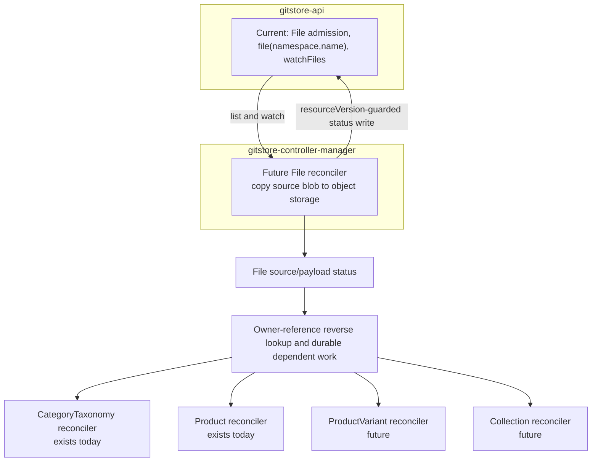

# File and Media Resource Lifecycle: Architecture Decision Document

**Status**: 🟡 Architecture synthesis; implementation state updated 2026-10-14
**Original design date**: 2026-08-09
**Audience**: GitStore API, controller-manager, and catalog authors.
**Feeds**: ADR-0008, specs 051/056/063/064, ADR-0015, GH#127, GH#283, GH#304, GH#316, GH#378.

This document records the File/media architecture and its evolution. The
original August proposal below was written before the File resource shipped and
before the current admission, secret, authorization, and cost contracts. The
current-direction summary and section status labels supersede older
recommendations and phase tables wherever they conflict. This document is not
an implementation claim; use the linked specs and ADRs for normative behavior.

---

## 1. Current direction

- **File already exists as a namespaced Git-backed resource.** Spec 051
  delivered its manifest contract, datastore record, admission, read query,
  and durable watch. It is not accurate to describe File as nonexistent or
  GH#79 as open.
- **Payload phase 1 is deliberately narrow:** retrieve the declared source
  blob and put it in configured object storage. Accept `spec.processing` as
  desired-state data but ignore it. Do not launch format transformations in
  this phase.
- **Storage/output shape is not the client presentation shape.** Do not put
  HTML `src`/`srcset` into the File manifest. GH#283 owns the storefront URL
  contract; storefront, admin, and mobile adapters can map resolved asset and
  rendition metadata to their native image-source APIs.
- **Spec 056 is the draft follow-on** for File reference ownership/deletion
  safety and production source access/verification, including renewable AWS
  and Backblaze B2 access. It supersedes the old blocking-delete and
  permanent-`Unknown` assumptions here.
- **Spec 063 defines the secret-material boundary and typed references.** Its
  implementation wires the controller bootstrap identity and reusable
  runtime resolver, but explicitly defers File as a runtime consumer. Spec 056
  owns that integration and renewable File source access. No secret bytes or
  bearer URLs belong in Git, status, durable controller state, or logs.
- **Resource scope is explicit.** Spec 064 implements Cluster vs Namespaced
  RBAC resources and scope-aware bindings (deployed capacity acceptance is
  still tracked separately). File is namespaced; ServiceAccounts are
  cluster-scoped and name-only. Cluster-scoped registrations/configuration
  follow the `gitstore-system/gitstore-system` admission convention and
  cluster-level authorization; a File namespace cannot install or select an
  arbitrary processor.
- **Lifecycle diagnostics follow ADR-0015.** Standard API error codes are
  `ADMISSION_REJECTED`, `ALREADY_EXISTS`, `NOT_FOUND`, `CONFLICT`,
  `FAILED_PRECONDITION`, `BAD_USER_INPUT`, and `FORBIDDEN`. Structured
  diagnostics use `code`/`diagnostics`, with `phase` for admission rejection
  and `commit` where applicable. Spec 057 partially implements this API
  envelope for Namespace and CategoryTaxonomy. Git receive-pack still returns
  its rejection as `ng <ref> <reason>`; ADR-0015 does not promise GraphQL
  codes or source positions in that text. File-specific mutations do not yet
  exist.
- **ADR-0015 defines the extension seam.** Extension authors can register
  asynchronous event subscriptions and lifecycle gates. For example, a
  malware scanner can consume committed payload events and provide signed
  external-attestation evidence that a File `Ready` gate evaluates. Payload
  facts do not block Git push admission, and untrusted scanners do not run
  synchronously in receive-pack.
- **GraphQL cost directives remain proposed** in doc 038. New File queries,
  connections, and nested media fields should receive declared `@cost` and
  `@listSize` weights when that proposal is implemented; costs must reflect
  bounded pages and reconciliation work.

This document's original option studies remain useful background. The current
delivery order and acceptance criteria are the feature specs, especially 051,
056, 063, and 064.

## 2. Implemented baseline and remaining work

The implementation table and issue graph that follow are the original
2026-08-09 research snapshot; their negative File-implementation claims are
superseded. Current state: spec 051 delivered File's manifest, datastore,
admission, `file(by)` query, and durable `watchFiles`. There is
no File list connection or File-specific create/update/delete mutation in the
current GraphQL schema, and no source-materialization reconciler in the
controller-manager. The initial payload phase is to retrieve the source blob,
write it to configured object storage, and ignore `spec.processing`.

| Area | Current state | Source of truth |
|---|---|---|
| File manifest and status contract | Implemented by spec 051; admission currently sets `AdmissionAccepted=True` and optimistic `Ready=True`. | [spec 051](../../specs/051-file-resource-contract/spec.md) |
| File read/watch | `file(by)` and durable `watchFiles` are present. | `shared/schemas/file.graphqls`, `file.resolvers.go`, catalog CDC source |
| File list and File-specific write mutations | Not exposed in current File GraphQL schema. Git-backed manifest admission is the authoring path. | `shared/schemas/file.graphqls` |
| Payload processing | Initial controller phase retrieves source blob into configured object storage; `spec.processing` is ignored. Transformation execution is a later design. | Current design direction; future implementation spec |
| Renewable source access, source verification, reference safety | Draft scope in spec 056, built on secret-material boundary from spec 063. | [spec 056](../../specs/056-file-reference-safety/spec.md), [spec 063](../../specs/063-implement-secret-adrs/spec.md) |
| Mutation diagnostics | ADR-0015 defines standard codes and diagnostics; spec 057 partly implements the envelope for Namespace and CategoryTaxonomy. | [ADR 0015](../ADRs/0015-resource-lifecycle-hooks.md), [spec 057 contract](../../specs/057-categorytaxonomy-path-freshness/contracts/admission-diagnostics.md) |
| Resource scope and authorization | Spec 064 implements Cluster vs Namespaced RBAC resources and bindings; File is namespaced and ServiceAccounts are cluster-scoped/name-only. Deployed capacity acceptance remains deferred. | [spec 064](../../specs/064-authz-action-vocabulary/spec.md) |
| GraphQL cost directives | Proposed in doc 038, not implemented. Annotate future File list/nested fields when adopted. | [doc 038](038-graphql-cost-and-rate-limits.md) |

**Historical snapshot (2026-08-09; superseded by the current-state table
above).** The component inventory and blocking-gap statement below describe
the pre-spec-051 state and must not be used to assess current implementation.

| Component                                                                                                                             | State                                                  | Evidence                                                                                                                                                                                                                                                                                                                                                                                                       |
|---------------------------------------------------------------------------------------------------------------------------------------|--------------------------------------------------------|----------------------------------------------------------------------------------------------------------------------------------------------------------------------------------------------------------------------------------------------------------------------------------------------------------------------------------------------------------------------------------------------------------------|
| `File` GraphQL type / `createFile`/`updateFile`/`deleteFile`/`file`/`files`                                                           | **Not implemented**                                    | No `.graphqls` schema file defines `File` or any File mutation/query anywhere under `gitstore-api/internal/graph`.                                                                                                                                                                                                                                                                                             |
| `File` Go struct / datastore table                                                                                                    | **Not implemented**                                    | `gitstore-api/internal/datastore/entities.go` defines `Namespace`, `Product`, `CategoryTaxonomy`, `Collection`, `ProductVariant`, `Repository`, `NamespaceMapping` — no `File`. Only `FileReference` exists (`gitstore-api/internal/catalog/product.go:67-71`), a `{Name, Kind, Optional}` *pointer* struct embedded in `MediaDefinition`, not a File record.                                                  |
| `File` in `gitstore-api/internal/cataloggrpc/`                                                                                        | **Not implemented**                                    | No File references in that package.                                                                                                                                                                                                                                                                                                                                                                            |
| `ResolvedFileDefinition{Name, URL, ContentType}` (`gitstore-api/internal/catalog/status.go:87-91`)                                    | **Shape exists, never populated** in a production path | The only place `ResolvedFileDefinition{...}` is constructed in the whole tree is a unit-test fixture (`product_test.go:182`). `DatastoreProductToGraphQL` round-trips `status.resolved` verbatim from the stored JSON blob; it performs no File lookup.                                                                                                                                                        |
| `CategoryTaxonomyStatus.Resolved` (`ResolvedCategoryTaxonomy`, `status.go:121-131`)                                                   | **Has no `Media` field at all**                        | Unlike `ResolvedProductDefinition.Media []ResolvedFileDefinition`, `ResolvedCategoryTaxonomy` only has `Depth`, `Path`, `Ancestors`, `ChildCount`, `ProductCount` — there is currently no place to put resolved category media even if a File existed. This is a schema gap, not just a resolution gap.                                                                                                        |
| CategoryTaxonomy controller's fileRef handling                                                                                        | **Implemented, intentionally hardcoded**               | `gitstore-controller-manager/internal/categorytaxonomy/fileref.go:12-35`, `computeFileRefCondition`: for every `optional: false` media entry, unconditionally emits `FileRefConfirmed=Unknown, Reason=FileNotQueryable` — no GraphQL/datastore query is attempted, by design, per `specs/039-category-taxonomy-reconciler/research.md` R5 ("No datastore or GraphQL query for `File` existence is attempted"). |
| File controller/reconciler                                                                                                            | **Not implemented**                                    | `gitstore-controller-manager/internal/` has exactly one resource-kind package: `categorytaxonomy`. No `file` package.                                                                                                                                                                                                                                                                                          |
| Generic watch/status/cache plumbing (`listwatch.ListWatcher[T]`, `status.StatusClient`, `cache.CacheAccessor[T]`, `types.Reconciler`) | **Implemented and reusable as-is**                     | `listwatch/listwatcher.go` interfaces are unparameterized-by-kind generics; `CategoryTaxonomyListWatcher` (spec 040) is the *first* concrete instance, not a hardwired dependency. A `FileListWatcher` needs zero interface changes — only a File GraphQL query/subscription on the `gitstore-api` side and a new reconciler package.                                                                          |
| Product/ProductVariant/Collection reconcilers                                                                                         | **Do not exist at all**                                | Only CategoryTaxonomy has a controller package today. These ADRs (0004/0005/0007) all defer `MediaResolved` to "Phase 2, GH#244" but there is no reconciler loop to even attempt it — CategoryTaxonomy is *ahead* of the others by having an explicit (if degenerate) condition.                                                                                                                               |

**Historical blocking-gap statement (superseded):** it is not that CategoryTaxonomy's
controller has a bug. It is that **File does not exist as a resource
anywhere in the system** — no schema, no table, no GraphQL surface, no
reconciler. `computeFileRefCondition` is a correct implementation of "we
have nothing to query," not a broken implementation of "we forgot to
query." Fixing this requires building File from the ground up, not patching
the CategoryTaxonomy controller.

### Issue lineage (GitHub state checked 2026-10-14)



The source-resolution initiative now continues through open #283 (storefront
URLs), #304 (admin File operations), #316 (MediaAsset), and #378 (File
reference safety); #127 remains open for LFS/object storage. Issues #79,
#192, #194, #195, #244, and #82 are closed. The graph above is historical
lineage, not a claim that all linked work remains open or is blocked on File
being queryable.

## 3. File/Media terminology and ownership model

Confirmed as the right split — do not merge these, per `docs/ADRs/0008-file-lifecycle.md`
and `../resource-storage/git-backed.md` ("Do not model `MediaAsset` as a wrapper
around `File`"):

| Resource                                                                                 | Owns                                                                                                                                                                                                               | Lifecycle driver                                                                                | Current state                                                                                                 |
|------------------------------------------------------------------------------------------|--------------------------------------------------------------------------------------------------------------------------------------------------------------------------------------------------------------------|-------------------------------------------------------------------------------------------------|---------------------------------------------------------------------------------------------------------------|
| **`File`**                                                                               | Namespaced technical source manifest: `contentType`, source reference, typed credentials reference, accepted processing hints, status, and future resolved payload metadata. One File represents one source asset. | Source access and managed object-storage materialization; later processing is a separate phase. | Manifest contract, datastore, admission, query and watch implemented; runtime controller remains future work. |
| **`MediaAsset`**                                                                         | Catalog-facing semantic layer: `fileRef`, `role`, `altTextRef`, `focalPoint`, ordering.                                                                                                                            | Presentation lifecycle, independent of the binary source.                                       | Open issue #316; not implemented.                                                                             |
| **Inline `spec.media[*].fileRef`** on Product/ProductVariant/CategoryTaxonomy/Collection | Typed same-namespace reference (`kind`, `name`, optionality) to a File.                                                                                                                                            | Consumer resource reconciliation.                                                               | Present on catalog resources; spec 056 defines safe resolution/deletion behavior.                             |

**Is `MediaAsset` necessary for the first useful implementation?** No.
`fileRef` today points directly at `File`. This is the reference shape for the
four catalog resource kinds; spec 056 defines resolution/deletion behavior,
but the File source controller and all dependent reconcilers are not thereby
implemented. `MediaAsset` adds a
second reference hop (`spec.media[*].fileRef` → `MediaAsset` → `File`) that
is valuable once multiple catalog resources need to share presentation
metadata (e.g., the same hero image with different alt text per product),
but is not required to answer "does this file exist and is it ready."
**Current direction:** keep File as the technical source and keep MediaAsset
as a separate semantic resource if/when #316 is implemented. File refs are
non-blocking on deletion under spec 056; a future MediaAsset reference must
preserve explicit kind, namespace, and UID identity semantics.

## 4. Resource dependency graph



No circular dependency: File never references a catalog resource (confirmed
in ADR-0008 §"Dependency graph position"). Spec 056 uses the existing indexed
owner-reference relation for resolved dependents; unresolved authored refs
remain a separate bounded recovery case.

## 5. Storage and controller option comparison

The tables in this section are design exploration, not a declaration that all
listed source types, URL forms, upload modes, or providers are implemented or
accepted for production. The current File schema permits source types `git`,
`lfs`, `s3`, and `gcs`. Spec 056's production acceptance scope is narrower and
explicitly includes AWS S3 workload/role credentials, rotating B2 S3-compatible
application keys, and B2 Native token renewal. Because B2 Native is not a
current File source enum, its representation must be resolved in the spec/plan
before implementation; this document does not silently extend the schema.

For the first payload-materialization phase, the invariant is simpler than the
provider comparison: retrieve the declared source blob and write those bytes
to configured object storage. This phase ignores `spec.processing`.

### Storage backend comparison

| Option                            | Max practical size                                                                   | Git impact                                                      | Dedup/CAS                                                                                               | Resumable                                                                                                          | Signed URLs                                                                                                                           | Local/Compose dev                                                                                                                                                      | Recommendation                                                                                                                                            |
|-----------------------------------|--------------------------------------------------------------------------------------|-----------------------------------------------------------------|---------------------------------------------------------------------------------------------------------|--------------------------------------------------------------------------------------------------------------------|---------------------------------------------------------------------------------------------------------------------------------------|------------------------------------------------------------------------------------------------------------------------------------------------------------------------|-----------------------------------------------------------------------------------------------------------------------------------------------------------|
| **Git LFS pointer**               | Multi-GB (LFS-server-limited); pointer is <1KB, always                               | None on primary repo (pointer only); LFS store grows separately | Yes — `oid` is `sha256:<hash>`, content-addressed by construction (verified: git-lfs.com, git-lfs spec) | Server-dependent (most LFS servers support resumable PUT)                                                          | Not standard; LFS uses its own auth handshake                                                                                         | Needs an LFS server (can run `git-lfs-test-server` or a Git host with LFS in Compose)                                                                                  | Use for **catalog-owned, versioned, low-churn** assets (product hero shots checked in with the catalog repo)                                              |
| **S3-compatible object storage**  | Multi-TB via multipart (AWS: switch to multipart ≥100MB — verified, AWS mpuoverview) | Zero                                                            | Only if the app computes/stores a content hash itself; S3 has no built-in CAS                           | Yes — multipart upload never expires until completed/aborted; failed parts retransmit individually (verified, AWS) | Yes — presigned URLs are **bearer tokens** inheriting the signer's IAM permissions, no further identity check (verified, AWS docs ×2) | MinIO (AIStor-compatible, supports full multipart lifecycle: Create/UploadPart/UploadPartCopy/ListParts/Complete/Abort — verified, MinIO docs) runs cleanly in Compose | Use for **generated, high-churn, PII-bearing, or CDN-fronted** assets (renditions, customer uploads, invoices)                                            |
| **External URL only**             | N/A (no ingestion)                                                                   | None                                                            | None                                                                                                    | N/A                                                                                                                | N/A                                                                                                                                   | Trivial                                                                                                                                                                | Not in the current v1beta1 source-type enum; any future URL source needs a separate SSRF, lifecycle, and access-control contract.                         |
| **Git repository blob as source** | Repository and Git-service bounded                                                   | Increases Git history when binary bytes are committed directly  | Git object identity; application checksum remains separate                                              | No source-level resumability implied                                                                               | No                                                                                                                                    | Existing Git service                                                                                                                                                   | May be a declared ingress source; the materializer copies it to managed object storage. This does not make the Git tree the managed serving/output store. |
| **Provider abstraction**          | Backend-dependent                                                                    | Backend-dependent                                               | Backend-dependent; do not assume `checksum` automatically provides cross-provider CAS                   | Backend-dependent                                                                                                  | Backend-dependent                                                                                                                     | Operator-configured object storage                                                                                                                                     | A useful implementation seam for spec 056's selected providers; do not infer support for every source in the old `{git,lfs,s3,gcs,b2,url}` sketch.        |

GH#79's File manifest is the control-plane record. GH#127 tracks storage work,
but this document does not choose a universal upload protocol or provider
matrix. Operator configuration selects the managed object-store destination;
spec 056 defines the source access and production evidence required for its
selected AWS/B2 paths. Payload ownership and public delivery remain separate
contracts.

### Controller architecture comparison

| Option | Verdict |
|---|---|
| **A. Dedicated File controller** | **Recommended target**, not implemented. It owns File source/payload status and durable work; dependent controllers consume File lifecycle state and never fetch external source bytes themselves. |
| B. Shared "media controller" for all consumers | Not selected as the primary owner: source materialization belongs to File, while each dependent's readiness remains that resource's lifecycle concern. |
| C. Each catalog controller resolves external File sources | Not selected; consumers should not duplicate provider access, credentials, or byte verification. They may reconcile their own File references. |
| D. API-side synchronous lazy hydration at resolver time | Rejected as primary — makes GraphQL read latency depend on external storage and cannot provide durable retry, lifecycle status, or deletion/reference recovery. API reads must not become the source-materialization worker. |

## 6. Recommended File and Media resource contracts

### `File` (implemented v1beta1 contract; processing envelope is not final)

```yaml
apiVersion: storage.gitstore.dev/v1beta1
kind: File
metadata:
  name: macbook-pro-hero        # immutable
  namespace: acme-store          # immutable
spec:
  contentType: image/jpeg        # author-writable; IMMUTABLE after first AdmissionAccepted
  type: gitstore.dev/media        # author-writable
  source:
    type: s3                     # current v1beta1 source type
    uri: s3://acme-assets/products/macbook-pro-hero.jpg
    checksum:
      algorithm: sha256           # author-writable; changing triggers re-verification
      value: <hex>
    credentialsRef:
      kind: CredentialsRef
      type: aws-access-key/v1
      secretRef:
        kind: SecretRef           # same-namespace only (ADR-0001)
        name: s3-catalog-assets
  processing:                     # accepted by spec 051; ignored by initial payload phase
    image:
      variants:
        - name: thumbnail
status:                           # controller-managed, never author-writable
  observedGeneration: 3
  conditions:
    - {type: AdmissionAccepted, status: "True"}
    - {type: Ready,             status: "True"} # current spec 051 admission baseline only
  resolved:                       # shape is system-managed; runtime values are future work
    resolvedVariants: []
```

This is a schema-shaped example. Under spec 051, admission sets
`AdmissionAccepted=True` and `Ready=True`; `SourceResolved` and
`ProcessingComplete` are absent until controller work populates them. The
admission-time `Ready=True` is optimistic and must not be presented as proof
that the source is accessible or copied to managed storage. The current
v1beta1 `FileVariantRequest` requires only a `name`; it is a deliberately
minimal contract, not the final media-processing envelope. The forward shape
for typed image, video, and 3D outputs, profile selection, and asynchronous
jobs is recorded in §7b. Initial payload materialization ignores processing
requests entirely.

**Immutability rules** (author-controlled fields marked immutable are
rejected at admission if changed post-creation, forcing a new `File` name
instead — this preserves "a File update never silently swaps the binary
identity out from under existing references"):
- `metadata.name`, `metadata.namespace` — immutable (existing ADR-0008 rule).
- `spec.contentType` — immutable after first successful admission (existing rule).
- `spec.source.type`, `spec.source.uri`, `spec.source.checksum.value` —
  **mutable**, but any change resets `SourceResolved=Unknown` and
  `ProcessingComplete=Unknown` and re-triggers the controller. This is a
  new decision beyond ADR-0008 (which was silent on whether URI changes are
  allowed at all): allow them, because "replace this hero image" is a
  legitimate authoring action, and rejecting it would force spurious
  File renames that break every `fileRef` pointing at the old name.
- `spec.processing` — mutable desired state. The initial payload phase ignores
  it; a later processor contract must define when a change triggers work.

**Target validation/admission behavior** (extends ADR-0008's table; this is
not a claim that every rule is implemented on every File path):

| Input                                    | Behavior                                                                                                                                                                                                               |
|------------------------------------------|------------------------------------------------------------------------------------------------------------------------------------------------------------------------------------------------------------------------|
| Malformed source URI                     | Pre-receive rejection (structural: must parse as a URI for the declared `source.type`'s scheme).                                                                                                                       |
| Unsupported `content Type`               | Pre-receive rejection against an admission-configured allowlist (not a hardcoded list — namespaces may need different allowlists).                                                                                     |
| Checksum mismatch (post-fetch)           | Controller sets `SourceResolved=False, reason=ChecksumMismatch`; does not retry the same checksum indefinitely — enters the poison/quarantine backoff class (§11).                                                     |
| Missing object at source URI             | Controller sets `SourceResolved=False, reason=SourceNotFound`; retries with exponential backoff (transient — object may not have propagated yet).                                                                      |
| Processing options                       | The current schema accepts named image variant requests only. The initial payload phase ignores them; capability checks, unsupported-option diagnostics, and processor scheduling require a later processing contract. |
| Cross-namespace `credentialsRef`         | Rejected at admission (ADR-0001 same-namespace rule — no exception for File).                                                                                                                                          |
| Source type                              | The current v1beta1 schema permits `git`, `lfs`, `s3`, or `gcs`; any additional provider/type requires an explicit schema and security decision.                                                                       |
| Duplicate `metadata.name`                | Standard resource-identity conflict — rejected like any other Git-backed resource.                                                                                                                                     |
| Source replacement (URI/checksum change) | Allowed; re-triggers verification (see immutability rules above).                                                                                                                                                      |
| Stale/conflicting update                 | Standard `resourceVersion` optimistic-concurrency rejection.                                                                                                                                                           |

### `MediaAsset` (deferred; contract sketch only, per GH#316)

```yaml
apiVersion: catalog.gitstore.dev/v1beta1
kind: MediaAsset
spec:
  fileRef: {name: macbook-pro-hero, kind: File}
  role: hero
  altTextRef: {locale: en-US, text: "MacBook Pro hero shot"}
  focalPoint: {x: 0.5, y: 0.3}
```

Not built in this phase. Preserve the seam: `fileRef.kind` on catalog
resources already accepts a `kind` field, so pointing at `MediaAsset`
instead of `File` later requires no schema change to Product/Variant/
Category/Collection.

## 7. Upload, processing, resolution, and deletion sequences

### 7a. Initial payload materialization (processing ignored)



### 7b. Forward media-processing envelope and worker resources

The manifest envelope is **not final**. Spec 051's `processing.image.variants`
is only the deliberately minimal v1beta1 baseline; it must not be mistaken for
the long-term File shape. Define the cross-media envelope before implementing
processing, then phase in execution separately. The proposed File shape is:

```yaml
spec:
  processing:
    profileRef:
      kind: MediaProcessingProfile
      name: storefront-standard
    outputs:
      - name: thumbnail
        image:
          width: 320
          format: webp
      - name: preview
        video:
          width: 720
          codec: h264
      - name: web
        model3d:
          format: glb
          lod: 2
```

This is a proposed forward contract, not accepted by the current API. `outputs`
expresses desired representations, not which executable creates them. Each
entry has a stable name and exactly one typed media-kind body (`image`,
`video`, or `model3d`); validation is media-specific, and output names are
unique within the File. `profileRef` selects an approved processing policy,
not an image or a permission grant. File manifests must never carry arbitrary
OCI image names, command lines, credentials, or processor-specific escape
hatches. The migration from the existing `variants` field to this envelope
needs an explicit version/compatibility plan before schema changes.

The related resource model is:

- **Cluster-scoped `MediaProcessor`**: operator-installed, digest-pinned OCI
  image plus declared capabilities (media kinds, formats/codecs, dimensions or
  LOD bounds) and bounded CPU, memory, timeout, and concurrency. Admission and
  RBAC use cluster scope and the `gitstore-system/gitstore-system` registration
  convention. This is registration of executable capability, not tenant-owned
  configuration.
  
  ```yaml
  kind: MediaProcessor
  metadata:
    name: image-standard
  spec:
    image: registry.gitstore.dev/media/image-standard@sha256:...
    capabilities:
    - kind: image
      formats: [jpeg, png, webp, avif]
      maxWidth: 4096
      maxHeight: 4096
    resources:
      cpu: "2"
      memory: "2Gi"
      timeoutSeconds: 60
      maxConcurrentJobs: 8
  ```
- **`MediaProcessingProfile`**: non-executable policy/preset that constrains
  allowed output requests, defaults, and cost/resource ceilings. Its exact
  scope and ownership (cluster defaults versus namespaced profiles) remain a
  decision for the feature spec. Namespaced authors may only use profiles and
  capabilities authorized for their namespace; profiles cannot grant more
  than the cluster's installed processors or operator budget.
  
  ```yaml
  kind: MediaProcessingProfile
  metadata:
    name: storefront-standard
  spec:
    allowedProcessors: [image-standard, video-baseline]
    allowedOutputs:
      image:
        formats: [jpeg, webp, avif]
        maxWidth: 2048
      video:
        codecs: [h264]
        maxWidth: 1280
    limits:
      maxOutputsPerFile: 8
      maxTotalPixelsPerFile: 30000000
  ```
- **Namespaced `MediaProcessingJob`**: controller-managed durable work record
  for a File UID, observed generation, profile revision, and requested output
  set. It carries lifecycle/status and retry state, but no secret material or
  bearer URL. The controller-manager creates a bounded Kubernetes Job to run
  the registered OCI image; completion records output object identities and
  conditions on the GitStore job/File resources. File deletion or generation
  change fences stale work. Namespace quotas and authorization bound tenants'
  processing consumption.

The controller-manager watches the cluster processor registry and creates
namespaced work only after API admission has established that the request is
supported by policy. Keep the decisions distinct: **supported by policy?** is
an API admission decision; **currently runnable?** is controller status,
backpressure, and durable retry. Missing capacity or a temporarily unavailable
worker must not retroactively reject an admitted request. Unsupported format,
codec, or media-kind requests are rejected using ADR-0015 diagnostics.
Transformation resource budgets are separate from doc 038's proposed GraphQL
`@cost`/`@listSize` query budgets.

### 7c. Future client upload flow (not implemented)

Keep an upload-session sequence in the architecture: it gives web, admin, and
mobile clients one control-plane workflow while transferring bytes directly to
object storage rather than proxying them through the API or Git service. The
preferred first option is a provider-native multipart session behind a
provider-neutral response. The API can choose single PUT versus multipart based on size
and provider capability, while clients use one transfer adapter.



Upload sessions must be idempotent, short-lived, object-key scoped, size- and
part-bounded, and auditable. Signed part URLs are bearer credentials: return
them only to the authorized caller and never persist them in Git, status,
checkpoints, logs, or metrics. If completion or Git admission fails, staging
objects expire through bounded cleanup; do not silently create a Ready File.
The future mutation names do not imply that File-specific upload mutations
exist today. Storefront delivery URLs and `src`/`srcset` mapping remain GH#283
work and must not be confused with upload URLs.

### 7d. Deletion

Deletion does not wait for or reject catalog references. Spec 056 defines
durable, bounded decoupling by File UID: previously resolved required
references become unavailable with a distinct deleted-File reason; optional
references are omitted; authored references remain unchanged. A same-name
replacement does not silently rebind the old UID. File-owned source work is
cancelled or fenced, and external source/object payloads are not automatically
deleted. See [spec 056](../../specs/056-file-reference-safety/spec.md).

## 8. Controller topology

This is a future target, not the current deployment topology. The API currently
has File manifest admission, a namespaced `file(namespace, name)` query, and a
durable watch; the controller-manager does not yet have a File reconciler. The
first payload-materialization phase should remain narrow: read the declared
source blob and write it to configured object storage, without interpreting
`spec.processing` or launching transformation workers.


\* Product, ProductVariant, and Collection reconcilers remain future work.
The File reference contract and reverse lookup are specified in spec 056;
they are not implemented merely by this architecture document.

**Why File-controller-reads-only for dependents**: this is what makes
"CategoryTaxonomy determines File usability without direct Git or
object-storage access" true by construction — CategoryTaxonomy's reconciler
never talks to object storage; it reads a `Cache[File]` populated by the
File controller's own watch, exactly mirroring how it already reads its own
resource type today via `CategoryTaxonomyListWatcher`.

**Idempotency/retries/backoff/poisoning**: reuse
`github.com/cenkalti/backoff/v5` (already a `gitstore-controller-manager`
dependency per CLAUDE.md) with distinct retry classes:
- *Transient* (network timeout, object not yet propagated): exponential
  backoff, unbounded retries, capped interval.
- *Terminal* (checksum mismatch, malformed content, unsupported content
  type): quarantine after N attempts — set `SourceResolved=False` with a
  terminal reason, stop requeueing until the manifest itself changes
  (generation bump), consistent with how Kubernetes controllers treat
  permanently-failing objects.
- Worker pool via `github.com/alitto/pond/v2` (already a dependency) bounds
  concurrent processing jobs to avoid one large-media backlog starving
  small-file reconciliation.

**Local development**: MinIO in `compose.yml`/`compose.scylla.yml`
(matching the existing `make scylla`/`make compose DATASTORE=scylla` pattern), File
controller reads `GITSTORE_FILE__S3_ENDPOINT` the same way the API reads its
other backend endpoints today.

> **Historical proposal:** Sections 9–17 below preserve design exploration
> from the original 2026-08 architecture draft. They are not normative where
> they conflict with the current direction in §1–2, ADR-0008, or specs 051,
> 056, 063, and 064. In particular, use spec 056's owner-reference-based
> reverse lookup, non-blocking deletion, source-access requirements, and
> durable recovery semantics; do not implement the old name-keyed index,
> deletion veto, upload API, or processing pipeline from these sections.

## 9. Historical reverse-reference proposal (superseded)

**Recommendation: maintain an explicit reverse-reference index in the
datastore**, keyed `(namespace, File.name) → []ObjectReference`, written by
`gitstore-api` **at admission time** for every catalog resource whose
`spec.media[*].fileRef` changed (add/remove/rename all update the index),
not derived by scanning all resources on every File event.

- **Consistency requirements**: index write happens in the same admission
  transaction as the referencing resource's own write (same pattern as
  `ownerReferences`, which is already written at admission per ADR-0002/0003).
- **Rename**: a `fileRef.name` change is an add-old-remove-new pair in the
  index, not an in-place rename (matches datastore semantics for other
  indexes in this codebase).
- **Delete/re-add**: deleting the referencing resource removes its index
  entries; deleting-then-re-adding a resource with the same name gets a new
  UID (existing convention per `../resource-storage/git-backed.md`) and a fresh
  index entry — no stale-UID leakage.
- **Namespace isolation**: index key is namespace-scoped; cross-namespace
  `fileRef` is already rejected at admission (ADR-0008), so the index never
  needs cross-namespace repair.
- **Stale-index repair**: a periodic reconciliation job (or the File
  controller itself, lazily, on cache miss) can rebuild an index entry by
  re-reading the referencing resource's `spec.media`, but this should be
  rare — the index is written transactionally, not eventually.

**Why not per-event full scans**: with "millions of Files" and "many
dependents per File" in scope (§11), a full scan per File status transition
is O(all catalog resources) per event — the index makes fan-out
O(references to this File), which is the only design that scales past a
few thousand resources.

**Event fan-out mechanics**: the File controller, after writing
`File.status`, looks up the reverse-reference index for `(namespace,
File.name)`, and for each `ObjectReference` returned, enqueues that
resource's *own* kind's reconciler work queue (CategoryTaxonomy's queue,
Product's queue, etc.) with the resource's identity — not with File's
identity. Each dependent controller's own reconcile loop then re-reads
current File status from its cache and recomputes its own condition. This
avoids the File controller needing to know each dependent kind's Ready
semantics.

## 10. Historical status-condition proposal (superseded)

| File state | Dependent condition (required ref) | Dependent condition (optional ref) |
|---|---|---|
| Absent (no such File) | `FileRefConfirmed=False, reason=FileNotFound` → contributes to `Ready=False` | No condition emitted (existing rule) |
| Admitted, not yet source-resolved | `FileRefConfirmed=Unknown, reason=FileResolutionPending` | No condition |
| `SourceResolved=True`, still processing | `FileRefConfirmed=Unknown, reason=FileProcessing` | No condition |
| Processing failed (terminal) | `FileRefConfirmed=False, reason=FileProcessingFailed` | No condition; media entry omitted from `status.resolved.media` |
| `Ready=True` | `FileRefConfirmed=True` | `FileRefConfirmed=True`, entry included |
| Deleted/terminating | `FileRefConfirmed=False, reason=FileTerminating` (same as absent from dependent's perspective) | Entry removed |
| Present, unauthorized (credentialsRef broken) | `FileRefConfirmed=Unknown, reason=FileAccessDenied` — not `False`, because this may be a transient credential-rotation issue, not "the file doesn't exist" | No condition |
| Present, incompatible content type for requested use | `FileRefConfirmed=False, reason=FileContentTypeMismatch` | Entry omitted |
| Present, missing requested rendition | `FileRefConfirmed=True` (the File itself is fine) but that specific `resolvedVariants` entry is absent from `status.resolved.media` — do not fail the whole reference over one missing variant | Same |

**`Ready` composition rule**: `Ready=False` only when a **required**
`fileRef`'s `FileRefConfirmed=False`. A required ref in `Unknown` state
keeps the dependent's own `Ready` in `Unknown` (never optimistically `True`)
— this replaces today's blanket `Unknown` with a real state machine.
Optional refs never gate `Ready`; a missing optional file is represented by
simply omitting it from `status.resolved.media`, never by `Ready=False`.

This satisfies the decision standard's explicit rejection: "Reject any
design that leaves File references permanently `Unknown`" — under this
design, `Unknown` is always a transient state that a subsequent File
reconcile resolves to `True`/`False`; it is only permanent today because no
File controller exists to advance it.

**`status.resolved.media` contents**: ready files only (matches existing
`ResolvedFileDefinition{Name, URL, ContentType}` shape) plus, additively,
`checksum` and a `renditionName` so storefronts can pick the right variant —
**not** pending entries, **not** error metadata (errors live in
`conditions`, not in resolved data, so consumers reading `resolved.media`
never have to distinguish "ready" from "broken" themselves). Last-known-good
publishing is explicitly **not** allowed — when `SourceResolved` regresses
to `False`, the stale entry is removed from `resolved.media` in the same
status write, not left dangling; this avoids "silently serving
stale/broken media," which the decision standard forbids.

**Flapping avoidance**: status writes only occur on condition-value
*transitions* (existing `resourceVersion`-guarded `StatusPatch` pattern
already used by CategoryTaxonomy), not on every reconcile tick — a File
stuck retrying the same transient error does not repeatedly rewrite
`SourceResolved=False` with a new timestamp each attempt; `lastTransitionTime`
only updates when `status` (not `reason`/`message`) changes, matching the
Kubernetes condition convention this codebase already follows.

**`CategoryTaxonomyStatus` schema gap**: since `ResolvedCategoryTaxonomy`
currently has no `Media` field (§2), implementing this requires adding
`Media []ResolvedFileDefinition` to it — an additive, non-breaking field
add, mirroring `ResolvedProductDefinition.Media`.

## 11. Historical GraphQL, datastore, and watch proposal (superseded)

- **File as a built-in GraphQL type**, not a generic CRD. Rationale: File
  is core-scope per `../resource-storage/git-backed.md`'s own classification
  table, and needs first-class mutations (`requestFileUpload` in particular)
  that a generic CRD surface would have to special-case anyway.
- **Mutations**: `createFile`, `updateFile`, `deleteFile`, `completeFileDeletion` (Phase 1, manifest
  only) + `requestFileUpload`, `completeFileUpload`, `retryFileProcessing`,
  `purgeFilePayload` (Phase 2). `requestFileDownload` is **not** needed as a
  mutation — resolved URLs are already exposed via `status.resolvedVariants`
  reads; a separate download-negotiation mutation would duplicate that.
- **Queries**: `file`, `files` (namespace-scoped, cursor-paginated
  per Relay connection spec — cursors are opaque, forward-only pagination
  sufficient for v1, verified via relay.dev/graphql/connections.htm).
- **Watch/subscription**: reuses the existing `graphql-transport-ws`
  transport already wired in `gitstore-api/internal/app/server.go` (spec
  040) — add a `watchFiles`/`FileWatchEvent` subscription following the same
  resourceVersion-resumable, at-least-once contract as the existing
  CategoryTaxonomy watch. On cursor expiration (aged-out resourceVersion),
  the server returns the equivalent of HTTP 410 semantics and the client
  must re-list and restart the watch from the fresh resourceVersion
  (verified pattern, kubernetes.io/api-concepts) — this is exactly how
  `CategoryTaxonomyListWatcher` must already behave per spec 040, so File's
  watcher inherits the same resume logic with zero new design work.
- **Status subresource**: File gets its own `updateFileStatus`-equivalent
  mutation (or reuses a generic status-patch mutation if one exists across
  kinds) guarded by `resourceVersion` precondition, matching
  `StatusClient`/`StatusPatch` already used for CategoryTaxonomy.
- **Reverse-reference queries**: expose `File.referencedBy` (paginated list
  of `ObjectReference`) backed directly by the index in §9 — useful for
  admin/debugging and for `deleteFile`'s own precondition check.

## 12. Historical security and threat model (retain as review input)

| Threat                                                      | Mitigation                                                                                                                                                                                                                                                                                                                                                                      |
|-------------------------------------------------------------|---------------------------------------------------------------------------------------------------------------------------------------------------------------------------------------------------------------------------------------------------------------------------------------------------------------------------------------------------------------------------------|
| SSRF via `source.type: url` or misused S3 endpoint override | **Allowlist, not denylist**, of permitted hosts/schemes at admission (verified: OWASP SSRF cheat sheet explicitly frames denylisting as bypass-prone "last resort"; raw user-supplied URLs must not be parsed/validated ad hoc — use a structured allowlist check, not regex on the URL string).                                                                                |
| Presigned URL misuse (bearer-token nature)                  | Scope to single object key, shortest workable TTL, single action (PUT-only for upload URLs, GET-only for download URLs) — verified: presigned URLs inherit exactly the signer's permissions and require no further identity check, so narrow scoping is the only real control.                                                                                                  |
| Content-type spoofing                                       | Never trust client-supplied `Content-Type` for security decisions (verified, OWASP File Upload Cheat Sheet) — verify server-side via magic-byte sniffing before setting `spec.contentType` as confirmed.                                                                                                                                                                        |
| Decompression bombs / oversized renditions                  | Bound *decompressed* output size in the processing pipeline, not just upload size (verified, CWE-409) — image/video processors must enforce a max-pixel-count or max-decoded-bytes ceiling before allocating buffers.                                                                                                                                                           |
| Malware in uploaded binaries                                | Out of scope for File controller itself; recommend an optional AV-scan hook in the processing pipeline as a Phase 2+ extension point, not a v1 blocker.                                                                                                                                                                                                                         |
| Path traversal in `source.uri` (git-sourced files)          | Reuse existing git-service path-normalization/validation (already required for any git-backed file read); reject `..`-containing relative paths.                                                                                                                                                                                                                                |
| Cross-tenant leakage via signed URLs                        | Presigned URL generation must include the namespace in the object key prefix (`s3://bucket/<namespace>/...`) and the File controller must refuse to generate a URL for an object outside the requesting namespace's prefix.                                                                                                                                                     |
| Secrets in Git/GraphQL/status/logs                          | `credentialsRef` is a typed wrapper around external `secretRef` (ADR-0009), not a CRD ownership/readiness edge. Resolved bytes must never enter status, logs, IR, publication or Storefront projections; observability uses fixed provider/reason categories, not secret names. Production File resolution and credential-readiness reconciliation remain deferred by spec 063. |
| Authorization for upload/download/processing/purge          | Each mutation checks the caller's namespace-scoped RBAC action (`file.create`, `file.upload`, `file.purge`, etc.) via the existing `AuthZProvider` — `purgeFilePayload` specifically should require a distinct, higher-privilege action than `deleteFile`.                                                                                                                      |
| Audit events                                                | Every `requestFileUpload`/`completeFileUpload`/`purgeFilePayload` call should emit an audit log entry (who, when, which object key) — object storage operations are the one place GitStore's Git-history audit trail doesn't naturally cover.                                                                                                                                   |

## 13. Historical performance and scaling model (retain as review input)

- **Reverse-reference index** (§9) is the load-bearing scalability
  decision — without it, "millions of Files, many dependents per File"
  makes fan-out cost unbounded per event.
- **Batching**: File controller processes status-write-triggered fan-out in
  batches (e.g., 100 dependent enqueues per index lookup page), not one
  GraphQL mutation per dependent.
- **Backpressure**: worker pool (`pond/v2`) bounds concurrent
  checksum-verification and processing jobs; a namespace-wide object-store
  outage should trip a per-namespace circuit breaker (stop retrying that
  namespace's Files at full rate) rather than burning the shared retry
  budget for unrelated namespaces.
- **Controller restart**: File controller resumes from its last-acked
  `resourceVersion` cursor exactly like CategoryTaxonomy's watcher already
  does (spec 040) — no new resume logic needed, same list-then-watch
  bootstrap.
- **Mass reprocessing** (e.g., new rendition format added to policy): rate-
  limited via `golang.org/x/time` (already a dependency), processed as a
  low-priority queue class distinct from new-upload processing, so a bulk
  reprocess job cannot starve interactive uploads.
- **Duplicate/out-of-order events**: the watch API is already at-least-once
  and resourceVersion-resumable; the File controller's reconcile must be
  idempotent by construction (recompute status from current File state, not
  from the event payload) — this is the standard level-based reconciliation
  pattern, not edge-triggered, matching Kubernetes' own controller design
  philosophy (verified).

## 14. Historical migration plan (superseded)

1. **Phase 0** (this document + ADR-0008 revision): finalize File contract,
   ratify provider abstraction, close open questions in §18.
2. **Phase 1**: Ship File as a queryable resource — GraphQL type, datastore
   table, `createFile`/`updateFile`/`deleteFile`/`getFile`/`listFiles`,
   admission validation, reverse-reference index writes. **No controller
   yet.** `AdmissionAccepted=True` is the only condition set; `Ready` is not
   set (do not repeat ADR-0008's Phase 1 mistake of optimistically setting
   `Ready=True` before real resolution exists — leave it `Unknown` so
   dependents don't get false confidence).
3. **Phase 2**: Ship the File controller (checksum verification,
   `SourceResolved`) without processing pipeline yet. This alone lets
   CategoryTaxonomy flip `FileRefConfirmed` from permanent `Unknown` to real
   `True`/`False` for existence-only checks.
4. **Phase 3**: Ship processing pipeline (`ProcessingComplete`, resolved
   variants) and signed-URL upload mutations.
5. **Phase 4**: Update `CategoryTaxonomy`, then `Product`/`ProductVariant`/
   `Collection` reconcilers (building the latter three from scratch) to
   read File status via cache and emit real conditions.
6. **Phase 5**: `MediaAsset` (GH#316), `purgeFilePayload`, mark-and-sweep
   payload retention.

**Rollback points**: each phase is additive (new type, new controller
package, new fields) — rollback is "stop deploying the new controller
binary," not a schema rollback, because no existing behavior is removed
until Phase 4 changes `fileref.go`'s hardcoded `Unknown` emission (and that
change itself is a one-file diff, trivially revertible).

## 15. Historical test plan (superseded by current specs)

- File manifest validation (malformed URI, bad contentType, missing checksum) — Phase 1.
- Upload lifecycle (signed URL issue → PUT → complete → checksum verify) — Phase 3.
- Checksum mismatch → terminal quarantine, not infinite retry — Phase 2.
- Missing source → transient retry with backoff, eventual `SourceResolved=False` after cap — Phase 2.
- Processing success/failure paths, including partial-rendition-missing case — Phase 3.
- Required vs. optional `fileRef` — `Ready` gating differs (§10) — Phase 4.
- File status transition (`Processing→Ready`) wakes exactly the indexed dependents, no others — Phase 4/9.
- Reverse-reference index update on add/remove/rename/delete-readd — Phase 1.
- Delete protection: `deleteFile` rejected while references exist; succeeds after all removed — Phase 1.
- Stale `resourceVersion` conflict on concurrent File update — Phase 1 (reuses existing optimistic-concurrency test pattern).
- Watch resume after disconnect, and cursor-expiration (aged-out resourceVersion) recovery — Phase 2 (reuse spec 040's own watch-resume test harness/pattern).
- Duplicate and out-of-order File events processed idempotently — Phase 2.
- Object-store outage: circuit breaker trips per-namespace, other namespaces unaffected — Phase 2.
- Controller restart mid-backlog resumes from last-acked resourceVersion without reprocessing already-Ready Files — Phase 2.
- Namespace isolation: cross-namespace `fileRef` rejected at admission; reverse-reference index never crosses namespaces — Phase 1.

## 16. Historical documentation checklist

- Revise `docs/ADRs/0008-file-lifecycle.md` from "Proposed" to reflect the
  phased plan in §14 once Phase 1 ships (it currently describes only the
  manifest-exists-but-nothing-resolves state as if that were the permanent
  Phase 1 endpoint).
- Add `File` to `docs/categories/category-taxonomy-spec.md`'s "File
  Existence Checks" section once GH#244's controller-side work lands —
  today it correctly says "deferred," which will become stale.
- Add a runbook entry for File-controller backlog/lag observability
  (mirrors the existing reconciliation-lag runbook pattern referenced in
  GH#244's acceptance criteria).
- Update `../resource-storage/lfs-object-storage.md` with the finalized
  `SourceResolver` provider list once implemented.

## 17. Historical open questions and non-goals

**Open questions:**
- Does an existing object at a presigned PUT target get silently
  overwritten, or does GitStore need conditional-write/ETag preconditions
  in `completeFileUpload` to prevent clobbering? (Flagged by adversarial
  verification during research as needing fresh, targeted confirmation
  against the specific S3-compatible backend chosen — do not assume either
  way before implementation.)
- Should local/Compose dev default to MinIO, or should `tus` be offered as
  a lighter-weight self-hosted alternative for contributors without Docker
  resources to spare? (Not blocking — MinIO is the safe default; revisit
  only if dev friction is reported.)
- Exact malware-scanning integration point and vendor — deferred to a
  follow-up security-focused ADR, not blocking Phase 1-3.

**Explicit non-goals (this document):**
- CDN edge architecture / on-the-fly rendition generation at request time
  (imgix-style) — File's `processing.image.variants` is a pre-generation
  model for v1; on-demand transform-by-URL-parameter is a plausible future
  extension but out of scope here.
- `MediaAsset` implementation (contract sketched in §6 only; GH#316 tracks
  the real work).
- Admin media library UX (GH#304) — this document defines the backend
  contract GH#304 will consume, not the admin UI itself.
- Git LFS server operational setup/hosting choice — GH#127's infra scope,
  not repeated here.
