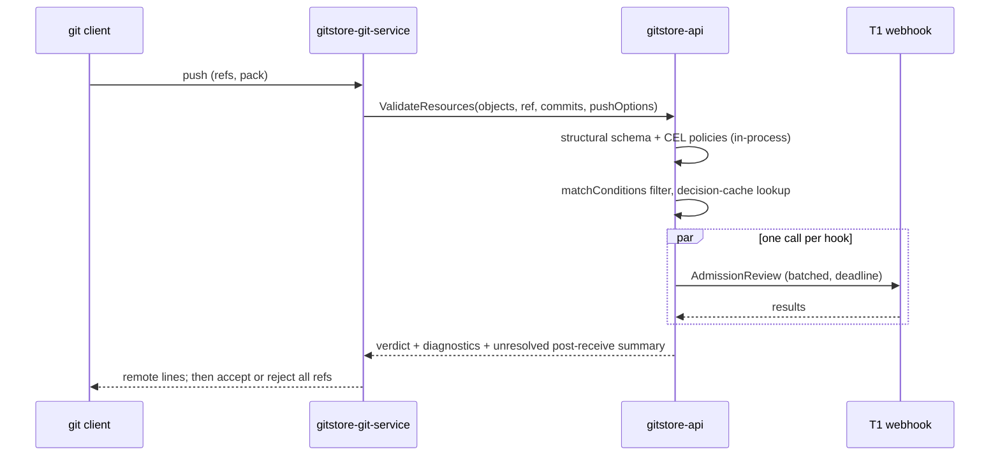

# Resource Lifecycle Hooks: Contracts
**Status**: 🟡 Proposed (contracts only; implementation requires separate feature specifications)

> Implements [ADR 0015](../ADRs/0015-resource-lifecycle-hooks.md). Referenced by
> [ADR 0014](../ADRs/0014-catalog-release-and-publication.md) (`ReleaseEligible` gates) and
> [ADR 0016](../ADRs/0016-custom-resource-definitions.md) (CRD validations and conversion
> Functions). It narrows [036](036-git-service-extension-architecture.md) and replaces the gate and
> action model of [037](037-custom-commerce-workflows.md). All API versions below are
> `v1alpha1` until the first feature spec graduates them.

> **Proposed amendment (2026-11-01).** App composition and the three end-to-end
> examples are in [ADR 0019](../ADRs/0019-app-installation-and-platform-capabilities.md).
> Sections 11–13 below extend the proposed registration contracts; none of the
> new declarations is evidence of a shipped endpoint or runtime target.

## 1. Registration resources

| Kind                               | Group                    | Storage group                       | Author                      | Tier                                      |
|------------------------------------|--------------------------|-------------------------------------|-----------------------------|-------------------------------------------|
| `ValidatingAdmissionPolicy`        | `admission.gitstore.dev` | Git + datastore                     | namespace admin             | any                                       |
| `ValidatingAdmissionPolicyBinding` | `admission.gitstore.dev` | Git + datastore                     | namespace admin             | any                                       |
| `MutatingAdmissionPolicy`          | `admission.gitstore.dev` | Git + datastore                     | namespace admin             | any; applies to datastore-only kinds only |
| `AdmissionHookConfiguration`       | `admission.gitstore.dev` | Git + datastore, cluster-scoped     | operator                    | T0/T1                                     |
| `LifecycleGate`                    | `lifecycle.gitstore.dev` | Git + datastore                     | namespace admin             | any                                       |
| `EventSubscription`                | `events.gitstore.dev`    | Git + datastore                     | namespace admin             | any                                       |
| `FunctionBinding`                  | `functions.gitstore.dev` | Git + datastore                     | namespace admin             | any                                       |
| `HookSuspension`                   | `admission.gitstore.dev` | Datastore only                      | operator or namespace admin | n/a                                       |
| `AdmissionReport`                  | `admission.gitstore.dev` | Datastore only                      | API                         | n/a                                       |

Registrations are admitted only from the admission branch of a `gitstore-system` repository
([ADR 0002](../ADRs/0002-namespace-lifecycle.md)). Admission rejects a registration manifest
anywhere else.

- **Cluster scope.** Manifests in `gitstore-system/gitstore-system` omit `metadata.namespace` and
  apply to every namespace. `AdmissionHookConfiguration` is accepted only here.
- **Namespace scope.** Manifests in `<namespace>/gitstore-system` apply only in that namespace. A
  namespace-scoped binding may reference a cluster-scoped policy but cannot weaken it.
- **Ordering.** Cluster-scoped policies are evaluated before namespace-scoped ones. A deny from
  either rejects the push.

### 1.1 `ValidatingAdmissionPolicy` and binding

```yaml
apiVersion: admission.gitstore.dev/v1alpha1
kind: ValidatingAdmissionPolicy
metadata:
  name: price-floor
  namespace: acme-store
spec:
  failurePolicy: Fail                  # Fail | Ignore (Ignore only for Async mode)
  paramKind:                           # optional
    apiVersion: catalog.gitstore.dev/v1beta1
    kind: PriceFloorPolicy             # a CRD
  matchConstraints:
    resourceRules:
    - apiGroups: [catalog.gitstore.dev]
      kinds: [ProductVariant]
      operations: [CREATE, UPDATE]
  matchConditions:
  - name: priced
    expression: "has(object.spec.price)"
  variables:
  - name: amount
    expression: "object.spec.price.amount"
  validations:
  - expression: "variables.amount >= params.spec.minimum"
    messageExpression: "'price ' + string(variables.amount) + ' below floor ' + string(params.spec.minimum)"
    reason: Invalid
    fieldPath: spec.price.amount
---
apiVersion: admission.gitstore.dev/v1alpha1
kind: ValidatingAdmissionPolicyBinding
metadata:
  name: price-floor-eu
  namespace: acme-store
spec:
  policyName: price-floor
  paramRef:
    name: eu-floor
  validationActions: [Deny]            # Deny | Warn | Audit
  matchResources:
    refs: [refs/heads/main]            # optional; defaults to the admission branch
  mode: Sync                           # Git: pre-receive; Async: post-receive
```

CEL environment variables:

- `object`, `oldObject` (null on CREATE), `request` (operation, user, ref, commit), `params`,
  `variables`;
- `namespaceObject`, the admitted Namespace;
- `references`, a map of declared references, resolved **only** from the push's own objects plus
  the current read model.

No network, clock or random functions are available. Every expression has an estimated-cost
ceiling that is checked at policy admission, and a runtime cost ceiling per evaluation. Both
values are set in the feature spec from benchmarks. `Warn` produces a `remote: warning` line
(pre-receive) or a `warning` annotation (post-receive).
`Audit` only records a result.

### 1.2 `AdmissionHookConfiguration` (cluster-scoped, T0/T1)

The manifest is committed to `gitstore-system/gitstore-system`:

```yaml
apiVersion: admission.gitstore.dev/v1alpha1
kind: AdmissionHookConfiguration
metadata:
  name: tax-classifier               # cluster-scoped: no namespace
spec:
  type: Validating                   # Validating | Mutating (Mutating: datastore-only kinds only)
  endpoint:
    url: https://tax.internal.example/admit
    caBundleRef: { name: tax-ca }    # SecretRef (ADR 0001)
    hmacSecretRef: { name: tax-hmac }
  rules:
  - apiGroups: [catalog.gitstore.dev]
    kinds: [ProductVariant]
    operations: [CREATE, UPDATE]
  namespaceSelector:                 # optional; default all namespaces
    matchLabels: { gitstore.dev/tier: USER }
  matchConditions:
  - name: taxable
    expression: "object.spec.taxable == true"
  mode: Sync                         # Git: pre-receive; Async: post-receive
  timeoutMs: 1500                    # ≤ admission.limits.max_hook_timeout_ms
  failurePolicy: Fail                # Fail | Ignore
  onLargePush: Defer                 # Defer | Reject
  largePushObjects: 500
  circuit: { failureRatio: 0.5, window: 30s, openFor: 60s }
  contextFields: [object, oldObject, operation, ref]   # sent and cache-keyed (§3); default all
  version: "2026-09-01"              # part of the decision-cache key
```

Admission rejects the manifest in any of these cases:

- it appears outside `gitstore-system/gitstore-system`;
- the pusher lacks `admissionHookConfiguration.create`;
- `type: Mutating` matches any Git-backed kind;
- the endpoint host isn't in the egress allowlist;
- any value exceeds a static limit.

`HookSuspension` overrides the manifest immediately, without a push. Per ADR 0015 §4, webhooks
are never invoked for pushes to `gitstore-system` repositories, so a broken hook can't block its
own fix.

Static operator limits (`config.toml`) bound every Git-declared hook:

```toml
[admission.limits]
remote_hooks_enabled = true
push_deadline_ms = 5000
max_hooks_per_push = 8
max_hooks_per_kind = 4
max_hook_timeout_ms = 2000
egress_allowlist = ["*.internal.example"]   # SSRF policy per 036 §9.3
```

### 1.3 `LifecycleGate`

```yaml
apiVersion: lifecycle.gitstore.dev/v1alpha1
kind: LifecycleGate
metadata:
  name: merch-approval
  namespace: acme-store
spec:
  subject:
    apiGroup: catalog.gitstore.dev
    kinds: [Product, ProductVariant]
    selector: { matchLabels: { gitstore.dev/brand: premium } }
  transition: ReleaseEligible          # ReleaseEligible | Ready | Delete | <Kind-declared transition>
  materialInputs:                      # fields hashed into the gate digest
  - spec
  - body
  gate:
    allOf:
    - requiredFields: [spec.title, spec.media]
    - approval:
        policyRef: { name: independent-merchandising-review }
        count: 1
    - externalAttestation:
        issuer: compliance-scanner
        predicateType: https://gitstore.dev/attestations/compliance/v1
```

- The gate digest covers canonical material inputs, subject UID/generation,
  definition and gate revisions, dependency revisions and evidence policy/trust
  revisions (§11). Missing paths fail closed; status conditions written by the
  gate itself must not feed its material digest.
- An approval is a datastore-only `ApprovalCertificate` holding `(gate, subject UID, digest,
  principal, time, signature)`, created through `approvalCertificate.create`. An attestation is a
  signed statement verified against the issuer's registered key.
- The controller patches the condition `Gate/<name>`. For `Delete` transitions it adds the
  finalizer `lifecycle.gitstore.dev/<name>` before deletion can begin. Gate
  installation on an already terminating subject is rejected or deferred; it
  cannot retroactively guarantee cleanup. The API checks current evidence at
  the command boundary rather than trusting that cached condition.

### 1.4 `EventSubscription`

```yaml
apiVersion: events.gitstore.dev/v1alpha1
kind: EventSubscription
metadata:
  name: erp-sync
  namespace: acme-store
spec:
  sources:
  - apiGroup: catalog.gitstore.dev
    kinds: [Product, ProductVariant]
    types: [created, updated, deleted, conditionChanged]
  filter: "event.data.conditions.exists(c, c.type == 'Ready' && c.status == 'True')"
  sink:
    http:
      url: https://erp.example.com/hooks/gitstore
      signingSecretRef: { name: erp-webhook-key }
  delivery:
    maxAttempts: 12
    backoff: { initial: 5s, max: 1h }
    deadLetter: true
```

### 1.5 `FunctionBinding`

```yaml
apiVersion: functions.gitstore.dev/v1alpha1
kind: FunctionBinding
metadata:
  name: tiered-pricing
  namespace: acme-store
spec:
  target: gitstore:pricing/line-price@1
  module:
    ref: oci://registry.example.com/acme/tiered-pricing
    digest: sha256:4f1c…                # required; tags are rejected
  inputQuery: |
    query Input($line: ID!) {
      line(id: $line) { quantity variant { sku price { amount currencyCode } labels } }
    }
  config: { tiers: [ { min: 10, discountPct: 5 } ] }
  failurePolicy: UseDefault            # UseDefault | Fail
```

## 2. Admission request and response envelope

Pre-receive and post-receive webhooks receive the same batched envelope:

`request.phase` identifies the actual execution boundary, independently of the
registration's requested execution mode:

| Phase value | Meaning | Denial effect |
| --- | --- | --- |
| `PreReceive` | Git push validation before refs move | Rejects the push |
| `PostReceive` | Git admission after refs have moved | Records a report and retains the last accepted read model |
| `InlineAdmission` | Synchronous admission inside an API operation | Rejects the operation before its work becomes accepted state |

These are execution-boundary names, separate from the admission Chain's
mutating/validating policy/webhook steps. The host sets `phase`; it is not an
author-supplied override. Git `mode: Sync` selects pre-receive unless
the configured deferral policy moves that invocation to post-receive.
Git `mode: Async` selects post-receive. Datastore-only writes use
`mode: Sync` and `phase: InlineAdmission`; asynchronous admission after persistence
is not allowed for them. API writes to Git-backed resources also use
`InlineAdmission` when admission runs within the API operation rather than a Git
receive hook; storage-group mutation restrictions remain unchanged.

The field and enum names below are proposed contracts, not an implemented
protocol migration. Only `phase` is specified; no single-letter aliases are
accepted. Inline writes omit unavailable Git-specific context instead of
inventing ref, commit or pusher facts.

```json
{
  "apiVersion": "admission.gitstore.dev/v1alpha1",
  "kind": "AdmissionReview",
  "request": {
    "uid": "0c5c…",
    "hook": { "name": "tax-classifier", "version": "2026-09-01" },
    "phase": "PreReceive",
    "repository": { "namespace": "acme-store", "name": "catalog" },
    "ref": "refs/heads/main",
    "oldCommit": "9f2e…",
    "newCommit": "abc1…",
    "pusher": { "subject": "user:ada", "tier": "human" },
    "pushOptions": ["ci.skip-notify"],
    "objects": [
      {
        "operation": "UPDATE",
        "path": "products/coat.md",
        "blobOID": "e69d…",
        "object": { "apiVersion": "catalog.gitstore.dev/v1beta1", "kind": "ProductVariant", "...": "..." },
        "oldObject": { "...": "..." }
      }
    ]
  }
}
```

```json
{
  "response": {
    "uid": "0c5c…",
    "results": [
      {
        "blobOID": "e69d…",
        "allowed": false,
        "reason": "Invalid",
        "annotations": [
          { "path": "products/coat.md", "fieldPath": "spec.taxCode",
            "level": "failure", "title": "tax-code-missing", "message": "taxable variants need spec.taxCode" }
        ]
      }
    ]
  }
}
```

Envelope rules:

- The response must contain one result per object, keyed by `blobOID`. A missing result is
  treated as a hook failure under `failurePolicy`.
- Mutating responses (`patch`, as JSON Patch) are accepted only for datastore-only subjects.
- `fieldPath` is mapped to a line and column through YAML node positions. `path` alone produces a
  line-1 annotation.
- Secrets, raw push credentials and non-matched objects are never sent (036 §8.2).
- Only the context fields named in the hook's `contextFields` are sent. The example above shows
  all of them. This is what lets the decision cache (§3) key on exactly what the hook saw.
- Request bodies are capped (default 4 MiB). Above the cap, `onLargePush` applies.

## 3. Pre-receive execution



- `admission.limits.push_deadline_ms` is the push-wide budget (default 5000). Hook timeouts are
  individually ≤ the remaining budget. After the deadline every pending hook is treated as timed
  out.
- **Decision cache.** The key is `(hook name, hook version, phase, policy digest, params digest,
  context digest)`. The context digest is the SHA-256 of the canonical JSON of exactly the fields
  sent to the hook for that object.
  - `phase` is always sent and always keyed, independently of `contextFields`.
    A pre-receive decision cannot be reused for post-receive or inline admission.
  - The fields are selected by the hook's `contextFields` from: `object` (by blob OID),
    `oldObject` (by blob OID), `operation`, `repository`, `ref`, `path`, `pusher` and
    `pushOptions`.
  - Fields not listed in `contextFields` are **omitted from the envelope** (§2), so a hook can
    never decide on input that the key doesn't cover.
  - The default `contextFields` is every field, which means no cross-request reuse. Hooks opt in
    to narrower context for a better hit rate.

  The value is the per-object result. Entries are stored in the datastore with a TTL
  (default 7 days) so that every API replica shares them. Only `allowed` and deterministic `deny`
  results are cached, never failures.
- **Circuit breaker.** The breaker is per hook per replica. An open circuit applies
  `failurePolicy` without a call.
- Diagnostics are capped at 50 `remote:` lines per push, followed by an `… and N more
  (gitctl admission show <commit>)` line.

## 4. `AdmissionReport`

```yaml
apiVersion: admission.gitstore.dev/v1alpha1
kind: AdmissionReport
metadata:
  name: catalog.abc1f00.main.tax-classifier   # deterministic from the key
  namespace: acme-store
spec:
  repositoryRef: { name: catalog }
  commit: abc1f00…
  ref: refs/heads/main
  hook: { kind: AdmissionHookConfiguration, name: tax-classifier, version: 2026-09-01 }
  phase: PostReceive
status:
  status: completed                   # queued | in_progress | completed
  conclusion: failure                 # success | failure | neutral | skipped | timed_out
  startedAt: "2026-09-30T10:00:00Z"
  completedAt: "2026-09-30T10:00:04Z"
  summary: 1 failure, 0 warnings
  annotations:
  - path: products/coat.md
    startLine: 7
    endLine: 7
    startColumn: 3
    level: failure                    # notice | warning | failure
    title: tax-code-missing
    message: taxable variants need spec.taxCode
    fieldPath: spec.taxCode
```

- **Identity.** The report is unique on `(repository, commit, ref, hook)`. Re-running a report
  replaces its annotations and increments `status.attempt`.
- **Phase.** These Git post-receive reports use `spec.phase: PostReceive`.
  Pre-receive rejection and inline-write failure are returned through their
  corresponding request paths; they are not mislabeled as post-receive reports.
- **Bounds.** At most 1,000 annotations per report and 64 KiB per message; the rest are counted
  in `status.truncated`. Retention is 90 days, or until the ref no longer contains the commit and
  30 days have passed.
- **SARIF export.** `GET /admission/reports/{uid}.sarif` produces one `run` per report:
  - `tool.driver.name` is the hook name, and `tool.driver.version` is the hook version;
  - each `result.ruleId` is the annotation title;
  - `level` maps `failure → error`, `warning → warning` and `notice → note`;
  - `physicalLocation.artifactLocation.uri` is the path, and `region` holds the lines and
    columns;
  - `versionControlProvenance[0]` has `revisionId` = commit and `branch` = ref.
- **GraphQL.** `repository.admissionReports(commit:, ref:)` and `watchResources(kind:
  "AdmissionReport")`. `gitctl admission show <commit> [--ref]` renders the reports.
- **Notes projection.** A controller writes `refs/notes/gitstore/admission` through a Git service
  command, one note per commit:

  ```text
  gitstore-admission/v1
  refs/heads/main tax-classifier failure 1 https://…/reports/<uid>
  ```

  The projection is rebuilt from reports and never read back. Pushes to `refs/notes/*` are
  rejected by the Git service. Admission also ignores those refs.

## 5. Datastore-only admission

For datastore-only subjects, the four-phase `Chain` runs inside the write:

1. mutating policies;
2. mutating webhooks (T0/T1);
3. validating policies;
4. validating webhooks (T0/T1).

After that, the row and its journal entry are written in one transaction. Mutating webhooks are
re-invoked at most once if a later mutation changed a field they matched. The GraphQL mutation
deadline bounds the whole chain (proposed initial default 2 s).

## 6. Event delivery

- Each subscription has a cursor per subscription key (`subscription/<uid>`), advanced after
  a 2xx response or a durably recorded exhausted-delivery/dead-letter outcome.
  Cursor advances carry the `subscription/<uid>` lease's fencing token, and the API
  rejects a stale one ([ADR 0018](../ADRs/0018-controller-ownership-concurrency-and-fencing.md)
  §3–§4).
- Headers:
  - `webhook-id` is the CloudEvent `id`, the journal sequence;
  - `webhook-timestamp`;
  - `webhook-signature: v1,<base64>` over `id.timestamp.body`;
  - `content-type: application/cloudevents+json`.
- Retries use `delivery.backoff` with full jitter. After `maxAttempts` the event goes to an
  `EventDeadLetter` record (datastore-only). The cursor moves past it. Replay is done with
  `gitctl events replay --subscription <name> --from <seq>`.
- A journal gap (retention exceeded) sets `EventSubscription` `Degraded=True` with reason
  `JournalGap`, and emits a `dev.gitstore.events.gap.v1` event so consumers know to resync.

Subscription installation requires authority for the selected source scope and
an approved sink/egress capability. Capture the allowed source kinds/namespace
in the activation revision; recheck revocation before delivery. A delivery worker
must not use its broad service identity to export data the app is not approved
to receive. Data envelopes remain bounded references; fetching resource/payload
bodies requires the consumer's own current authorization. Delivery signing
material uses resource secret references; it is not a workload identity key.

Consumers deduplicate `(source, id)` and use subject UID plus material revision
for logical external work. No global ordering across sources is promised.
An old update cannot overwrite a newer accepted generation. A sink returning
2xx acknowledges receipt, not a successful scan/review/payment. The consumer
reports results through separately authenticated and authorized operations.
Conditions-only updates can wake consumers; filter/deduplicate them to avoid
status feedback loops. Retention-gap recovery uses paginated list plus watch
resume and reconciliation of authoritative state. Never infer deletion from
an incomplete page or a missed event.

## 7. Function host

| Bound (per invocation) | Initial default  | Notes                                  |
|------------------------|------------------|----------------------------------------|
| Module size            | 1 MiB            | Checked at `FunctionBinding` admission |
| Fuel                   | target-specific  | Wasmtime fuel, benchmarked per target  |
| Linear memory          | 16 MiB           |                                        |
| Input / output         | 128 KiB / 32 KiB | Input comes from `inputQuery`          |
| Wall clock             | 50 ms            | A backstop to fuel                     |

- Modules are compiled once per digest per replica and instantiated per call. No state carries
  over between calls.
- WASI is not provided, apart from a deterministic `log` import that is bounded to 4 KiB.
- `failurePolicy: UseDefault` returns the target's declared default. `Fail` fails the enclosing
  operation with a typed `FUNCTION_FAILED` error.

## 8. Authorization actions

These actions follow the [ADR 0010](../ADRs/0010-authorization-model.md) grammar
`<kind>[.<subresource>].<verb>`. `<kind>` is the singular camelCase kind, and the verb comes from
the control-plane set `create · read · list · watch · update · delete`.

- `admissionHookConfiguration.{read,list,watch,create,update,delete}`, cluster scope only
- `validatingAdmissionPolicy.{read,list,watch}`, `validatingAdmissionPolicyBinding.{read,list,watch}`,
  `mutatingAdmissionPolicy.{read,list,watch}`
- `admissionReport.{read,list,watch}`
- `lifecycleGate.{read,list,watch}`
- `approvalCertificate.{create,read,list}`, which satisfies an `approval` gate (§1.3)
- `eventSubscription.{read,list,watch}`
- `eventSubscription.deliveries.replay`, which replays from a sequence (§6)
- `functionBinding.{read,list,watch}`
- `hookSuspension.{create,read,list,delete}`

`create`/`update`/`delete` on Git-backed registration kinds are exercised only by admission of a
push. Datastore-only kinds (`approvalCertificate`, `hookSuspension`) are written through the API.

Creating a registration requires push permission on the `gitstore-system` repository it is
admitted from. Remote webhooks additionally require `admissionHookConfiguration.create`.

## 9. Rollout

1. **R1: CEL validating policies (pre-receive only).** Wire policies into the existing Git-backed
   `Chain` phase 3, and remove mutating registration for Git-backed kinds. Add YAML node-position
   diagnostics.
2. **R2: `AdmissionReport` and post-receive.** Add `mode: Async`, the report store, GraphQL and
   `gitctl`, and the next-push echo.
3. **R3: T0/T1 webhooks**, with batching, the decision cache, deadlines, circuit breakers and
   `onLargePush`.
4. **R4: Event subscriptions** from the watch journal, with a CloudEvents sink.
5. **R5: Lifecycle gates**, starting with `ReleaseEligible` (ADR 0014) and `File Ready`.
6. **R6: Function host**, starting with `gitstore:apiextensions/convert@1` (ADR 0016) and
   `gitstore:pricing/line-price@1`.
7. **R7: Notes projection** (optional).

Each phase is gated per namespace by a feature flag. Every phase deploys readers before writers,
and activates a phase only after all serving replicas support its descriptor,
registry and policy revisions. An incompatible replica fails closed for an
activated registration; ignoring an unknown required gate/policy is unsafe.
An explicit operator can stage non-security policies with `Warn`; required
safety gates and deny policies must not silently become advisory during rollout.

## 10. Test strategy

- **Multi-replica.** Two API replicas share the decision cache and reports, and a report keyed on
  `(repository, commit, ref, hook)` is written once under concurrent post-receive runs. Two controllers
  deliver a subscription with no gaps and only detectable duplicates across a lease handover.
- **Rolling upgrade.** A compatible mixed-version API fleet gives stable verdicts
  for the same revision. Unsupported replicas cannot dispatch activated new
  registrations or bypass unknown required gates. Activation waits for readers.
- **AuthN/AuthZ.** A namespace admin can't bind a policy outside their namespace. T2/T3 can't
  obtain a synchronous slot. `hookSuspension.create` is enforced. Webhook secrets never appear in logs,
  reports or envelopes.
- **Registration location.**
  - An `AdmissionHookConfiguration` pushed to any repository other than
    `gitstore-system/gitstore-system` is rejected, and so is a registration pushed outside a
    `gitstore-system` repository.
  - A manifest that exceeds `[admission.limits]` is rejected.
  - With a `failurePolicy: Fail` webhook down, a push to `gitstore-system` that removes the
    webhook still succeeds, and so does a `HookSuspension`.
- **Bounded work.** Push-deadline enforcement with slow hooks; the large-push `Defer`/`Reject`
  paths; the annotation, diagnostic and payload caps; CEL cost rejection at policy admission; and
  WASM fuel, memory and wall-clock exhaustion.
- **Sustained load.** Repository lifecycle capacity profiles (`make capacity TARGET=repository
  PROFILE=lifecycle`) with 10 policies and 2 webhooks bound. The p95 push-admission overhead is
  recorded, and the decision-cache hit ratio is measured on re-pushes.
- **Determinism.** The same Function input gives the same output across replicas and
  architectures. CEL policies give identical verdicts in pre-receive
  and post-receive for identical declared inputs. Cache tests verify
  that decisions cannot cross execution phases.

## 11. Transition and evidence contracts

### 11.1 Declaration and enforcement

A CRD declares `spec.lifecycle.transitions` under
[ADR 0016 §8](../ADRs/0016-custom-resource-definitions.md#8-declared-custom-transitions).
The initial custom executor is `Workflow`, implemented by the API command
handler using a pinned `WorkflowDefinition` with `CUSTOM_RESOURCE` scope.
The definition must match subject GVK, command and bounded input schema; an
unknown command/target or unsupported executor fails admission. CRD declaration
alone cannot register executable code. Core transitions retain their own
enforcers: release preparation, resource readiness and finalizer completion.

The proposed generic transition operation has this logical request contract;
GraphQL field names and transport schema are future implementation work and
must be advertised through discovery before clients call it:

| Input | Requirement |
| --- | --- |
| Subject | Explicit GVK, namespace, name and immutable UID |
| Transition | Exact declared command and executor contract version |
| Preconditions | Expected subject resourceVersion, material digest, and execution version where present |
| Idempotency | Caller-supplied bounded key, scoped to principal/subject/command; key reuse with different input is rejected |
| Input | Bounded payload validated against pinned command schema; no author-supplied status or trusted actor claims |

The server resolves authoritative scope/owner facts and pins registry/catalog,
definition and execution revisions. It calls the configured authorizer with
the registered action, checks the current source state and every applicable
required gate, materializes allowed function inputs, validates pure output and
conditionally commits the runtime transition. Git-backed subject spec is never
patched by a function or transition executor.

The response identifies subject UID, command, execution/version, committed
outcome, resulting resourceVersion, material/definition/registry digests and
causal event ID. A valid retry returns the recorded logical result, with current
read authority checked before disclosure. Outcomes distinguish authorization
denial/concealment, unsupported transition, precondition conflict, pending gate,
invalid evidence, function failure and successful commitment. Pending gates
never produce a successful transition receipt.

Transition, idempotency result and durable journal/outbox fact must share one
defined atomic commit boundary. Subject, gate-policy and evidence revisions
must be guarded there against concurrent change/revocation. A pre-read followed
by an unrelated write is insufficient. Implementations must document the
backend-neutral conditional/commit-intent protocol for memdb and Scylla before
enabling this contract; this document does not claim arbitrary cross-table ACID
transactions. If a guarded snapshot is invalidated, retry from authoritative
facts and reauthorize. An uncertain commit is resolved by idempotency lookup,
never by issuing a second external operation.

External calls run after the durable transition through the subscription/work
path. Results carry an attempt ID, subject UID, execution version, input digest
and fencing epoch where applicable. Reject stale/duplicate conflicting results;
a lease alone is not correctness. State transition events cannot be constructed
by an external controller writing the datastore directly.

### 11.2 Material digest and gate composition

Use one documented canonical JSON encoding and SHA-256 across implementations.
The material snapshot contains:

- subject UID, authored/admitted generation and operation/transition identity;
- selected bounded field paths, body digest and required immutable payload facts;
- definition/schema/conversion and gate UID/generation digests;
- selected reference UID/generation/content digests, never only mutable names;
- approval-policy revision, issuer trust/key-set revision and predicate version;
- applicable installed registration revision, without unrelated App health/status.

The gate controller's own condition, timestamps and resourceVersion-only status
patches are excluded, avoiding self-invalidating feedback. Unknown/missing
required material makes the gate `Unknown`/pending. A self-referential `Ready`
condition gate on the same subject is rejected. Reference/gate dependency
cycles are rejected, not treated as ready. Fields that can change independently
of spec (such as verified payload digest or issuer trust) explicitly invalidate
the cached digest and trigger bounded reconciliation.

All required matching gates must be satisfied. Inside each gate `allOf`, `anyOf`
and `noneOf` retain explicit semantics; `Unknown` is never permission to advance.
Removing a registration cannot silently remove a required safety obligation
from retained subjects/executions. Authorized policy replacement records the
new requirement and activation revision before retiring the old evaluator.

### 11.3 Approval policies, issuers and evidence

`approval.policyRef` resolves an admitted, versioned approval policy containing
principal eligibility, minimum distinct approvers, separation of duties,
validity, revocation and material scope. Approval eligibility is evaluated by
the configured provider using authoritative principal/subject facts; role names
in token claims are not authority. The examples replace the earlier `role`
shorthand. The concrete policy resource/API and its finite catalog entries must
be specified in the implementing feature; an unresolved reference fails closed.

The referenced policy has the following required logical fields. Transport and
resource naming can reuse an existing compatible policy resource; it must not
weaken these semantics:

| Field | Constraint |
| --- | --- |
| Identity/revision | Immutable UID, admitted generation and content digest |
| Subject scope | Explicit namespaces/kinds and permitted transitions |
| Eligibility | Registered approval action evaluated by AuthZ with authoritative subject/owner facts |
| Distinct approvers | Positive bounded minimum; repeated certificates from one principal count once |
| Separation of duties | Explicit author/submitter exclusion and any required independent groups, enforced from trusted facts |
| Validity | Bounded maximum age/expiry, current revocation state and material digest binding |
| Conflict behavior | Self-approval, out-of-scope subject and conflicting evidence produce typed denial |

`approval.count` may request more approvers than the referenced policy requires;
it cannot reduce its minimum. A policy change starts a new digest and requires
fresh evaluation. Approval author identity comes from immutable creation/change
provenance, not an author-supplied name in the certificate. A later change of
resource owner cannot turn the original author into an independent approver.

`externalAttestation.issuer` resolves a separately authorized trust registration:
issuer identity, allowed predicate types/versions, algorithm/key IDs, namespace
and subject-kind restrictions, validity bounds, key rotation/revocation and
binding to the submitting ServiceAccount or approved verification path. Package
content may request an issuer registration but cannot self-approve its trust.
Public verification keys are enrollment data; private issuer keys stay outside
GitStore manifests under the credential boundary. Unknown algorithms/keys and
cross-namespace evidence are rejected. The trust-registration API/actions are
an implementation prerequisite, not currently shipped resources.

A predicate type identifies a versioned, bounded schema and a host-approved
success interpretation. Signature validity alone never means a positive verdict.
For example, the payload-clean predicate requires result `Clean`, the exact
payload digest, scan-policy revision and valid signature-database revision;
`Infected`, `Error` or an unknown result cannot satisfy the gate. A compliance
predicate likewise distinguishes approval, rejection and incomplete review.
Negative verdicts remain auditable without counting as successful evidence.
Predicate schemas cannot execute remote code or perform network validation.

Trust activation covers registration UID/revision, public keys/algorithms,
allowed predicate schemas, namespace/kind scope, submission identity, lifetime
ceilings and an explicit approval receipt from an authorized trust administrator.
A publicly readable key or a key packaged by the app is not that receipt.
Private issuer signing material and workload token-signing material are distinct
credentials with independent rotation. Revoking one key does not silently replace
it with an unapproved package key.

Persisted evidence includes gate/subject UID, material digest, transition,
predicate/policy version, issuer or approving principal, issued/expiry times,
signature and revocation metadata. Validate authenticated submission, submitter
authority, signature, subject scope, freshness, input binding and replay before
recording it. Bound serialized size and lifetime by operator configuration.
Evidence ingestion is idempotent by immutable evidence ID and digest; changing
bytes under an existing ID is rejected. Never accept an arbitrary status patch
as an approval or attestation.

Evidence issuance time is part of verification, not a nondeterministic WASM
import. Verification uses the platform clock and current trust outside pure
computation. Key rotation supports explicitly bounded overlap; revocation
invalidates pending satisfaction and cached receipts within the documented
ceiling. Before commitment, recheck validity and the guarded trust/evidence
revision. After commitment, retain the historic receipt and apply the domain's
suppression/review policy; do not erase audit evidence or silently rewrite a
published snapshot.

## 12. Function target selection and App activation

A platform target descriptor must define the following before advertisement:

| Contract | Required definition |
| --- | --- |
| Identity | Exact versioned target ID, WIT ABI and input/output schemas |
| Invocation | Host operation and phase; no arbitrary new hook from a binding |
| Selection | Namespace, subject/surface/target key and allowed selectors |
| Authority | Caller/service context, allowed input fields and capability/RBAC checks |
| Composition | Exactly one binding, or an explicit ordered pipeline with maximum length |
| Bounds | Module/fuel/memory/deadline/query/input/output/cache limits |
| Validation | Allowed output shape, invariant checks and downstream eligibility checks |
| Failure | Typed error or specific safe default; permitted `UseDefault`/`Fail` values |
| Evolution | Compatibility range, retirement and retained execution behavior |

Extend `FunctionBinding.spec` with an optional `selection` object whose schema
is fixed by its target descriptor. For example, a recommendation rank target
can select a `surfaceRef`; a conversion target can select a CRD/version pair.
The namespace comes from the binding. Arbitrary cross-namespace selectors and
unknown selector fields fail admission. Explicit pipeline descriptors additionally
allow bounded integer `order`; equal order on an overlapping selection is a
conflict. A single-binding target rejects overlapping selection even if one
binding has higher installation priority. There is no implicit registration
order or app-name tiebreaker. Standalone bindings and App bindings share this
conflict domain.

Prepare modules and input queries before activation. Validate GraphQL selection
against host-provided input schema/mapping and complexity limits, not an
unrestricted administrator query. A module does not inherit the installer's
identity. Cache keys include target, module/configuration, selection and input
digests plus authorization/publication context where output can differ. Never
reuse results across tenant, snapshot or caller boundaries accidentally.

`gitstore:search/query-rewrite@1` and `gitstore:recommendation/rank@1` in ADR 0019
are candidate contracts, not implemented target names. Index/provider I/O runs
outside pure WASM. A function cannot perform payment capture, scan remote
payloads, mutate an index or issue arbitrary HTTP requests.

App-owned registrations prepare under one immutable inactive revision covering
package, grants, inventory, policy/catalog and target descriptors. Dispatch
checks that revision's active pointer and current suspension state. All serving
replicas must support the revision before activation. An incompatible or stale
replica returns a typed unavailable/denied result, never a partial registry.
Control-plane refresh ceilings, dispatch caches and revocation invalidation
must be defined and tested; restart is not a revocation mechanism.

Durable external work already emitted when disablement occurs can complete,
but reporting still needs current authority and causal input validation.
Required gates stay pending until replacement evidence/evaluation exists.
No request-time artifact fetch, uncontrolled compilation, package installer
script or automatic arbitrary controller hosting is introduced.

## 13. End-to-end implementation acceptance

[ADR 0019 §§7–9](../ADRs/0019-app-installation-and-platform-capabilities.md#7-use-case-search-and-recommendation)
contains complete proposed Search/Recommendation, antivirus and combined
approval/attestation examples. Their implementation suites must demonstrate:

| Scenario | Required positive and negative evidence |
| --- | --- |
| Search configuration | Merchant CRUD/default installation drives accepted-generation reconciliation; secondary changes do not rewrite config; denied mutation has no backend effect |
| Public serving | Snapshot-target isolation, no unpublished hits/snippets/facets/count leakage, suppression during stale-index/cache serving, explicit unavailable fallback |
| Recommendation functions | Deterministic bounded candidate ranking, explicit selection, conflicting binding rejection, no host I/O or unauthorized behavioral data |
| Antivirus | No synchronous payload scan at admission, exact payload/policy digest binding, infected/expired/untrusted verdict blocks Ready/download, disabled scanner does not bypass gate |
| Approval and attestation | Both required for the same material; separation of duties; old-generation, revoked, wrong-issuer and replayed evidence rejected |
| Custom transitions | Adapter/source-state validation, expected-version conflict, idempotent retry/uncertain-commit recovery, stale worker/result fencing |
| App lifecycle | No partial activation, unauthorized identity reuse rejected, additional grants reapproved, required-gate-safe disable/uninstall, retained pinned contracts |

Run each affected path with pluggable authorization, two APIs/two controllers,
rolling replacement, restart/replay and sustained push/reconciliation load under
documented resource limits. Inject provider outage, slow calls, journal gaps,
queue exhaustion and evidence revocation at commitment. Verify bounded memory,
disk, retries, telemetry label cardinality and sanitized diagnostics. These
contracts require future feature specifications and tests; they do not claim
the above scenarios have passed or replace the full default PR readiness suite.
