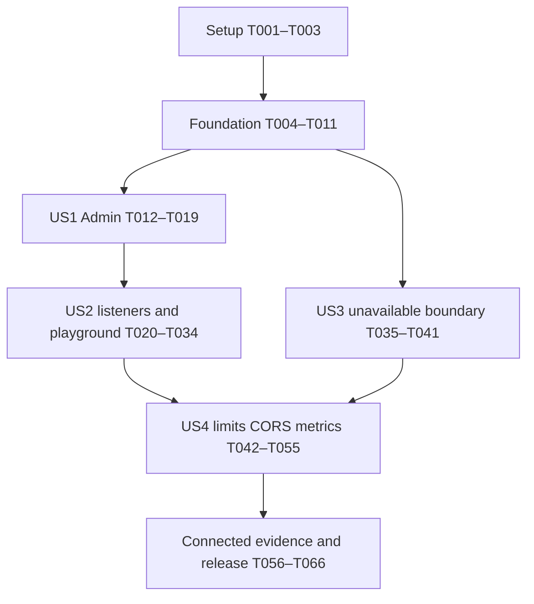

# Tasks: Admin and Storefront Endpoint Split

**Input**: Design artifacts in `specs/070-admin-storefront-split/`

**Prerequisites**: [plan.md](plan.md), [spec.md](spec.md), [research.md](research.md), [data-model.md](data-model.md), [contracts/](contracts/) and [quickstart.md](quickstart.md)

**Branch**: `070-admin-storefront-split`

**Tests**: Required by the specification and constitution. Write new behavior tests first and observe the expected failures before implementation. For the behavior-preserving package move, existing tests are the regression contract; keep that change separate from routing/security behavior.

**Scope**: Generate/implement the split in this worktree only. Two fixed listeners: `api.admin_port` → `/admin/graphql`; `api.storefront_port` → `/storefront/graphql`. No generic `api.port`, aliases, shared-routing modes, enablement switch, publication implementation, new service or transport fork. New metrics use OpenTelemetry SDK/shared observability. Preserve unrelated edits, including the existing Rust lockfile change.

## Format and path conventions

- Every task is `- [ ] Tnnn [P?] [USn?] Description with repository-relative paths`.
- `[P]` permits parallel execution only within the explicit ready wave described below; prerequisite gates still apply. It does not authorize delegation or simultaneous changes to shared files.
- `[US1]`–`[US4]` map to specification stories; setup, foundation and final cross-cutting tasks have no story label.
- Existing Admin sources start in `gitstore-api/internal/graph/` and move to `gitstore-api/internal/admin/graph/` in T004. All later references use the destination path. New filenames below are planned files, not claims they already exist.
- Preserve existing Make selector families. Do not introduce `make test TARGET=api`, a feature-specific public target, external account setup or a new Compose overlay.

## Phase 1: Setup

**Purpose**: Establish a reproducible baseline and protect unrelated work before mechanical changes.

- [X] T001 Record branch/base revision, scoped/unrelated edits and the approved feature boundaries from `specs/070-admin-storefront-split/plan.md`; identify the current `gitstore-git-service/Cargo.lock` edit as outside this feature and retain a private diff/status receipt without staging or changing it.
- [X] T002 Establish the existing API/controller regression baseline using the root `Makefile` and focused existing suites under `gitstore-api/internal/app/` and `gitstore-controller-manager/internal/`; record pre-existing failures separately without weakening checks or modifying unrelated services.
- [X] T003 Inventory old Go import/model/scalar bindings, schema globs, URL/health assumptions and external consumer coordination using `gitstore-api/gqlgen.yml`, `gitstore-api/generate.go`, `gitstore-controller-manager/internal/schemavalidate/schemavalidate.go`, `Makefile` and `scripts/repository-capacity-stack.sh`; use `specs/070-admin-storefront-split/research.md` as the source map and retain a scoped migration checklist in private implementation evidence.

## Phase 2: Foundational prerequisites

**Purpose**: Make endpoint ownership explicit without changing behavior, then establish the two schema/executor boundaries. No user-story implementation begins before T011 passes.

- [X] T004 Mechanically move `gitstore-api/internal/graph/` to `gitstore-api/internal/admin/graph/`, rename `gitstore-api/gqlgen.yml` to `gitstore-api/gqlgen.admin.yml`, update imports/scalar/model bindings and generation directives in `gitstore-api/generate.go`, and regenerate the existing Admin executable with its current schema contract; add no compatibility packages or routing changes.
- [X] T005 Compile API/controller modules and run the existing affected resolver/security/app tests against `gitstore-api/internal/admin/graph/`; verify the moved schema behaves identically and generator output is deterministic before proceeding. Correct mechanical import/binding errors without mixing endpoint behavior changes into this checkpoint.
- [X] T006 Add failing schema-boundary tests in `gitstore-api/internal/app/schema_boundary_test.go` and `gitstore-controller-manager/internal/schemavalidate/schemavalidate_test.go` for separate schema roots, no management fields in Storefront, valid Node identity, no mutation/subscription root, Admin-only controller documents and independent generation/source sets; validate the standalone `specs/070-admin-storefront-split/contracts/storefront.graphqls` contract.
- [X] T007 Move management SDL into `shared/schemas/admin/`, extract the actually shared Node definition into `shared/schemas/common/`, correct its obsolete ID docstring, and create identity-only `shared/schemas/storefront/schema.graphqls`; update `gitstore-api/gqlgen.admin.yml`, add `gitstore-api/gqlgen.storefront.yml`, and explicitly run both configs from `gitstore-api/generate.go` without a glob spanning the two resource trees.
- [X] T008 Generate isolated outputs under `gitstore-api/internal/storefront/graph/generated/` and `gitstore-api/internal/storefront/graph/model/`; implement a safe non-data-backed Node resolver in `gitstore-api/internal/storefront/graph/resolver/schema.resolvers.go` and minimal fixed 503/no-data/no-store boundary handler in `gitstore-api/internal/storefront/handler.go`, with failing-first handler tests. Dependencies must exclude Admin services/models, current-row datastore and Git writers; no production ready flag or fake reader.
- [X] T009 Update `gitstore-controller-manager/internal/schemavalidate/schemavalidate.go` to load Admin plus common only, reject accidental inclusion of Storefront roots, and preserve validation of every registered controller operation against the moved schema; make the T006 controller tests pass.
- [X] T010 Refactor executor construction from route mounting in `gitstore-api/internal/app/server.go` and a focused `gitstore-api/internal/app/graphql.go` helper, using existing registry/admission/journal dependencies and bounded APQ/query caches owned by each constructed executor. The fixed unavailable Storefront path constructs no unused executor/caches; a future reader must own separate instances. Add focused constructor tests and no role/plugin framework.
- [X] T011 Run both schema generators for `gitstore-api/gqlgen.admin.yml` and `gitstore-api/gqlgen.storefront.yml` via `Makefile`'s existing `make generate TARGET=all`, compile affected modules and pass T006 plus preserved Admin regressions; verify no generated import still points at the removed Admin path and a second generation run creates no additional drift.

**Checkpoint**: Mechanical move is validated; separate schemas/executors and a safe unavailable Storefront boundary exist. No real public reads or production activation are implied.

## Phase 3: User Story 1 — Preserve explicit Admin management access (P1)

**Goal**: Preserve existing management semantics while enforcing the schema/identity/introspection boundary.

**Independent test**: Instantiate the Admin handler with the existing test datastore, registry, Git/admission doubles and durable journal; complete authorized read/author/status/completion/watch journeys and reject unauthorized/opposite-endpoint access without requiring production publication support or the real listener deployment.

### Tests first

- [X] T012 [P] [US1] Add failing Admin handler contract tests in `gitstore-api/internal/app/admin_contract_test.go` for authenticated/anonymous introspection, existing query/mutation/admission diagnostics, status/completion identity/version behavior and APQ cache isolation; reuse current fixtures rather than inventing parallel resource services.
- [X] T013 [P] [US1] Extend `gitstore-api/internal/app/server_websocket_test.go` and `gitstore-api/internal/app/namespace_watch_shutdown_test.go` with failing regressions for Admin connection-init auth, expiry/revocation, cancellation/terminal watch errors and durable cursor resumption after the schema/package split.
- [X] T014 [P] [US1] Extend `gitstore-api/internal/admin/graph/resolver/global_id_test.go` and `gitstore-api/internal/admin/graph/resolver/resolver_global_id_test.go` with failing cases for well-formed Storefront kinds returning `NOT_FOUND` without datastore access, unchanged valid Admin IDs and preserved malformed-ID diagnostics.

### Implementation and verification

- [X] T015 [US1] Update the closed Admin kind validation in `gitstore-api/internal/admin/graph/resolver/global_id.go` and corresponding parsing/presentation in `gitstore-api/internal/middleware/security/graphql.go` to distinguish opposite-endpoint IDs from malformed input without widening the allow-list; extract pure parsing only if both endpoints actually need it.
- [X] T016 [US1] Add the authenticated Admin introspection gate through the pinned gqlgen operation hooks in `gitstore-api/internal/app/graphql.go`, preserving normal login/auth operations and existing field/service authorization rather than introducing an SDL authorization-directive redesign.
- [X] T017 [US1] Wire the moved Admin executable/resolver and existing registry, committed-manifest admission, journal and WebSocket lifecycle into `gitstore-api/internal/app/graphql.go` and `gitstore-api/internal/app/server.go`; keep current control-plane operations and middleware semantics intact.
- [X] T018 [US1] Complete per-executor APQ/query-cache isolation in `gitstore-api/internal/app/graphql.go`, ensuring registered hashes and parsed documents do not cross schema boundaries or bypass fresh authentication/authorization, and make the T012 isolation probes pass.
- [X] T019 [US1] Run focused API resolver/security/app tests and appropriate race checks for `gitstore-api/internal/admin/graph/resolver/`, `gitstore-api/internal/middleware/security/` and `gitstore-api/internal/app/`; verify T012–T014 pass and retain the precise unverified WebSocket pre-decode allocation limitation from `specs/070-admin-storefront-split/contracts/security-and-limits.md`.

**Checkpoint**: Admin management behavior is independently verified. This is the internal MVP checkpoint, not a deployable release cutover without US2/US3 and applicable US4 safeguards.

## Phase 4: User Story 2 — Deploy fixed named listeners and switch playground endpoints (P1)

**Goal**: One predictable URL per endpoint, named ports, complete client migration and safe playground switching without routing combinations.

**Independent test**: Start actual ephemeral Admin/Storefront listeners with injected handlers, probe correct/opposite/old paths and operational routes, exercise bind failure/shutdown and confirm controller HTTP/WS use one complete Admin URL. Browser checks prove switching does not transfer credentials or auto-run documents.

### Tests first

- [X] T020 [P] [US2] Add failing configuration tests in `gitstore-api/internal/config/config_test.go` for default/custom `api.admin_port` and `api.storefront_port`, environment overrides, nonzero/distinct ports, collisions with Git/catalog, removed `api.port`/legacy environment setting rejection and nested endpoint CORS/limit field decoding.
- [X] T021 [P] [US2] Add failing fixed-route and resource-ownership tests in `gitstore-api/internal/app/listeners_test.go` for exact prefixed paths, 404 on old/opposite paths, Admin-root health/readiness/compatibility metrics, no Storefront-induced Admin unreadiness, bind-failure cleanup and one-deadline HTTP/gRPC shutdown.
- [X] T022 [P] [US2] Add failing client/default tests in `gitstore-controller-manager/internal/config/config_test.go`, `gitstore-controller-manager/internal/graphqlclient/client_test.go`, `scripts/test-make-workflow-dispatch.sh` and `scripts/test-repository-capacity-stack.sh` for full Admin HTTP/WS paths, explicit root health URL and separate host port mappings for two API replicas.
- [X] T023 [P] [US2] Define the failing playground HTTP/bootstrap assertions in `gitstore-api/internal/app/playground_test.go` and execute the red browser scenarios in `specs/070-admin-storefront-split/quickstart.md` for both directions of endpoint switching, edited/missing peer URLs, independent schema/editor sessions, cleared headers/credentials, closed subscriptions and no automatic execution; record browser observations privately without adding a frontend framework or test-only production toggle.

### Implementation and verification

- [X] T024 [US2] Replace generic `Api.Port` with defaulted/validated named Admin and Storefront fields in `gitstore-api/internal/config/config.go`, register endpoint CORS/limit defaults for Viper decoding and explicitly reject old generic-port configuration; provide migration diagnostics instead of an alias or zero-port sharing convention.
- [X] T025 [US2] Own the Admin/Storefront/Git HTTP/catalog listeners in `gitstore-api/internal/app/server.go` with a small HTTP server/listener slice, pre-bind every listener before serving, roll back all acquisitions on failure and bound graceful shutdown/force-stop by one deadline; preserve Git HTTP timeouts and singleton storage behavior.
- [X] T026 [US2] Mount only `/admin/graphql` and `/admin/playground` on Admin, `/storefront/graphql` and `/storefront/playground` on Storefront, and existing root operational routes on Admin in `gitstore-api/internal/app/server.go`; connect T008's unavailable Storefront handler and add no `/graphql`, opposite-path or shared-mode fallback.
- [X] T027 [US2] Migrate full Admin URL defaults/examples in `gitstore-controller-manager/internal/config/config.go`, `gitstore-controller-manager/.env.example`, `gitstore-controller-manager/config.toml.example` and `gitstore-api/cmd/gitctl/enroll_serviceaccount.go`; preserve caller-supplied complete URLs and the client's HTTP-to-WS path conversion without layout discovery.
- [X] T028 [US2] Update `Makefile` API/health defaults and `scripts/repository-capacity-stack.sh` bootstrap/query/readiness wiring so health is explicitly at the Admin root, not `/admin/health`; map each test API replica's Admin/Storefront container ports to distinct host ports using existing selectors/stack helpers.
- [X] T029 [US2] Migrate `config/config.toml`, `compose.local.yml` and `compose.capacity.yml` to named ports and complete Admin URLs; preserve existing image, credential, datastore and owned-volume wiring, and add no feature-specific overlay.
- [X] T030 [US2] Update application URL defaults in `tests/integration/main_test.go`, affected integration helpers and `tests/capacity/profiles/namespace-admission.js`, `tests/capacity/profiles/product-lifecycle.js` and `tests/capacity/profiles/category-hierarchy.js`; distinguish Admin/Storefront/operational URLs and do not rewrite historical feature specifications or manufacture a missing local Admin UI repository.
- [X] T031 [US2] Implement the small endpoint selector around the existing playground in `gitstore-api/internal/app/playground.go`, using same-origin current-endpoint defaults, explicit editable peer URLs, separate schema/editor sessions and no automatic public-host inference or server-side fetch; render only under the existing playground exposure policy.
- [X] T032 [US2] Complete switch lifecycle handling in `gitstore-api/internal/app/playground.go`: clear auth/custom headers on endpoint or URL change, close old subscriptions, prevent automatic document execution and implicit cross-origin credentials, and keep private Admin URLs out of the public Storefront page; pass T023 HTTP assertions and repeat the red browser scenarios to demonstrate the expected behavior.
- [X] T033 [US2] Exercise named-port construction, occupied-port rollback and bounded shutdown through `gitstore-api/cmd/server/main_test.go` and the T021 app tests using actual ephemeral listeners; verify the fixed paths remain invariant with custom ports and Storefront still returns its unavailable envelope.
- [X] T034 [US2] Pass T020–T023/T033 plus controller URL/schema and shell stack/default regressions, and rehearse the documented matching-version API/client/routing cutover and rollback from `specs/070-admin-storefront-split/contracts/capacity-and-rollout.md`; record external Admin/quickstart consumer updates as explicit release coordination items, without claiming they were changed or contacting others.

**Checkpoint**: Fixed listeners, named configuration, complete local client paths and playground switching work. CORS request enforcement and overload protection are completed in US4 before release.

## Phase 5: User Story 3 — Keep incomplete Storefront reads safe and explicit (P1)

**Goal**: Guarantee that normal Storefront routing cannot execute management reads or appear ready through a feature flag, credential, transport or cache shortcut.

**Independent test**: Use the standalone Storefront handler/executor and controlled fixtures, without a live publication implementation. Assert exact unavailable responses and zero datastore/Git access; exercise the generated identity/schema contract separately. No successful production reads are expected.

### Tests first

- [X] T035 [P] [US3] Expand failing unavailable-boundary tests in `gitstore-api/internal/storefront/handler_test.go` for GET/POST, introspection, Admin documents/IDs, APQ hashes, valid/invalid/absent credentials and WebSocket upgrade attempts; require HTTP 503, `STOREFRONT_UNAVAILABLE`, omitted data and no-store unless an explicit ingress rejection precedes it.
- [X] T036 [P] [US3] Add failing dependency/access-boundary tests in `gitstore-api/internal/storefront/graph/resolver/boundary_test.go` for separate model/kind allow-lists, valid opposite-endpoint IDs, stable public UID across fixture releases, and zero current-row/Git access; fixture readers or resolver injections must remain test-only.
- [X] T037 [P] [US3] Add fixture/provenance contract cases in `gitstore-api/internal/storefront/publication_contract_test.go` and `tests/integration/endpoint_split_capacity_contract_test.go` for two targets, published/absent identities, a newer draft and release change; test only fields actually present in the boundary schema, assert unsupported lists/counts/relationships stay absent, and reject any evidence that presents fixture-oracle results as real publication reads.

### Implementation and verification

- [X] T038 [US3] Harden the T008 unavailable handler in `gitstore-api/internal/storefront/handler.go` so every accepted Storefront method stops before body-dependent readiness checks, authentication/data execution or cacheable success; expose no ready/enablement switch or fallback and make T035 pass.
- [X] T039 [US3] Finalize Storefront's closed kind decoder in `gitstore-api/internal/storefront/graph/resolver/global_id.go` and non-data-backed Node resolver in `gitstore-api/internal/storefront/graph/resolver/schema.resolvers.go`, preserving malformed-ID diagnostics and opposite-endpoint `NOT_FOUND` for direct executor tests while production 503 takes precedence; do not add publication APIs or catalog fields to make fixtures pass.
- [X] T040 [US3] Enforce the Storefront dependency boundary in `gitstore-api/internal/app/schema_boundary_test.go` and `gitstore-api/internal/storefront/graph/resolver/boundary_test.go`, including transitive local helper dependencies that would reintroduce Admin models, services, datastore or Git writers; keep generated schemas/cache ownership separate.
- [X] T041 [US3] Pass T035–T037/T040 and record applicability against `specs/070-admin-storefront-split/contracts/capacity-and-rollout.md`: boundary/fixture outcomes are independently attributable, real public-read capacity is dependency-blocked, and future target/publication loss/restoration guarantees are not certified by the current fixed unavailable handler.

**Checkpoint**: Storefront is safely unavailable by construction; its identity/schema boundary is tested without claiming publication, target selection or catalog capacity exists.

## Phase 6: User Story 4 — Bound public load and preserve management work (P2)

**Goal**: Endpoint-specific resource/CORS policies, bounded limiter lifecycle and OpenTelemetry observations protect management traffic under public ingress pressure.

**Independent test**: Use deterministic clocks, blocking/cancellable handlers and the existing WebSocket registry to force exact/one-over-limit, saturation, expiry and cancellation cases. Test CORS independently per endpoint and collect SDK metrics in memory/through the shared export test harness. Connected load/recovery is verified in the final phase.

### Tests first

- [X] T042 [P] [US4] Add failing structural/cost tests in `gitstore-api/internal/middleware/security/graphql_limits_test.go` for every threshold in `specs/070-admin-storefront-split/contracts/security-and-limits.md`, including body/document/tokens, depth, aliases/roots/directives/fragments/errors, pagination/node batches, variable/default page cost, cyclic fragments, APQ hits and zero backend execution on rejection.
- [X] T043 [P] [US4] Add failing resource lifecycle tests in `gitstore-api/internal/middleware/security/admission_limits_test.go` and `gitstore-api/internal/wsregistry/registry_test.go` for finite key tables, expiry/sweep shutdown, 128/32 HTTP slots, no waiting queue, deadlines/cancellation, WS connection/operation caps and narrowly authenticated controller principal-budget exemption.
- [X] T044 [P] [US4] Add failing independent CORS/Origin tests in `gitstore-api/internal/middleware/security/cors_test.go` for exact/empty/wildcard origins, credential combinations, headers/max-age validation, environment overrides, Vary/preflight/error behavior and Admin WebSocket Origin enforcement; the playground picker must never modify server policy.
- [X] T045 [P] [US4] Extend `gitstore-api/internal/app/telemetry_test.go` with failing SDK collection/export assertions for endpoint admission/rejection/cancellation/in-flight observations, bounded attributes and clean registration/lifecycle; reuse the `shared/observability/collector_test.go` harness and prohibit new direct Prometheus collectors.

### Implementation and verification

- [X] T046 [US4] Implement endpoint CORS policy enforcement and Admin WS Origin checks in `gitstore-api/internal/middleware/security/secure.go` and `gitstore-api/internal/app/graphql.go` using `api.admin.cors`/`api.storefront.cors`; validate configuration in `gitstore-api/internal/config/config.go`, preserve same-origin access and make T044 pass.
- [X] T047 [US4] Implement bounded parser/structural/validation hooks and cardinality-aware complexity callbacks in `gitstore-api/internal/middleware/security/graphql_limits.go`, `gitstore-api/internal/app/graphql.go` and `gitstore-api/internal/admin/graph/` bindings, using pinned gqlgen hooks and the 1,000-unit operation ceiling; no scans or post-pagination filtering.
- [X] T048 [US4] Extend the existing per-IP limiter in `gitstore-api/internal/middleware/security/secure.go` with 10,000-key bounds, 10-minute idle expiry and owned stoppable cleanup; reject unseen keys at capacity instead of unbounded growth or resetting active quotas, with independent endpoint IP policies and explicitly configured trusted proxies.
- [X] T049 [US4] Implement the absent bounded Admin principal-cost budget in `gitstore-api/internal/middleware/security/graphql_limits.go`, charging calculated cost once with 50-unit/s refill and burst 1,000; exempt only authenticated configured GitStore controller identity under existing service/policy contracts, not arbitrary ServiceAccounts/headers, and never bypass IP/structure/cost/concurrency limits.
- [X] T050 [US4] Apply finite nonblocking HTTP admission and 10-second non-subscription deadlines through `gitstore-api/internal/app/graphql.go` and listener lifecycle in `gitstore-api/internal/app/server.go`; release slots on every error/cancellation, preserve the ingress → unavailable/Admin execution order and structured rejection codes, and add no automatic API retries.
- [X] T051 [US4] Enforce 1,000 Admin WS connections per replica and 20 operations per principal through existing `gitstore-api/internal/wsregistry/registry.go` and app hooks, preserving long-lived watches, bounded initial auth, expiry/revocation/cancellation and terminal subscription errors; do not fork gqlgen or claim that post-decode/HTTP limits bound incoming WS frame allocation.
- [X] T052 [US4] Add request/admission/rejection/in-flight OpenTelemetry SDK instruments in `gitstore-api/internal/app/telemetry.go` using `shared/observability` provider/export lifecycle, bounded endpoint/outcome/reason attributes and no direct Prometheus registry; preserve existing auth/admission/watch signal semantics and make T045 pass.
- [X] T053 [US4] Integrate the independent endpoint policies in `gitstore-api/internal/app/graphql.go`, `gitstore-api/internal/app/server.go` and `gitstore-api/internal/storefront/handler.go`; all APQ/cache paths reapply current checks, Storefront has no principal bucket/controller exemption, and untrusted buyer-IP headers are ignored until an authenticated claim contract exists.
- [X] T054 [US4] Run exact-boundary, saturation, cancellation and race regressions from T042–T045 plus `gitstore-api/internal/app/server_websocket_test.go`; demonstrate bounded keys/workers/slots/connection cleanup and unchanged management behavior under blocked public handlers instead of relying on constant-only wiring assertions.
- [X] T055 [US4] Verify the completed limits/CORS/SDK contracts against `specs/070-admin-storefront-split/contracts/security-and-limits.md` and record the inherited pre-decode WS resource gap explicitly; controlled-client load or parser rejection must not be marked as adversarial bounded-memory certification.

**Checkpoint**: Applicable HTTP/resource/CORS/observability safeguards pass; existing WebSocket frame-allocation and real publication gates remain explicitly unverified.

## Phase 7: Connected evidence, documentation and release gates

**Purpose**: Verify the implemented stories together under the declared topology and workload, then make the implementing change reviewable without certifying missing capabilities.

- [X] T056 Add failing dispatch/evidence-contract cases to `scripts/test-capacity-dispatch.sh` and `tests/integration/endpoint_split_capacity_contract_test.go` for `api/endpoint-split`, exact-source/config and dataset/topology provenance, separate boundary/fixture/published-catalog outcomes and rejection of 503-only or synthetic-fixture public-read passes.
- [X] T057 Register `api/endpoint-split` in `scripts/run-capacity-target.sh` through existing `_capacity-k6`, add `tests/capacity/profiles/api-endpoint-split.js` for the 100-public/10-Admin offered-rate mix and overload stage, and preserve `api/readiness`, `repository/lifecycle` and diagnostic-only authorization behavior without new public targets.
- [X] T058 Connect the new profile to existing `tests/integration/capacity_push_driver_test.go`, `tests/integration/repository_lifecycle_capacity_test.go` and a focused `tests/capacity/verifiers/api-endpoint-split.sh` verifier for acknowledged pushes, 20 durable observers, expected revisions, bounded resource measurements, classified errors/drops and separately blocked real-public-read components; make T056 pass.
- [X] T059 Extend owned provisioning/preflight in `scripts/repository-capacity-stack.sh`, `scripts/test-repository-capacity-stack.sh` and `compose.capacity.yml` to prove two API/two controller instances, separately mapped Admin/Storefront ports, one retained-storage Git process and fixture/source ownership before load or faults; preserve the existing catalog baseline and reject unowned targets.
- [X] T067 Await merge of upstream #529, then rebase and rebuild before repeating T060–T062. Its Category status-conflict fix and two-replica durable/restart regressions cover the quarantine found during connected load; do not duplicate that production fix or its tests in this feature.
- [ ] T060 Run diagnostic and alpha boundary/fixture passes via the root `Makefile` capacity selectors and verify every applicable domain receipt against `specs/070-admin-storefront-split/contracts/capacity-and-rollout.md`; retain actual topology/process identity, offered/admitted/rejected/completed work and no false public-read pass.
- [ ] T061 Run the declared 30-minute Admin/public-ingress/push workload and five-minute doubled-public-rate overload against the verified five-million-Product/10,000-Category baseline using `tests/capacity/profiles/api-endpoint-split.js` and the connected verifier; require Admin p95 ≤2 s, unexpected errors <0.1%, acknowledged convergence ≤60 s and baseline recovery ≤30 s, reporting unavailable responses separately. Real public-read latency/throughput remains blocked; missing dataset/preconditions leave this task incomplete, never passed on a smaller diagnostic fixture.
- [X] T062 Run `make chaos CHAOS_PROFILE=api-restart` only against a verified owned API while the connected workload is active, and exercise new-contract API/controller rolling replacement using `scripts/repository-capacity-stack.sh` and `tests/integration/namespace_watch_recovery_test.go`; require 30-second readiness, 60-second observer recovery and every acknowledged change, preserving Git singleton/non-overlapping storage ownership.
- [X] T063 Update supported endpoint/config/CORS/limit behavior and coordinated cutover/rollback instructions in `gitstore-api/README.md`, `gitstore-controller-manager/README.md`, `docs/developer-guide.md`, `tests/capacity/README.md`, `scripts/AGENTS.md` and relevant existing runbooks; align external Admin/quickstart release prerequisites without inventing local files, sending messages or claiming external work completed.
- [X] T064 In the implementing PR, update `docs/ADRs/0012-admin-storefront-graphql-endpoints.md` and `docs/ADRs/README.md` from Proposed to Accepted using the prescribed implementation/acceptance date and explicit publication/WS open items; align ADR-0010/0011 and implementation docs 022/037/038 plus publication-lifecycle wording, and close only this spec's implemented boundary scope in `specs/070-admin-storefront-split/spec.md` after its applicable checks pass. Do not accept the ADR or close the spec during task generation.
- [X] T065 Execute `specs/070-admin-storefront-split/quickstart.md`, including real browser switching/CORS/no-credential-transfer checks, then run deterministic dual generation, targeted race/shell checks, `make check TARGET=all` and full default `make pr-ready` through `Makefile`; refresh `graphify update .` after code changes and correct relevant failures without using capacity runs as a substitute for the normal suite.
- [X] T066 Review the final scoped diff and evidence against `specs/070-admin-storefront-split/spec.md` and `specs/070-admin-storefront-split/contracts/capacity-and-rollout.md`; verify all FR/PR/SC mappings below, breaking release/cutover notes, unchanged unrelated edits, no compatibility/enablement modes, no new direct Prometheus instrumentation and accurately blocked publication/WS/external-consumer claims before creating a PR.

**Checkpoint**: Implementation is reviewable only with passed applicable contracts and ordinary checks plus honest connected-load/recovery evidence. Completing this boundary does not establish full published-catalog or adversarial WS production readiness.

**Execution status (2026-11-05)**: #527 resolved retained-schema compatibility, and offline verification established more than five million Products and ten thousand Categories. #529 merged; this worktree is rebased onto `4648798e`, rebuilt and retested with its upstream conflict fix. T034's matching-version cutover/rollback passed. The repeated sustained HTTP workload completed 260,040 iterations with zero drops and passed latency/error/recovery bounds; the connected Admin driver passed 4,320 acknowledged operations and twenty durable observers across physical API/controller replacements. No controller quarantine recurred. The combined alpha result remains **failed**: native pushes had 309 dropped schedules and 361 convergence-oracle failures, including sampled committed manifests absent from both APIs. The user directed keeping push scheduling/admission/convergence as a separate dependency while finishing the endpoint boundary; T060–T061 remain open for that acceptance dependency, with unchanged gates. T062's separate functional fault check passed all 180 pushes/oracles with zero drops/failures and API readiness in 2.66 seconds; namespace recovery and both controller replacements also passed. The optional slow-consumer namespace subprobe was not enabled; this is not a full production capacity or WebSocket frame-bound claim. Retained data and unrelated edits are preserved.

## Dependencies and execution order

### Phase graph

Task IDs give the default sequential execution order. US3 can be brought forward after foundation because it uses separate Storefront files/direct executor fixtures; coordinate its `schema_boundary_test.go` edits with other test changes. US1 and US3 are independently testable after foundation. US2 uses the foundation's safe unavailable handler, so it does not wait for real publication or a later US3 activation mechanism. US4 integrates both real listener wiring and the final guard behavior. All stories remain independently exercisable through their stated seams even where integration prerequisites exist.

### Mandatory gates within phases

1. T004/T005 is a mechanical relocation checkpoint. Do not fold new endpoint behavior into it.
2. Within each story, author/observe failures for its test wave before implementing the corresponding behavior; T006 and T008 include the equivalent foundation tests.
3. Serialize shared config/app/security files. A `[P]` marker never permits skipping foundation, red-test or integration gates.
4. T034's deployment rehearsal verifies routing/client rollback; it is not release approval while US4 is incomplete. T060 precedes production/fault runs; ownership/data preflight must pass before T061/T062.
5. Run T064's status/doc changes as part of the actual implementing PR, not planning. Full checks T065 and final review T066 gate PR creation. No artifact from task generation claims any task completed.

## Parallel execution examples

The examples describe available work, not an instruction to spawn agents automatically.

| Story | Ready parallel wave | Independent verification |
| --- | --- | --- |
| US1 | After T011: T012 Admin HTTP contracts, T013 WS lifecycle regressions, T014 global-ID regressions touch separate files | Authorized management journeys + anonymous/opposite-ID denials; preserve journal replay/revocation |
| US2 | After T019: T020 config tables, T021 listener tests, T022 client/shell URL tests, T023 playground red checks use distinct files/evidence | Fixed paths/custom ports, startup cleanup and complete HTTP/WS URLs; browser switch clears credentials |
| US3 | After T011: T035 handler envelope tests, T036 resolver/dependency tests, T037 integration fixture-provenance cases are separate | Exact safe 503/no data + independently validated identity contract, no production reader |
| US4 | After US2/US3: T042 structural tests, T043 resource lifecycle tests, T044 CORS tests, T045 SDK telemetry tests are separate | Exact/one-over-limit, saturation/cancellation, origin enforcement and SDK collection |

Implementation tasks in `server.go`, `graphql.go`, `secure.go` or config files are deliberately not marked parallel. Browser checks require no tokens in saved evidence and may be performed locally; no account login or external workspace is a prerequisite.

## Requirement coverage

| Requirement | Tasks |
| --- | --- |
| FR-001 schemas | T006–T011, T035–T040 |
| FR-002 management preservation | T012–T019, T027, T062 |
| FR-003 fixed paths | T020–T026, T033–T034 |
| FR-004 named ports/operations | T020–T021, T024–T029 |
| FR-005 client cutover | T022, T027–T030, T034, T063–T066 |
| FR-006 unavailable without flag | T008, T026, T035, T038, T041 |
| FR-007 no current-row/public fallback | T006–T008, T036–T041; real publication path remains dependency-blocked |
| FR-008 endpoint IDs | T014–T015, T036, T039 |
| FR-009 pluggable AuthN/AuthZ | T012–T019, T035, T049, T053–T055 |
| FR-010 introspection/subscriptions | T012–T013, T016–T019, T035, T051 |
| FR-011 bounded limits/CORS | T020, T042–T055, T060–T062 |
| FR-012 trusted IP claims | T043–T044, T048, T053 |
| FR-013 cache/execution separation | T006, T010, T012, T018, T035, T038, T053 |
| FR-014 contracts/docs/ADR | T003, T011, T063–T066 |
| FR-015 playground switcher | T023, T031–T032, T034, T044, T046, T065 |
| PR-001 replica/rolling safety | T013, T022, T028–T034, T059–T062 |
| PR-002 security/providers | T012–T019, T035–T040, T042–T055, T062 |
| PR-003 capacity | T056–T061; real successful public reads remain dependency-blocked |
| PR-004 backpressure | T042–T055, T057–T061 |
| PR-005 evidence/provenance | T037, T041, T056–T061, T066 |
| PR-006 faults/recovery | T013, T021, T025, T033–T034, T062 |
| PR-007 data integrity | T012–T019, T034, T037–T041, T058–T062 |
| SC-001 management/isolation | T012–T019, T035–T041, T054, T062 |
| SC-002 routing/cutover/UI | T020–T034, T063, T065 |
| SC-003 unavailable/public boundary | T035–T041; actual publication observations remain dependency-blocked |
| SC-004 sustained performance | T057–T061; successful public-read thresholds are not satisfied by 503s |
| SC-005 overload/recovery | T043, T050–T055, T061–T062 |
| SC-006 replica/provider consistency | T012–T019, T044, T053–T055, T059–T062 |

## Implementation strategy

Start with the mechanical move, schema foundation and US1 as the smallest internal management MVP. Demonstrate it independently, then complete the fixed production routing/client/playground work, Storefront boundary assurances and applicable resource/security policies. This is incremental implementation, not staged compatibility releases: deploy the final new contract once with matching client configuration.

Avoid adding fake commerce, new projections, a test activation switch or a copied WebSocket stack to clear an evidence gate. Record real-public reads and pre-decode WS payload allocation as open dependencies. External Admin/quickstart changes require release coordination outside this checkout; do not claim completion based only on local defaults. Existing load bounds and preserved data remain mandatory for any capacity claim.

## Generation notes

The requested `.specify/scripts/bash/setup-tasks.sh --json` could not complete because its installed `common.sh` lacks `feature_json_matches_feature_dir` and `resolve_template`. The working prerequisite resolver confirmed this feature path; this file uses the present `.specify/templates/tasks-template.md` fallback. No Spec Kit scripts were changed. Optional pre/post task commit hooks are configured off, so generation does not commit or stage unrelated edits.

**Boundary completion (2026-11-05)**: Final full `make pr-ready`, affected race tests, generation/dispatch checks and AST refresh passed. ADR-0012 and its index now record acceptance prepared for the implementing PR, and the spec closes only the implemented boundary. T060–T061 remain open for the user-directed separate push scheduling/admission/convergence dependency; the combined alpha result is still failed. No real published-read or adversarial WebSocket frame-bound pass is claimed. External consumer repositories remain unchanged. The user requested PR publication and directed starting the separate deferred dependencies only after this PR merges.
